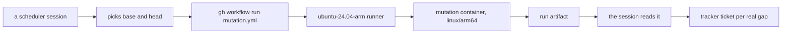

# 0067: The hourly mutation run runs in GitHub CI on an arm64 runner, started by hand each hour, never by a push, a pull request or a cron trigger



```sh
# each hour, only when main moved since the last run
gh workflow run mutation.yml -f base=<last run's head> -f head=<main's head>
```

**What this decides:** the hourly mutation run from 0066 moves from the laptop to GitHub CI, and a
scheduler session starts each run by hand.

## Context

[0066](0066-mutation-runs-on-a-schedule.md) took mutation off the pull request's steps and made it
one run an hour against main, as a one-week trial. It put that run on the laptop and put CI off.
On 2026-11-10 lanes parked on a busy Docker box several times, and the laptop keeps only one box
([0045](0045-test-steps-run-in-containers.md)).

This amends 0066 in part: where the run happens. The rest of 0066 holds.

Facts behind it:

- GitHub gives public repos free arm64 Linux runners (`ubuntu-24.04-arm`, 4 vCPU, 16 GB).
- The mutation container is built for `linux/arm64` (`PLATFORM` in
  `.agents/skills/lead/scripts/mutbox.ts`), so it runs there unchanged.
- This repo's CI already runs on Linux x64 (six jobs) and macOS (one).
- On the laptop, a container run took 143 s for 2 mutants and 162 s to 484 s for 150, with about
  2 minutes of fixed start-up. Runner timing is not measured yet.

## Decision

**The hourly mutation run runs in GitHub CI, started by hand with `workflow_dispatch` by a
scheduler session each hour, never by a push, a pull request or a cron trigger in the workflow.**

- The workflow is `.github/workflows/mutation.yml`, on `ubuntu-24.04-arm`, with two inputs:
  `base` and `head`.
- The scheduler session picks the range: from the last run's head to main's head. An hour with no
  new commits gets no run.
- The run's results are kept as run artifacts. The session reads them, judges the survivors and
  files tickets, as 0066 says.
- This replaces the laptop run inside 0066's trial. The trial is still read after one week,
  around 2026-11-17.

**Binding constraints:**

- `mutation.yml` has only a `workflow_dispatch` trigger: no `push`, `pull_request` or `schedule`.
- The run changes nothing in the repo. It reads, runs the container and uploads its results.

## Consequences

- The laptop's one Docker box is left for lanes. 0066's "the hourly run waits its turn behind a
  lane's test step" no longer applies, since the run uses no laptop box.
- A run no longer dies when a laptop session closes.
- Anyone can read a run's results in its artifacts.
- Why not a cron trigger: the range, the skip and the ticket filing need judgment, and a cron in
  the workflow can do none of it. The cost is that the scheduler session must stay alive. Its own
  timer ends 2026-11-17, the same day the trial ends.
- Runner timing is not measured yet. The first runs give it.
- This is about today's trial only. The `next/` mutation queue in
  [the mutation note](../docs/direction/fast-and-daily-mutation.md) still runs on the host's
  alarms, with no GitHub Actions shards.
- Not decided here: whether mutation returns to the pull request's steps, and what happens after
  the trial.
