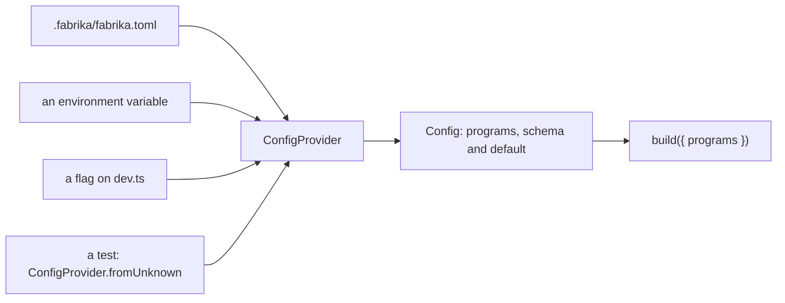

# 0069: A choice that makes sense as a fabrika.toml value is a fabrika.toml value, declared once with its schema and default



```ts
// A sketch, next/. One setting, declared once, with its schema and its default.
import { Config, ConfigProvider, Effect, Schema } from "effect";

export const programs = Config.schema(Schema.Record(Schema.String, Schema.String), "programs").pipe(
  Config.withDefault({}),
);

// A test sets it the way a person does: through a provider, never a second option.
const file = ConfigProvider.fromUnknown({ programs: { "writer-fixture": "./writer.ts" } });
Effect.runSync(programs.parse(file)); // { "writer-fixture": "./writer.ts" }
Effect.runSync(programs.parse(ConfigProvider.fromUnknown({}))); // {}: an empty file changes nothing
// The person's file, the environment and a flag are providers too. Their order is not decided here.
ConfigProvider.orElse(ConfigProvider.fromEnv(), file);
```

**What this decides:** when a choice could be a value in `fabrika.toml`, it is one, in both
versions, and in `next/` it is declared once as an Effect `Config` that a file, an environment
variable, a flag and a test all feed the same way. Tier 1 builds the foundation for it.

## Context

In `next/`, the build can already take extra programs by name and module path (the `programs`
option in `next/apps/fabrika/src/build.ts`, used by `next/apps/fabrika/src/stage-records.test.ts`).
No person can reach it. `next/apps/fabrika/dev.ts` takes a few flags (port, name, person, founder,
window), `next/apps/fabrika/src/settings.ts` is the app's whole settings schema, and nothing in
`next/` reads a `fabrika.toml`. A choice a test can make and a person cannot is a choice made in
two ways.

The owner calls this one of the most important guidelines, and it was missing. Why:

- It makes testing easier. A test sets a choice the same way a person does, so the test runs the
  path the person runs.
- It is why tools like tmux and Neovim last. Both work with no config file at all and grow as far
  as the person wants, in one plain text file. tmux reads `~/.tmux.conf` "if present"
  ([tmux(1)](https://man.openbsd.org/tmux.1)). Neovim reads one `init.lua` or `init.vim`
  ([starting](https://neovim.io/doc/user/starting/)) and ships tuned defaults so an empty file
  works ([nvim-defaults](https://neovim.io/doc/user/vim_diff/)).
- `next/` is Effect all the way, and Effect already has the shape: a `Config` says what a value is
  and where it sits, and a `ConfigProvider` says where it comes from. `ConfigProvider.fromUnknown`,
  `fromEnv` and `orElse` exist in the installed `effect` 4.1.2 (`src/Config.ts`,
  `src/ConfigProvider.ts`; upstream
  [Config.ts](https://github.com/Effect-TS/effect-smol/blob/main/packages/effect/src/Config.ts) and
  [ConfigProvider.ts](https://github.com/Effect-TS/effect-smol/blob/main/packages/effect/src/ConfigProvider.ts);
  the docs page is [Configuration](https://effect.website/docs/configuration/)). The sketch above
  ran once against that version.

The first settings land early, not at Tier 5, for the same reason a decision written beside this
one gives: each tier carries a thin slice of every part, and settings are one of the parts.

How it relates to what is settled:

- [One fabrika.toml per repo](../docs/direction/one-fabrika-toml-per-repo.md) (decided 2026-10-05,
  about today's version) says what a setting **may** be. That note's rules all stay: the files
  live at `.fabrika/fabrika.toml` and `~/.fabrika/fabrika.toml`, with one spelling; a knob is a
  number, a name, or a pick between paths the code already has and tests; the step order stays in
  code; an empty file changes nothing; an unknown key fails; a run copies its settings when it is
  filed. This record says what **must** be a setting. Its "walked when Tier 5 starts" for `next/`
  no longer holds for loading settings: that moves to Tier 1. Repo programs and packs stay where
  the tiers put them.
- [Keybindings are configurable](../docs/direction/keybindings-are-configurable.md) and
  [themes](../docs/direction/themes.md) are this same rule, already applied to keys and themes,
  each in its own file. They do not change.
- [Principles](../docs/direction/principles.md), "unsure is a setting" (decided 2026-11-08), puts a
  choice we are not sure of in a setting. This record is wider: a choice that fits as a value is a
  setting whether we are sure or not. That note's "a wall is never a setting an agent can turn
  off" stays, and so does its split of experiment flags from preferences.
- The glossary rows `fabrika.toml` and `pack` (one `[pack.<name>]` table) in
  [TERMS](../.glossary/TERMS.md) stay as they are.

## Decision

**A choice that makes sense as a `fabrika.toml` value is a `fabrika.toml` value, in `next/` and in
today's version.**

- "Makes sense as a value" means the 2026-10-05 note's test: a number, a name, or a pick between
  paths the code already has and tests. The order of steps, a wall, and a secret never qualify.
- In `next/`, a setting is declared once, as an Effect `Config` with its schema and its default.
  The file, an environment variable and a flag are providers of that one `Config`. No setting has
  a second, hand-written reader.
- A test sets a setting the same way a person does: through a `ConfigProvider`, such as
  `ConfigProvider.fromUnknown`. It never takes a test-only option that a person cannot reach.
- In `next/` this holds now, not from Tier 5.
- Tier 1 builds the foundation for loading settings in `next/`: the read of the file, each
  setting declared once with its schema and default, and the providers. It also builds the
  settings for what Tier 1 already builds or changes. The owner added it to Tier 1 on 2026-11-10,
  as row P38 in [the Tier 1 plan](../docs/plan/tier-1.md#the-pull-requests-one-at-a-time). Not
  building that foundation in Tier 1 was a miss.
- A plan asks of each new choice: is this a setting? When the answer is no, the plan says why.
- Which settings Tier 1 gets is answered by P38's plan, never asked of the owner (owner,
  2026-11-10). The plan lists every choice Tier 1 builds or changes and says of each: a setting,
  or not, and why.

**Binding constraints:**

- Every limit of [one fabrika.toml per repo](../docs/direction/one-fabrika-toml-per-repo.md) still
  holds: an empty file changes nothing, an unknown key fails, a value out of range fails and names
  the key, the step order stays in code, and a run copies its settings when it is filed.
- No machine reads the file. The file is read once at the edge, and each machine is handed its
  values, as that note says.
- A setting has exactly one default, in its `Config`, so the code, the test and the person never
  see different defaults.

## Consequences

- Tier 1 grows from 38 rows to 39, with P38 not yet planned or sized. Its plan comes next;
  tracker ticket 664 holds it.
- `next/apps/fabrika/src/build.ts`'s `programs` option and `dev.ts`'s flags are choices a person
  cannot yet set from a file. P38's plan says which become settings in Tier 1.
- `next/apps/fabrika/src/settings.ts` stays the app's schema until the first `Config` lands. How
  the two meet is P38's plan.
- A plan gets one more question to answer, and a "no" costs one line of why.
- Not decided here:
  - The order when a flag, an environment variable and the file disagree. The common order is
    flag, then environment, then file, then default. That is a lean, not a ruling.
  - Whether a check enforces this rule, and which kind: lint, type or review.
  - Secrets. They never go in the file. A secret is read with `Config.Redacted`
    ([secrets are redacted](../docs/direction/secrets-are-redacted.md)); which provider holds one
    is not settled here.
