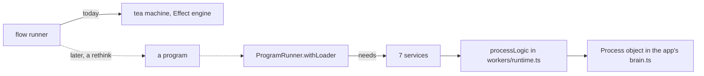

# 0070: For now the flow runner stays a plain tea machine on tea's Effect engine until a program can run outside fabrika's app, never a Program.make that nothing can run

**What this decides:** the lead's flow runner is written as a tea machine, not wrapped in
`Program.make`, because today nothing outside fabrika's app can run a program.



```ts
// next/packages/libfabrika/src/app/runner.ts:189-193, what the runner asks for.
Layer.Layer<
  ProgramRunner,
  never,
  ProcessStore | ProcessManager | Mailbox | CheckedWriter | WatcherManager | Alarm | Recording
>
```

## Context

[0031](0031-lane-tooling-dogfoods-fabrikas-primitives.md) said the lane runner is built as programs
with `Program.make`, not bare tea machines, to show a program works as a unit of work outside
fabrika's app. [0064](0064-the-lead-drives-with-flows.md) then made that runner the flow runner
(tracker ticket 656), and [0068](0068-tiers-carry-every-part.md) left open whether it becomes a
program.

A walk on 2026-11-10 of what a person writing programs outside fabrika's source would need showed
that a program cannot run without the app yet:

- `ProgramRunner.withLoader` needs seven services: `ProcessStore`, `ProcessManager`, `Mailbox`,
  `CheckedWriter`, `WatcherManager`, `Alarm` and `Recording`
  (`next/packages/libfabrika/src/app/runner.ts:189-193`).
- Only the Worker's process object wires them for real: `processLogic` in
  `next/packages/libfabrika/src/workers/runtime.ts:740`, which builds them at lines 757 and 804 and
  hands them to the runner at line 843.
- The one caller of that is the app: `Process` in `next/apps/fabrika/src/brain.ts:205-206`, with
  the programs the app's build lists (`virtual:fabrika-built`, line 19).
- A program's logic is already tested without the app, through `@kampus/libfabrika/testing`
  (`syncTest` and `senderTest`, `next/packages/libfabrika/src/testing.ts:18` and `:99`), as
  `next/programs/counter/src/program.laws.test.ts` does.

So a `Program.make` around the flow runner would be a declaration nothing runs. The lead tooling
would still run the bare machine, and the wrapper would only look like a program.

This amends the "Programs" half of 0031. Its "Agents" half stands: every agent the tooling starts
goes through the Agent interface.

## Decision

**The flow runner stays a plain tea machine on tea's Effect engine until programs have a real way
to run; it is not wrapped in `Program.make` before then (owner, 2026-11-10).**

- A design that lives at the machine level is not dressed as a program. No `Program.make`
  declaration for a machine that nothing can run as a program.
- The runner becomes a program when a program can really run outside fabrika's own app. Today the
  gap is the seven services above, which only the app's worker wires.
- That move is a rethink at that time, against the notes that hold then. It is not a rename of the
  machine into a `Program.make`.
- [0046](0046-one-tea-machine-per-file.md) still holds: the runner is one tea machine in its own
  file. [0064](0064-the-lead-drives-with-flows.md) still holds: the lead drives with flows, and no
  agent holds a loop.

**Binding constraints:**

- No `Program.make` in the lead scripts until a program can run without fabrika's app.
- The flow runner keeps 0031's other rules: agents through `Agents`, and the scripts inside
  `pnpm typecheck`.

## Consequences

- This is for now. The owner may amend it again later, for example once a program can run outside
  the app.
- The cost: 0031's point, "breakage is the point", is not exercised for programs until then. The
  lead tooling no longer proves a program works as a unit outside the app.
- That proof now comes from [0068](0068-tiers-carry-every-part.md): each tier carries a slice of
  programs written outside fabrika's source, so a program that runs without the app is a tier's
  job, not the lead tooling's.
- [0033](0033-agents-code-follows-next-rules.md) named `chain.ts` moving onto `Program.make` as the
  first big burn-down of its ledger. That move waits with this decision; the ledger still shrinks
  as scripts are touched.
- Not decided here: what the runner looks like as a program, and which piece of the app moves into
  libfabrika so a program can run outside it.
