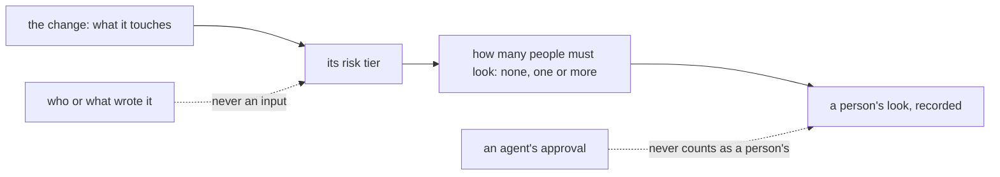

# 0071: fabrika gives each change a risk tier, set from what the change touches and never from who wrote it, that decides how many people must look at it, with its shape left open



```ts
// A sketch, next/. Only what must be recorded from day one; every name here is made up.
// The risk tier's cases, what sets it and the counts are not decided.
{ _tag: "tiered", change: "sha256:…", tier: "…", rule: "…" }   // per change: its risk tier and what set it
{ _tag: "looked", change: "sha256:…", saw: "sha256:…", by: "github:42", sentAt: 1793400000000 }   // per look by a person
```

**What this decides:** in the product, fabrika works out a risk tier for each change from the
change itself, and the risk tier says how many people must look at it; how it is built is a later
plan.

## Context

A study of public write-ups by the teams that build coding agents (reading, not a measurement; it
lands as an experiment) found that the scarce thing is a person's attention, not the review
itself. One such team places people by risk with a classifier: nobody for low risk, one person for
medium, two for high. Others review every change, review after the merge, or forbid human review.
These are the companies' own claims about their own work, not checked by us. An experiment is
running that tags a public repo's merged pull requests by risk tier from their paths and counts
the reverts and fixes that came later. Its result shapes the open points below.

The industry's words are "risk tier" and "risk-based review". Here "tier" alone already means a
slice of the plan ([the tiers](../docs/plan/tiers.md)), so this record always writes "risk tier"
in full.

Related, and not changed by this record:

- [0014](0014-the-lead-merges-when-every-step-passed.md), the lead merges once every step passed,
  with the loosening hand check, is this repo's own hand-run rule. It stays as it is.
- [0056](0056-lead-runs-a-refused-step-itself.md) and
  [0066](0066-mutation-runs-on-a-schedule.md) are this repo's lead and mutation rules. 0066 is a
  case of a check that runs after the merge, one of the shapes left open here.
- [0069](0069-choices-are-settings.md): a choice that makes sense as a `fabrika.toml` value is
  one. Which part of a risk tier a repo may set is open below.
- [Principles](../docs/direction/principles.md): this record applies principle 2, spend the
  person's attention well. Principle 5's "a wall is never a setting an agent can turn off" bounds
  what a repo's settings may change.
- [Nobody writes their own exam](../docs/direction/nobody-writes-their-own-exam.md): a risk tier
  from the change, never from the writer, keeps a writer from lowering its own.
- [Autonomy is measured trust](../docs/direction/autonomy-is-measured-trust.md) says a merge
  never waits on the owner, for this repo's two people. A risk tier that asks for nobody fits it.
  A shape that puts a person's look before the merge would walk that rule back for the product, so
  the plan that picks one names it as an owner call.
- [Pipeline strategies](../docs/direction/pipeline-strategies.md) (proposed) asks "can a later
  change undo the harm?". That question is one candidate for what sets the risk tier.

## Decision

**fabrika gives each change a risk tier, worked out from the change itself, and the risk tier
decides how many people must look at it (owner, 2026-11-10).**

- The risk tier comes from the change: what it touches. It never comes from who or what wrote it.
- The risk tier decides how many people must look: none, one or more. It is how fabrika decides
  whom to ask for attention, so a person looks only where their look changes the outcome.
- An agent's approval never counts as a person's look. This is already a rule:
  [AGENTS.md](../AGENTS.md#running-the-machine-on-a-real-ticket) says no agent approves a pull
  request.
- It applies to the product fabrika, what a repo using fabrika gets, built in `next/`.
- This repo's own hand-run rules for merging, 0014 and the loosening hand check, do not change by
  this record.

Not decided here:

- How many risk tiers there are, and their names.
- What sets the risk tier: paths, a classifier, or both.
- The count of people for each risk tier, and whether the top one may be zero.
- Whether a look comes before the merge or after it.
- Which risk tier a repo's settings may change. 0069 says a choice that makes sense as a
  `fabrika.toml` value is one, and the settings study (proposed) treats this as a case. The limits
  of [one fabrika.toml per repo](../docs/direction/one-fabrika-toml-per-repo.md) apply: a setting
  is a pick between tested paths, and a wall is never a setting an agent can turn off.
- Which plan tier ([the tiers](../docs/plan/tiers.md)) it lands in.
- The false-alarm rate a blocking risk tier check must show first. AGENTS.md asks about 0% to
  block and up to 10% to only advise, measured on our own data.

**Binding constraints:**

- Nothing about the writer feeds the risk tier: not the person, the agent, its model or its past
  record.
- An agent's look is never counted toward a risk tier's count of people.

## Consequences

- This commits to the idea before we have a measurement of our own. The running experiment may
  change the shape; it does not reopen the rules above.
- The shape gets its own plan and its own walk with the owner.
- What must be recorded from day one, so nothing is lost
  ([the data shape comes first](../AGENTS.md#before-you-design-anything)):
  - For each look by a person: who, when on their own clock, what they saw (the hash), and for
    which change.
  - For each change: its risk tier and what set it, such as the rule or classifier and its
    version.
- What already exists, in [one ask and one meter](../docs/direction/one-ask-and-one-meter.md)
  and the ledger: an `asked` fact names `who` may answer and the hash of what it `shows`; an
  `answered` fact carries a person's pick, the `saw` hash of what the window drew, and `via`; the
  ledger's entry keeps `by`, `sentAt` and `arrivedAt`, and only a person's session writes
  `answered`. [A yes binds to the diff](../docs/direction/a-yes-binds-to-the-diff.md) (proposed,
  built in today's version) says how a person's yes carries to a new head.
- What is new: a change's risk tier and what set it, both missing everywhere today; a look that is
  not an answer to an ask, such as a read after the merge; and a look tied to a change, not only
  to the data an ask shows.
- Whether the rules that set the risk tier count as part of the exam is the plan's question.
  Nobody writes their own exam points that way.

## Records

- Glossary: `risk tier` added to the Pipeline section of [TERMS](../.glossary/TERMS.md), with a
  context map line. The Records section's `tier` row now says it is not a risk tier.
