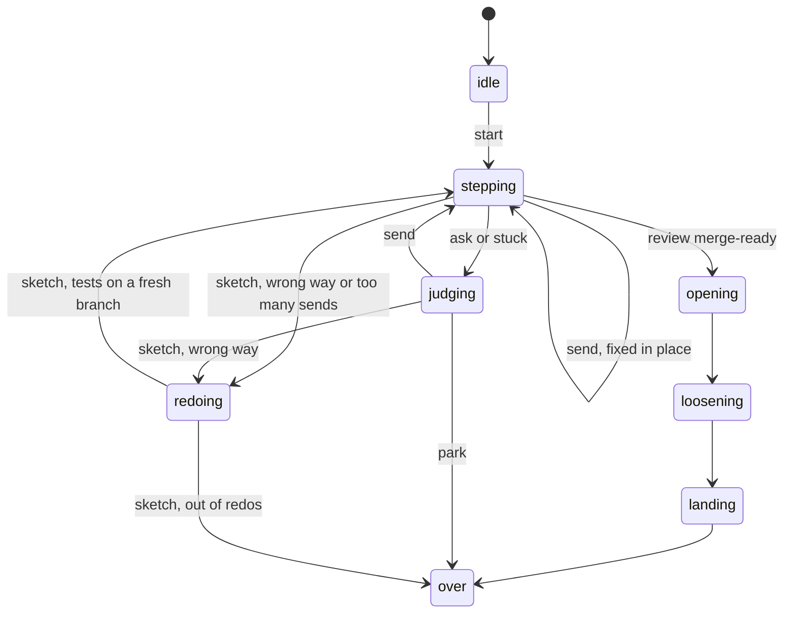

# 0072: A lane whose change points the wrong way, or that keeps being sent back, is closed and redone on a fresh branch from its amended plan, by a state of the chain's machine, never by the lead's habit or a prompt

**What this decides:** the chain tells two kinds of bad change apart: one with faults is fixed in
place by send-backs, as today; one that points the wrong way, or has been sent back too often, is
closed and the lane starts again on a fresh branch.



```ts
// Sketch, not built. chain.ts's Model has seven phases today (.agents/skills/lead/scripts/chain.ts:463-475):
// idle, stepping, judging, opening, loosening, landing, over. A redo adds one phase and one Act.
type Model =
  | { readonly phase: "idle"; readonly lane: Lane }
  // ... the six phases as they are ...
  | {
      readonly phase: "redoing";
      readonly lane: Lane;
      readonly replaced: { readonly branch: string; readonly pr: number | null };
      readonly reason: string; // what was counted, or why it points the wrong way
    };

// The Act closes the old pull request with a link, keeps the old branch as it is,
// and cuts a fresh branch from main with the plan as amended.
const redo = Cmd.make("redo", {
  input: Schema.Struct({ branch: Schema.String, pr: Schema.NullOr(Schema.Number), reason: Schema.String }),
  ok: Schema.Struct({ branch: Schema.String }),
  err: ["unknown"],
});
```

Every arrow marked "sketch" is new. The rest is the machine as it runs today.

## Context

**Two kinds of bad.** Today the chain has one answer to a bad change: send it back to a step, again
and again, on the same branch. `MaxSteps` (16) parks a lane for the lead, and the lead then goes on
on the same branch. Nothing in code ever says "this branch is the wrong start".

**What the industry does.** A study of public write-ups by teams that build coding agents (reading,
not a measurement, and not yet in this repo; the companies' own claims) found one habit: since a
start is cheap, a pull request that points the wrong way is closed and redone, and the time to say
"different direction" is early, not after many rounds of fixes.

**Today's evidence.** Counted on 2026-11-10 from the lane state files that the `field/runs.jsonl`
rows name (`state/<lane>.json` in the lead's boxes folder, on the lead's laptop and not in git).
There are 40 lane files, with 654 steps in all and a median of 12.5 steps a lane. The lanes with
the most steps (both versions; tooling lanes included):

| Ticket | Steps | Stuck | Sent back | How it ended, as of 2026-11-10 |
|---|---|---|---|---|
| 502 | 61 | 14 | 8 | merged, [PR 763](https://github.com/usirin/tea-fabrika/pull/763) |
| 286 | 53 | 14 | 4 | [PR 810](https://github.com/usirin/tea-fabrika/pull/810) still open, one branch, 19 plan amendments (A1 to A19) |
| 343 | 37 | 9 | 15 | last step done; no pull request found for its branch |
| 389 | 35 | 5 | 7 | still running; its last step was sent back to tests |
| 276 | 35 | 11 | 9 | [PR 646](https://github.com/usirin/tea-fabrika/pull/646) still open |
| 270 | 34 | 21 | 7 | merged, [PR 530](https://github.com/usirin/tea-fabrika/pull/530) |
| 477 | 34 | 8 | 6 | merged, [PR 824](https://github.com/usirin/tea-fabrika/pull/824) |
| 204 | 34 | 5 | 11 | [PR 648](https://github.com/usirin/tea-fabrika/pull/648) closed and redone by hand on a fresh branch (3 steps since, all done) |
| 102 | 15, then 10 | 12, then 2 | 1, then 4 | [PR 582](https://github.com/usirin/tea-fabrika/pull/582) closed and redone by hand on fresh commits; the redo's last step was sent back to build |

- Ticket 286's numbers match what the lead knew: 53 steps, 14 stuck, 19 plan amendments, all on
  one branch. Its steps were 21 tests, 14 build, 9 mutation, 8 review and 1 plan.
- Most stucks in these lanes came from the tooling, not the change: in ticket 286, 10 of 14
  (`unsigned` 5, `fetch_failed` 4, `box_failed` 1); in ticket 270, 17 of 21 (`fetch_failed` 13,
  `box_failed` 4).
- `field/runs.jsonl` on main is behind the lane files: it has 61 step rows for ticket 502 and 28
  for ticket 270, and none for ticket 286, whose 39 rows sit on PR 810's branch.

**What the counts cannot tell us.** No record says whether a change pointed the wrong way, so the
counts cannot tell a lane that was off course from a lane that was hard. They cannot say whether a
redo would have been shorter. A stuck is mostly a tooling fault, and a fresh branch would not have
saved it. Some of these lanes were driven by hand before `chain.ts` ran them, and their counts
include mutation steps from before [0066](0066-mutation-runs-on-a-schedule.md).

**The same move, done by hand, twice.** The ask desk (ticket 102): PR 582 was closed on 2026-11-10
without a merge. An early build commit had edited a file the tests step owns (field note
`2026-11-09-12`), so under [0053](0053-exam-list-read-at-each-parent.md) the commits check stops
every later step, and history is not rewritten. The work is being re-landed on fresh step commits,
and the new pull request will link back; it is not open yet, and no field note records the redo
itself. The layers lane (ticket 204) did the same on 2026-11-09: PR 648 was closed, kept for
reference, and rebuilt on a fresh branch from main with every step signed fresh.

**How it fits older texts.**

- [Pipeline guidelines](../docs/direction/pipeline-guidelines.md#p4-resume-never-redo), P4,
  "resume, never redo" (decided 2026-11-01): a stuck or crashed lane goes on from the step that
  broke. That still holds for a crash or a stuck. This record amends it in part: a change that
  points the wrong way, or is sent back too often, is not a crash, and it is redone.
- [0037](0037-implicit-state-machines-made-explicit.md) and
  [0046](0046-one-tea-machine-per-file.md): the redo is control state, so it is a phase of the one
  machine in `chain.ts`, with its transitions in its `update`.
- [0064](0064-the-lead-drives-with-flows.md): the chain's fixed lane becomes one named flow, and
  the redo goes with it into the flow runner's machine.
  [0070](0070-flow-runner-stays-a-machine.md) keeps that runner a plain tea machine, not a
  `Program.make`.
- [0053](0053-exam-list-read-at-each-parent.md): no lane rewrites history. A redo rewrites nothing;
  it leaves the old branch as it is and starts a new one.
- [0014](0014-the-lead-merges-when-every-step-passed.md), as amended by 0066: the redo's new pull
  request goes through every step again, and merges by the same rule.
- [0036](0036-a-flaky-test-is-fixed.md): a flaky test is fixed at its cause. A lane stuck on a
  flake is not a reason to redo it.
- [Every pull request goes through the steps](../docs/direction/next-is-a-pipeline-pre-run.md): no
  builder starts before an approved plan and tests that exist. The redo starts from the plan as
  amended, with its approval line, and the tests step runs first on the fresh branch.

Tracker ticket 667 is this decision.

## Decision

**A change that points the right way and has faults is fixed in place by send-backs; a change that
points the wrong way, or has been sent back too often, is closed, and the lane starts again on a
fresh branch from the plan as amended (owner, 2026-11-10).**

- The rule lives in code, as states and transitions of the chain's tea machine, never as a habit of
  the lead or a line in a prompt.
- A redo loses no fact. The old branch and pull request are closed, never deleted or rewritten. The
  redo is recorded with what it replaced (the branch, the pull request) and why.
- The owner called this a restart rule. Here it is a **redo**, because in this repo "restart"
  already means a new process (Runtime) and, for a resume point, going on with finished steps kept.

**Binding constraints:**

- No redo by hand once the chain has the state: the lead does not close a lane's pull request and
  cut a new branch outside the machine.
- No redo deletes a branch, force-pushes or rewrites a commit.
- The redo's record names the branch and pull request it replaced, and its reason.

## Consequences

- The chain gains one phase and one Act. It is lead tooling, fast-tracked
  ([0033](0033-agents-code-follows-next-rules.md)). The lead skill's chain section says how a redo
  runs when it is built.
- The closed lane's boxes and worktrees are removed as for any closed lane
  ([0019](0019-nothing-stale.md)); its branch on the remote stays.
- The cost: each redo runs the tests, build and review steps again. Work in the old branch that was
  right is redone, or carried over by a rule not yet set.
- **The doubt (about 60% sure a redo shortens a lane).** The plan and the tests carry over, so a
  redo may repeat the same churn. Ticket 286's 19 amendments would all go into the fresh start. The
  field counts above and the first redos will show it. If redone lanes take as many steps as their
  first try, the carry-over rule is the thing to change.
- Not decided here:
  - What is counted (send-backs, plan amendments, stuck steps, steps in total), and the numbers.
  - What carries over: the plan and its amendments do; whether the tests step's commits are
    re-applied or written again is open.
  - Whether a redo needs the lead's or the owner's yes. If a person's yes starts it, P5 of the
    pipeline guidelines ("a person's answer never restarts a lane") needs a matching amendment.
  - How a redo shows on the ticket.
  - Who says a change "points the wrong way": the judgment agent, a review, or the lead.
- [Pipeline strategies](../docs/direction/pipeline-strategies.md) (proposed) is about harm after a
  merge; a redo comes before one. Whether it becomes a fifth strategy there is not decided here.

## Records

- `.glossary/TERMS.md`: a row for **redo**, in Pipeline.
- `docs/direction/pipeline-guidelines.md`: a one-line pointer under P4.
