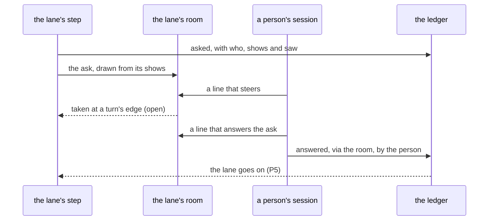

# 0073: In next/, a lane can have its own room, where a person steers its agent halfway, and a person's line there that answers an open ask is the same answer the window gives, never a second gate and never an agent's



```ts
// A sketch, next/. Effect Schema writes `_tag`; `arrivedAt` is the referee's clock, `sentAt` the writer's.
// The answer is one-ask-and-one-meter's `answered`; only `via`'s room case is new. Names are made up.
{ _tag: "said", by: "github:42", room: "lane-17", at: 9, line: "yes, keep the old name", arrivedAt, sentAt }
{ _tag: "answered", ask: "plan-17", pick: "approve", note: "keep the old name", saw: "sha256:4be0…",
  via: { _tag: "room", room: "lane-17", line: 9 }, by: "github:42", arrivedAt, sentAt }
```

**What this decides:** in `next/`, a person can talk to a lane's agent in a room while the lane
runs, and when what they say there answers an open ask, that is their answer, recorded once, as if
they had picked it in the window.

## Context

A study of public write-ups by the teams that build coding agents (reading, not a measurement, and
not yet in this repo) found that several of them start work from a chat thread and correct the
agent in that thread while it works. These are the companies' own claims, not checked by us.

The six pipeline primitives (`packages/pipeline/src/primitives.ts`, today's version) cover every
move in that study, with one strain: a person correcting an agent halfway is a Listen inside a
Draft. A room already covers that with a decided piece, so nothing new is added.

**Words.** The owner said "a pipeline run". In `next/`, "run" means an agent run only, and the
glossary's `run (pipeline)` row means the agent run a step starts. One ticket's run through the
pipeline is a **lane** (glossary, Pipeline). So this record says "a lane's room". It coins no new
word: `lane` and `room` are both glossary words, and "lane's room" is plain English for the two.
It is not "run room", which would break the glossary's rule for "run".

What is already settled, and how this fits:

- [Summon guidelines](../docs/direction/summon-guidelines.md#rooms-mentions-and-turns-in-order)
  (decided 2026-11-06 and 2026-11-07): a room is a named place whose members are people and agents
  (R1). Every room is readable by everyone on the project, and nothing in it is private (R2). A
  line to a room starts with `#room` (R5). R8 (a lean, 80%) records each line with `by`, the room,
  its place, the line as typed, and both clocks. A lane's room is one more room. Nothing there
  changes.
- [One ask and one meter](../docs/direction/one-ask-and-one-meter.md): an ask is the `asked` and
  `answered` facts. `asked` names `who` may answer and the hash `saw` of what it `shows`;
  `answered` carries the pick, the `saw` of what the person was shown, and `via`. The first answer
  wins by the ledger's own rule, and only a person's session writes `answered`. A chat answer
  already exists: `via: {_tag: "chat", session}`. A room answer is the same fact with a room in
  `via`.
- [Talk where you work](../docs/direction/talk-where-you-work.md): talk with agents happens in
  fabsh, never a separate chat program. A lane's room is typed in from fabsh, like any room.
- [Pipeline guidelines](../docs/direction/pipeline-guidelines.md), P5 (decided 2026-11-01): a
  person's answer never restarts a lane; it goes on from the earliest step the answer makes stale.
  An answer said in a room is a person's answer, so P5 holds as written.
- Pipeline guidelines, Linear clash 2, and
  [jidoka and andon](../docs/direction/jidoka-and-andon.md#a-person-speaks-unasked) (decided
  2026-11-01, today's version): a person steers a running lane by a plain comment on its ticket,
  read by the running step at its next turn, never cutting a turn off; "the ticket is the one way
  in". **This record amends that in part, for `next/`:** a lane's room is a second way in. The
  rest holds: a ticket comment is still read at the next turn, and a ticket comment still answers
  no ask.
- [0026](0026-fabrika-never-owns-the-agent-loop.md): steering happens at the edges the harness
  gives us, not between model steps. A room line taken at a turn's edge fits it.
- [0071](0071-risk-tier-decides-who-looks.md): an agent's approval never counts as a person's look.
  This record keeps that for rooms.
- [AGENTS.md](../AGENTS.md#running-the-machine-on-a-real-ticket): "No agent approves a pull request,
  and no agent answers a question the machine put to a person." This record keeps it: the answer is
  a person's line, written by the person's own session.

The tracker ticket for this record was filed the same day.

## Decision

**In `next/`, a lane can have its own room, and a person's line there that answers an open ask is
the same answer the window gives (owner, 2026-11-10).**

- **A lane can have a room.** It is the decided room: a named place, members who are people and
  agents, readable by everyone on the project. A person joins it and talks to the lane's agent
  there. This is how a person steers a lane halfway. No new primitive is added for it.
- **A person's line that answers an open ask is their answer.** It is one record, the same
  `answered` the window writes, with who typed it and what they were shown when they said it. The
  person never has to say it again somewhere else.
- **The room is one level below the window,** as a terminal is to a GUI. It is not a way around a
  check, and it is not a second gate after one. An answer in the room is checked as an answer in
  the window is: the pick must be offered, `saw` must match, and the first answer wins.
- **A line is recorded as its writer's.** An agent's line is an agent's and is never recorded as a
  person's. An agent's line that reads like an answer answers nothing.

**Binding constraints:**

- Only a person's own session writes `answered`, from a room as from the window or a chat.
- No answer said in a room skips a check an answer in the window must pass, and no room adds a
  check the window does not ask for.
- Nothing in a lane's room is private, as for every room (R2).

## Consequences

**What must be recorded from day one,** since a fact that exists only when a line is written is lost
if it is not written then ([the data shape comes first](../AGENTS.md#before-you-design-anything)):

| Fact | Where it is recorded |
|---|---|
| Who wrote the line, as the signed-in key | Already: the ledger entry's `by`, stamped by the gateway, and R8's `said` |
| Both clocks of the line | Already: `arrivedAt` and `sentAt` on every entry, in R8's `said` |
| What the person was shown | Already: `answered`'s `saw`, which must equal the ask's `saw`. New: the room must draw the ask from its `shows`, as the window's ask box does, so the hash is of what the room drew |
| That the answer came from the room, and which line | New: `via: {_tag: "room", room, line}`, beside `window` and `chat` |
| Which agent run was live when a steering line was written | New for rooms: clash 2's `during`, filled in by code, as a ticket comment has it |

**What it costs:**

- A step must listen to its room. That is new: no step listens to a room today, in either version.
- Everyone on the project can read a lane's room. Nothing private may be said there, as R2 already
  says of every room.
- A person can now steer in two places, the ticket and the room. The record must show both, with
  who and when, so a later reader sees every word that steered the lane.

**Not decided here:**

- How a room line is matched to an open ask: an explicit form, or a reply to the ask's own line.
  And what happens when the head moved after the person spoke.
- How a step listens to its room, and when the agent takes a line. Clash 2's rule for a ticket
  comment, at the next turn and never cutting one off, is where a plan starts.
- When steering that changes the plan becomes a plan amendment, and who signs it.
- The room's name and its lifetime: one per agent run, per lane or per ticket, and what a redo
  under [0072](0072-a-churning-lane-is-redone.md) does to it.
- Whether an agent's look can be the last one for a low risk tier. That is 0071's shape, and
  ticket 666 holds it: an escalation policy is one idea, not decided here.
- Which plan tier carries the first slice. Rooms read by other people need `next/`'s brain (R7),
  agents sit in Tier 5 and pipeline steps in Tier 6. [0068](0068-tiers-carry-every-part.md) asks
  each tier to carry a slice of programs working together and of a person starting a program; a
  lane talking in a room may be one such slice. The plan says which.

## Records

- `.glossary/TERMS.md`: the Frame section's `room` row says a lane can have one, and its line
  can answer an ask; the Tracker section's `ask` row names the room as a place to answer.
- `docs/direction/pipeline-guidelines.md`: a one-line pointer under clash 2.
- `docs/direction/jidoka-and-andon.md`: a one-line pointer under "A person speaks unasked".
- `docs/direction/one-ask-and-one-meter.md`: a one-line pointer under "An answer said in chat".
