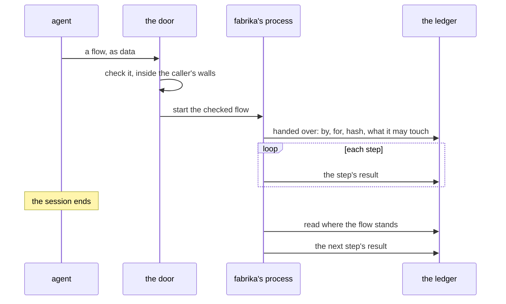

# 0074: An agent composes work by handing fabrika a flow as data, which fabrika checks and runs as a recorded process, so the goal is the agent's and the loop stays fabrika's, never a loop held in the agent's context

**What this decides:** when an agent wants to put steps together at run time, it writes the steps
down as data and hands them to fabrika; fabrika checks them, runs them as a process and records each
step on the ledger, so the work goes on after the agent's session is gone.



```ts
// A sketch. Every name is made up; what the data is stays open (Consequences).
const flow = {
  name: "fix-ticket-41",
  steps: [
    { _tag: "gather", read: "ticket", id: "t-41" },
    { _tag: "draft", agent: "builder", brief: "fix t-41" },
    { _tag: "check", run: "tests", expect: "pass" },
    { _tag: "ask", who: "owner", for: "approval" },
    { _tag: "act", write: "merge" },
  ],
};
```

```text
step 2 done     draft by builder, head 3f9c1e2, written to the ledger
session gone    the agent that handed the flow over ends; nothing in its context is needed
step 3 starts   fabrika's process reads the ledger (steps 1 and 2 done) and runs check: tests
```

## Context

A walk on 2026-11-10 of a study of public write-ups by teams that build coding agents (reading, not
a measurement, and not in this repo yet; the companies' own claims) found them moving from fixed
steps to goals. One says its early fixed transitions were too rigid. That pulls against this repo's
bet that code holds the loop ([control lives in code](../docs/direction/control-in-code.md),
[0037](0037-implicit-state-machines-made-explicit.md)). This record is the answer that keeps both:
the agent picks the steps, and code runs them. A tracker ticket carries this record.

"Loop" here means the order of the work's steps: what runs next, what to wait for, when to stop. It
is not the agent's own model-and-tool loop inside its harness, which stays the harness's
([0026](0026-fabrika-never-owns-the-agent-loop.md)).

It builds on these, and changes none of them:

- [Control lives in code](../docs/direction/control-in-code.md): an agent "does not decide what the
  pipeline does next". That still holds inside the pipeline. An agent that hands over a flow picks
  the steps before they start, as data, and code runs them; it never decides the next step from
  inside a running loop.

- [0064](0064-the-lead-drives-with-flows.md): the lead drives with flows, a list of typed steps one
  program runs, and no agent holds a loop. This record says the same of any agent that composes
  work, and of fabrika the product. "Flow" keeps 0064's meaning.
- [0070](0070-flow-runner-stays-a-machine.md): the lead's flow runner stays a tea machine until a
  program can run outside fabrika's app. This record is about fabrika running a handed-over flow
  inside, as a process. Whether the two become one runner later is not decided here.
- [0068](0068-tiers-carry-every-part.md): "programs written outside fabrika's source" is a core idea
  each tier carries. An agent is one such author. If a flow turns out to be a program, a handed-over
  flow rides that slice; if it is a composition of primitives, it does not, and its tier is open.
- [0020](0020-programs-get-hard-walls.md) and [0028](0028-the-parent-holds-every-right.md): a
  program has hard walls, and the parent holds every right. A handed-over flow sits inside both.
- [0071](0071-risk-tier-decides-who-looks.md): a change's risk tier decides how many people look.
  Who must look at a handed-over flow before it runs is a case of it, left open.
- [Why libfabrika exists](../docs/direction/where-each-piece-lives.md#why-libfabrika-exists-decided-2026-11-08):
  any client built on libfabrika alone works like fabrika.
  [Brain, hands, window, agent](../docs/direction/brain-hands-window-agent.md): an agent is a client
  at the door. [A browser is always a client](../docs/direction/a-browser-is-always-a-client.md): the
  protocol a flow travels on needs nothing a browser lacks.
- [The backend is a library](../docs/direction/backend-as-a-library.md): agents talk to typed
  services, never to a command-line tool.

How an agent reaches programs today, by version:

- **Today's version:** the MCP door in `packages/fabrika/src/mcp/tools.ts` makes one tool per input
  of each program, from its schema, plus the host's own tools (`runs`, `job`, `stop`, `restart`,
  `line`). An agent composes work by calling them one at a time from its own context.
- **`next/`:** Tier 1's "Agents through MCP" (row P25, tests on its own branch, no pull request yet)
  plans the same shape: one tool per input, through a bridge that dials the door as a client
  ([Tier 1's detail](../docs/plan/tier-1-detail.md#agents-through-mcp)). `libfabrika` has no `mcp`
  room on main.
- The six primitives (Gather, Act, Listen, Draft, Check, Judge) exist only in today's version, in
  `packages/pipeline/src/primitives.ts`, with their combos in `combos.ts`.

## Decision

**An agent composes work by handing fabrika a flow as data, and fabrika runs it: the goal is the
agent's, and the loop stays fabrika's (owner, 2026-11-10).**

- **Fabrika is not the pipeline.** Fabrika is the ledger, programs and the primitives. The pipeline
  is one arrangement of them: ours, backed by this repo's experiments. Another agent, or a person,
  may make another arrangement.
- **An agent never holds the loop in its own context.** An agent that wants to compose work at run
  time writes the arrangement down and hands it over as data.
- **Fabrika checks the flow, then runs it as a process and records each step.** So a flow resumes
  exactly, and any agent, or none, can pick it up after the session that wrote it is gone.
- **The API an agent composes against is libfabrika's public names,** the same library any client
  uses. An agent is one more client.
- **The walls hold.** A handed-over flow gets only what its caller may touch
  ([0020](0020-programs-get-hard-walls.md)), never a key.

**Binding constraints:**

- No step of a handed-over flow runs outside fabrika's process, and none goes unrecorded.
- A handed-over flow's rights are at most its caller's. Handing over a flow never widens them.
- No key goes into a flow, its data or its steps.
- The typed API for flows is libfabrika's public one. No private API exists for agents only.

## Consequences

- **Recorded from day one,** so nothing is lost ([the data shape comes
  first](../AGENTS.md#before-you-design-anything)):
  - who handed the flow over: `by`, and `for` whom;
  - when, on both clocks: the writer's `sentAt` and the ledger's `arrivedAt`;
  - the flow's content hash, so a resume runs exactly what was handed over;
  - each step's result;
  - what the flow was allowed to touch, as it stood when it was checked.
- **The cost:**
  - a checker for handed-over flows, built and measured before it can block;
  - a free script that acts on its own between steps is not allowed to be the loop, whatever form
    the data takes. Every act goes through a recorded step.
- **What this does not change:**
  - this repo's hand-run merge rules ([0014](0014-the-lead-merges-when-every-step-passed.md) and
    AGENTS.md);
  - "no agent approves a pull request". An ask step in a flow goes to a person, and the agent that
    handed the flow over never answers it;
  - [autonomy is measured trust](../docs/direction/autonomy-is-measured-trust.md). The sketch's ask
    is that made-up flow's own choice, not a rule.
- **Not decided here:**
  - **What the data is:** a composition of the six primitives, a tea machine, or a whole program
    with a view that shows as a tile.
  - **How the MCP door takes it.** One lean, not decided: a "code mode" door, where the agent writes
    a small program against the one typed API and fabrika runs it in an isolate
    ([experiment 173](../experiments/173-worker-loader.md) runs program code in one), instead of one
    tool per program input. A reading of the makers' pages is running.
  - **What fabrika checks before it runs a handed-over flow, and who must look:** a case of
    [0071](0071-risk-tier-decides-who-looks.md)'s risk tier.
    *2026-11-10: partly answered by [0082](0082-approvals-is-a-floor-for-every-run.md): a flow with
    fewer review steps than the repo's `approvals` floor is refused before any step runs.*
  - **The wall for view code an agent wrote,** which runs in a person's window.
  - **How today's primitives are rethought for `next/`.** They live in today's `packages/pipeline`
    and are rethought, not ported ([rethink, do not port](../docs/direction/rethink-do-not-port.md)).
  - **Which plan tier carries the first slice.** Context says how this sits beside 0068 and 0070.

## Records

- [`.glossary/TERMS.md`](../.glossary/TERMS.md): a row for `flow`, in Pipeline, with 0064's
  meaning, which this record keeps.
- [0064](0064-the-lead-drives-with-flows.md): a one-line pointer in its Consequences. Its status
  does not change.
