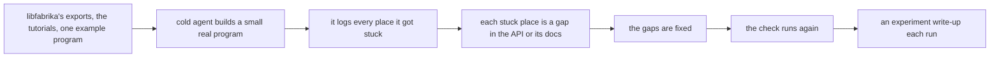

# 0075: Each tier checks its slice of programs written outside fabrika's source with a cold agent as the author, and every place it gets stuck is a gap

**What this decides:** once per tier, an agent that knows only what an outside author would know
builds a small real program, and the list of places it got stuck is the result.

## Context

[0068](0068-tiers-carry-every-part.md) gives each tier a working slice of four core ideas. One is
programs written outside fabrika's own source. 0068 says what the slice must do, but not how a
tier knows the slice works for the person who writes such a program. This decision gives that
check. It amends 0068 in part: a tier plan now names this check for that idea, and the rest of 0068
still holds.

The tier slices are tracker ticket 665.

## Decision

**Each plan tier checks its slice of programs written outside fabrika's source with a cold agent
as the author.**

- The author of a pack is a person with an agent. So an agent is the right test subject, not a
  stand-in for one.
- The run starts cold. The agent gets only what such an author would have: libfabrika's public
  exports with their types and doc comments, the tutorials, and one example program. It builds a
  small real program.
- The agent logs every place it got stuck. That list is the result. Each stuck place is a gap in
  the API or in its docs.
- It runs once per plan tier, as a standing check, and again after the gaps it found are fixed.
- Each run's write-up is an experiment, in `experiments/`, with the next free number.
- The person's half is checked too: can they tell from the tile and the debugging programs whether
  the program is right. How that is checked is not decided.

**Binding constraints**

- A tier plan names this check in its slice for programs written outside fabrika's source.
- The agent gets nothing an outside author would not have, such as `.decisions/`,
  `docs/direction/` or this repo's notes.

## Consequences

- [The tiers](../docs/plan/tiers.md) and [packs are programs](../docs/direction/packs-are-programs.md)
  get a dated pointer to this file.
- Not decided: which model or models run the check.
- Not decided: whether the check ever blocks a tier's close, or only reports. A blocking check needs
  its false alarms measured first (AGENTS.md).
- Not decided: how the person's half is checked.
- An idea, not decided: a "build your own pack" pack, a set of debugging programs shipped as a pack.
- A lean, not decided: ship the author's guide inside the package, the way Effect ships `AGENTS.md`
  in its installed package.
