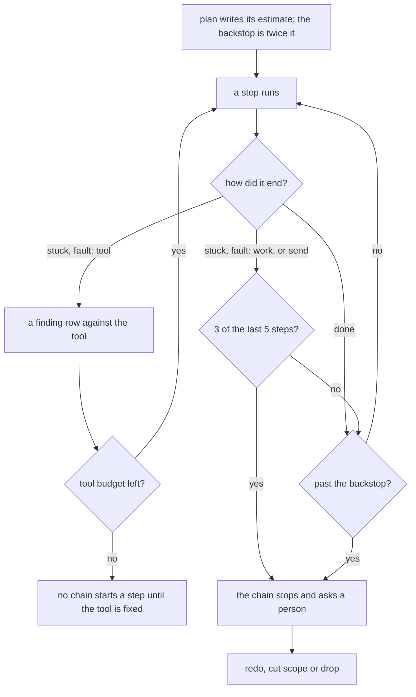

# 0076: A lane stops and asks a person to redo, cut scope or drop when 3 of its last 5 steps were stuck on the work or sent back, with twice the plan's estimate in steps and dollars as a backstop, while a stuck on a tool files a finding and drains one tool budget shared by all lanes, as a trial

**What this decides:** a lane stops and waits for a person when its work keeps failing close
together, or when it passes twice its plan's estimate; a stuck step caused by a tool is charged to
the tool, not the lane.

The picture shows the shape as amended on 2026-11-10 ([Amendments](#amendments)).



```ts
// Sketch, not built. How a step ends, as the chain counts it.
type StepEnd =
  | { _tag: "done" }
  | { _tag: "send"; to: string; reason: string }
  | { _tag: "stuck"; reason: string; fault: "tool" | "work" };

// OTP's restart intensity, counted in steps, never seconds (0065).
const intensity = { count: 3, within: 5 }; // work stucks or sends in the last 5 steps

// The plan's own estimate, and the backstop set from it.
const estimate = { steps: 12, dollars: 15 };
const backstop = { steps: 24, dollars: 30 }; // twice the estimate

// What a stop asks. A person picks one; the chain runs it.
type Answer = "redo" | "cut_scope" | "drop";
```

## Context

**Why now.** A few lanes run far longer than the rest, and nothing stops them early. Counted on
2026-11-10 from the lane state files that `field/runs.jsonl` names: 40 lanes, 654 steps in all, a
median of 12.5 steps a lane. The worst lane ran 61 steps. Another ran 53 steps, with 14 stuck and
19 plan amendments, all on one branch. Most stucks on the worst lanes were tooling faults, not the
change. [0072](0072-a-churning-lane-is-redone.md) has the full table.

**Today's limit.** `chain.ts` parks a lane after a fixed `MaxSteps` (16) for every lane, whatever
its size, and it has no limit on dollars. The rows file already records each step's list-price
dollars.

**What labs do.** The labs study (experiment 250, in an open pull request) found teams that cap
rounds: one caps CI rounds at two, another caps review rounds at three. Those are caps on one kind
of round. This budget is a cap on the whole lane.

**How it fits 0072.** 0072 says when a churning lane is redone, and it leaves open what is counted
and the numbers. This decision adds the trigger that forces the question: at the budget, a person
must choose, and redo is one choice. No rule in 0072 changes, so its status line stays as it is and
this file only links it.

**A trial.** The owner called this our least thought out area. The rule here is a starting point,
and a study and our own experiments follow under tracker ticket 675:

- how others stop runaway work;
- replaying past lanes from `field/runs.jsonl` at 1.5x, 2x and 3x the estimate;
- whether a tooling fault counts against the lane;
- what stops an endless run of lanes that each stay inside budget.

This decision is amended with the measured numbers after that. Tracker ticket 675 is this decision.
*It was amended the same day, from
[experiment 254](../experiments/254-how-a-lane-should-stop.md); see [Amendments](#amendments).*

## Decision

**A lane whose work gets stuck or sent back 3 times within its last 5 steps, or that passes twice
its plan's estimate, stops the chain and asks a person to redo, cut scope or drop it; a stuck step
caused by a tool files a finding against the tool and does not count against the lane (owner,
2026-11-10, amended the same day, still a trial).**

As first recorded, the rule was only the budget at twice the estimate. *Amended 2026-11-10: that
budget is now the backstop, and the window of 5 steps is the main rule; see
[Amendments](#amendments).*

- Every stuck step says its fault: `tool` or `work`. *Added 2026-11-10.*
- 3 work stucks or send-backs within the last 5 steps stop the chain. *Added 2026-11-10.*
- The plan gives its own estimate of steps and dollars. The budget is twice that. *Amended
  2026-11-10: it is the backstop, written in steps and dollars in the plan, no longer the main
  rule.*
- Reaching either number, steps or dollars, stops the chain.
- A stop, from the window or the backstop, asks a person one of three things:
  - **redo**, in 0072's sense: close the lane and start again on a fresh branch from the plan as
    amended. Never "restart", which means a new process here.
  - **cut scope**: amend the plan to do less, and go on.
  - **drop**: close the lane without a merge.
- A tool stuck writes a finding row against the tool
  ([0035](0035-outside-work-becomes-finding-rows.md)) and takes one from a tool budget shared by
  all lanes. When it runs out, chains start no new step until the tool is fixed. *Added
  2026-11-10.*
- No agent sees any of these numbers in its prompt, so saying "stuck" stays cheap and honest.
  *Added 2026-11-10.*
- Plumbing and lead tooling lanes get a budget the same way as product lanes.
- Each week the owner sees the share of merges that are lead tooling or field logs. It asks; it
  never blocks. *Added 2026-11-10.*
- The stop is a state of the lane's machine, never the lead's habit or a line in a prompt
  ([0037](0037-implicit-state-machines-made-explicit.md)).

**Binding constraints:**

- No lane starts without a budget in its plan, in steps and dollars.
- No stuck step is written without a fault, `tool` or `work`.
- At a stop, no step of that lane starts until a person answers.
- With the tool budget spent, no chain starts a step until the tool is fixed.
- The stop records which rule fired, the window's steps or the budget, what was spent and the
  answer.

## Consequences

- **Today's version (lead tooling).** The plan's shape gains an estimate and a budget in steps and
  dollars; plans give agent hours today. The step row and the stuck answers in `drive.ts` and the
  step skills gain the fault. `chain.ts` counts the window of 5 steps, the backstop and the shared
  tool budget, in place of the fixed `MaxSteps`. The weekly share goes in the lead's status notes
  for now, and later inside fabrika, from a metrics program with its own ticket. All of it is lead
  tooling, fast-tracked ([0033](0033-agents-code-follows-next-rules.md)).
- **In `next/`.** The budget is a field of the plan, and the fault a field of a stuck outcome. The
  window and the stop are states of the lane's machine, with the three answers as transitions
  ([0037](0037-implicit-state-machines-made-explicit.md),
  [0046](0046-one-tea-machine-per-file.md)). When the lane becomes a named flow
  ([0064](0064-the-lead-drives-with-flows.md)), they go with it.
- The cost: every stuck step must say its fault, and an agent cannot always tell. A lane that loops
  on send-backs spread out wider than 5 steps runs on to the backstop. The plan step must also give
  an honest estimate in steps and dollars, which it does not do today.
- A person's answer at the stop may start a redo. [P5 of the pipeline guidelines](../docs/direction/pipeline-guidelines.md#p5-after-a-persons-judgment-the-lane-goes-on-from-the-step-before)
  says a person's answer never restarts a lane; 0072 already named that clash. Settling it is left
  to ticket 675.
- Not decided here:
  - the tool budget's size, and what counts as one tool;
  - whether a send-back counts the same as a stuck; for now each counts as one;
  - who answers the stop: the lead or the owner;
  - the line on the weekly share;
  - the P5 clash above.
- Answered on 2026-11-10 ([Amendments](#amendments)): a tooling fault does not count against the
  lane; a run of lanes that each stay inside budget is caught by the tool budget and the weekly
  share. Twice the estimate stays as the backstop's multiple, unmeasured: plans gave hours, so the
  replay could not test it in steps and dollars.

## Amendments

- 2026-11-10: **the main rule becomes a count of work stucks and send-backs in a window of
  recent steps, and twice the estimate becomes a backstop** (owner, still a trial, tracker ticket
  675). Experiment 254 is the study this file asked for. The text above now says the new rule.
  1. **Every stuck step says its fault: `tool` or `work`.** A tool stuck files a finding against
     the tool ([0035](0035-outside-work-becomes-finding-rows.md)) and does not count against the
     lane.
  2. **The stop rule is a count in a window:** 3 work stucks or send-backs within the last 5 steps
     stop the chain, which asks a person to redo, cut scope or drop. The three answers do not
     change. This is OTP's restart intensity (at most a number of restarts within a period, then
     the supervisor gives up and tells its parent), counted in steps, never seconds
     ([0065](0065-speed-laws-count-work.md): a count of work, never a clock).
  3. **Tools get one shared budget across all lanes.** When it runs out, chains start no new steps
     until the tool is fixed. Its size is not set here.
  4. **Twice the plan's estimate stays, as a backstop,** written in steps and dollars in the plan.
     It is no longer the main rule.
  5. **Agents never see these numbers,** so saying "stuck" stays cheap and honest.
  6. **The owner sees a weekly share of merges that are lead tooling or field logs.** Today in the
     lead's status notes; later inside fabrika, from a metrics program with its own ticket. It
     asks; it never blocks.
  - **Why**, from [experiment 254](../experiments/254-how-a-lane-should-stop.md). It counted 84
    lanes and 992 steps since 2026-11-01, cut by ticket from the rows, so its numbers do not
    compare one to one with the 40 lanes above. The median lane ran 6 steps, the longest 93. On the
    five longest lanes, 35 of 41 stuck steps were sorted as tool faults. A flat cap at twice the
    median lane would have stopped 29 of 84 lanes, and 24 of those landed later. Twice the plan's
    estimate, from its hours, fired on 2 of 38 lanes. "3 stuck in 5 steps" stops 7 lanes, the two
    worst among them, each at its first burst. One level up, lead tooling and field logs rose to 56%
    of merges on 2026-11-09.
  - **How sure: about 65%.** The tool-versus-work sort was one agent's judgment, on five lanes. Two
    weeks of stuck rows with a typed fault, then the same replay, settles it. If tool faults stay
    above about half, the rule holds; if agents cannot tell tool from work, the lead tags the fault
    at the stop instead. It stays a trial.

## Records

- `.glossary/TERMS.md`: a row for **budget (lane)**, in Pipeline.
- `.glossary/TERMS.md`: rows for **fault (stuck)**, **intensity (lane)** and **tool budget**, in
  Pipeline (2026-11-10 amendment).
