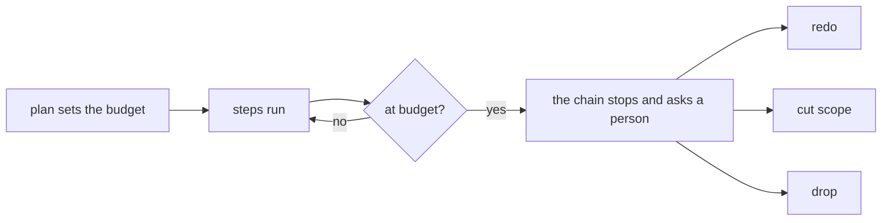

# 0076: Every lane gets a budget of steps and dollars at plan time, twice the plan's own estimate, and hitting it stops the chain to ask a person to redo, cut scope or drop, as a trial

**What this decides:** each lane carries a limit on steps and on dollars, set when it is planned,
and a lane that reaches it stops and waits for a person to pick one of three ways on.



```ts
// Sketch, not built. The plan's own estimate, and the budget set from it.
const estimate = { steps: 12, dollars: 15 };
const budget = { steps: 24, dollars: 30 }; // twice the estimate, for now

// What the stop asks. A person picks one; the chain runs it.
type Answer = "redo" | "cut_scope" | "drop";
```

## Context

**Why now.** A few lanes run far longer than the rest, and nothing stops them early. Counted on
2026-11-10 from the lane state files that `field/runs.jsonl` names: 40 lanes, 654 steps in all, a
median of 12.5 steps a lane. The worst lane ran 61 steps. Another ran 53 steps, with 14 stuck and
19 plan amendments, all on one branch. Most stucks on the worst lanes were tooling faults, not the
change. [0072](0072-a-churning-lane-is-redone.md) has the full table.

**Today's limit.** `chain.ts` parks a lane after a fixed `MaxSteps` (16) for every lane, whatever
its size, and it has no limit on dollars. The rows file already records each step's list-price
dollars.

**What labs do.** The labs study (experiment 250, in an open pull request) found teams that cap
rounds: one caps CI rounds at two, another caps review rounds at three. Those are caps on one kind
of round. This budget is a cap on the whole lane.

**How it fits 0072.** 0072 says when a churning lane is redone, and it leaves open what is counted
and the numbers. This decision adds the trigger that forces the question: at the budget, a person
must choose, and redo is one choice. No rule in 0072 changes, so its status line stays as it is and
this file only links it.

**A trial.** The owner called this our least thought out area. The rule here is a starting point,
and a study and our own experiments follow under tracker ticket 675:

- how others stop runaway work;
- replaying past lanes from `field/runs.jsonl` at 1.5x, 2x and 3x the estimate;
- whether a tooling fault counts against the lane;
- what stops an endless run of lanes that each stay inside budget.

This decision is amended with the measured numbers after that. Tracker ticket 675 is this decision.

## Decision

**Every lane has a budget of steps and dollars, set at plan time at twice the plan's own estimate,
and a lane that hits it stops the chain and asks a person to redo, cut scope or drop it (owner,
2026-11-10).**

- The plan gives its own estimate of steps and dollars. The budget is twice that.
- Reaching either number, steps or dollars, stops the chain.
- The stop asks a person one of three things:
  - **redo**, in 0072's sense: close the lane and start again on a fresh branch from the plan as
    amended. Never "restart", which means a new process here.
  - **cut scope**: amend the plan to do less, and go on.
  - **drop**: close the lane without a merge.
- Plumbing and lead tooling lanes get a budget the same way as product lanes.
- The stop is a state of the lane's machine, never the lead's habit or a line in a prompt
  ([0037](0037-implicit-state-machines-made-explicit.md)).

**Binding constraints:**

- No lane starts without a budget in its plan.
- At the budget, no step starts until a person answers.
- The stop records the budget, what was spent and the answer.

## Consequences

- **Today's version (lead tooling).** The plan's shape gains an estimate and a budget. `chain.ts`
  reads the budget from the plan, counts steps and list-price dollars as they run, and stops at the
  budget in place of the fixed `MaxSteps`. It is lead tooling, fast-tracked
  ([0033](0033-agents-code-follows-next-rules.md)).
- **In `next/`.** The budget is a field of the plan. The stop is a state of the lane's machine, with
  its three answers as transitions ([0037](0037-implicit-state-machines-made-explicit.md),
  [0046](0046-one-tea-machine-per-file.md)). When the lane becomes a named flow
  ([0064](0064-the-lead-drives-with-flows.md)), the budget goes with it.
- The cost: a lane that would have finished just past twice its estimate now waits on a person. The
  plan step must also give an honest estimate, which it does not do today.
- A person's answer at the stop may start a redo. [P5 of the pipeline guidelines](../docs/direction/pipeline-guidelines.md#p5-after-a-persons-judgment-the-lane-goes-on-from-the-step-before)
  says a person's answer never restarts a lane; 0072 already named that clash. Settling it is left
  to ticket 675.
- Not decided here:
  - the right multiple: twice is a starting point, not a measured number;
  - whether a tooling fault (`fetch_failed`, `box_failed`, `unsigned`) counts against the lane;
  - a budget across lanes, so a run of lanes that each stay inside budget still stops;
  - who answers the stop: the lead or the owner.

## Records

- `.glossary/TERMS.md`: a row for **budget (lane)**, in Pipeline.
