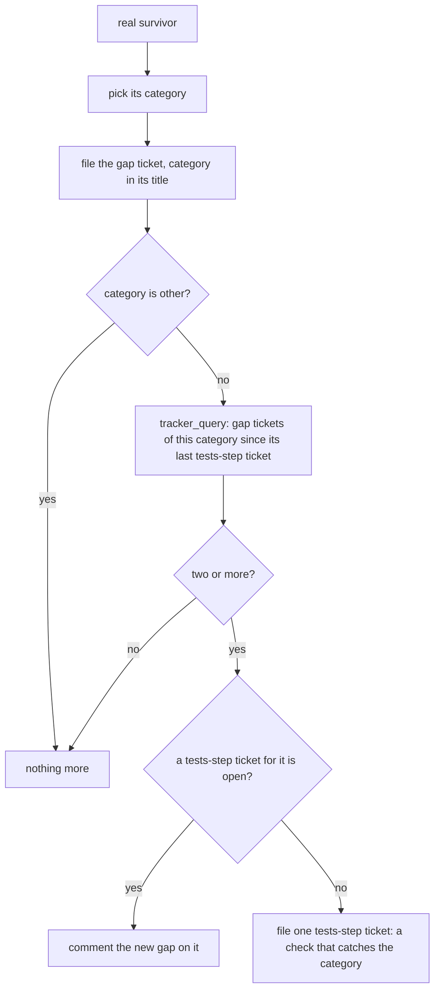

# 0077: Each real mutation gap carries a category from a closed list, and the second gap of one category files one ticket against the tests step



```ts
// A sketch: one real gap, as the hourly run judges it. Keys are short words; no `_tag`.
const gap = {
  file: "packages/pipeline/src/stages/ship/gate.ts",
  line: 41,
  mutator: "EqualityOperator", // Stryker's name, as its report gives it
  from: "tries < limit",
  to: "tries <= limit",
  category: "boundary", // one of the closed list below
};
// Its ticket title: "mutation gap (boundary): packages/pipeline/src/stages/ship/gate.ts"
```

**What this decides:** each real gap the hourly mutation run files gets one word from a short
closed list, and when a second gap of the same word turns up, the run files one ticket to make the
tests step catch that whole category.

## Context

[0066](0066-mutation-runs-on-a-schedule.md) made mutation an hourly run on main that files each
real surviving mutant as a ticket for a missing test, and
[0067](0067-hourly-mutation-runs-in-ci.md) moved that run to GitHub CI. Each ticket fixes one test.
Nothing tells the tests step that it keeps missing the same sort of case (tracker ticket 676).

This amends 0066 in part: what the run files. A real gap is still one ticket for a missing test,
as 0066 says; the gap now carries a category, and a repeat adds one ticket. The rest of 0066
holds. 0067 is unchanged: where the run happens is the same, and its "files tickets, as 0066
says" now reads through this file.

The run keeps no store of its own: its answer is the CI artifact, and its real gaps are the
tracker tickets it files. So the category goes on the ticket, and the count is a tracker query,
never a second file.

## Decision

**Every real gap gets one category, and the second gap of one category, `other` aside, files one
ticket against the tests step.**

- The categories, a closed list. Stryker's mutator names are hints, not the rule; the run picks by
  what test is missing.

  | `category` | The missing test | Stryker mutators that often point at it |
  |---|---|---|
  | `error_branch` | an error or failure path no law runs | `BlockStatement` in a `catch`, `ConditionalExpression` on an error check |
  | `boundary` | a value at an edge: zero, the limit, one past it | `EqualityOperator`, `ArithmeticOperator`, `UpdateOperator` |
  | `condition` | a condition forced true or false that no law notices | `ConditionalExpression`, `LogicalOperator`, `BooleanLiteral`, `UnaryOperator` |
  | `return_value` | an output or returned value no law reads | `ObjectLiteral`, `ArrayDeclaration`, `StringLiteral`, `ArrowFunction`, `Regex` |
  | `call_order` | a call, a side effect or their order no law checks | `BlockStatement`, `MethodExpression`, `AssignmentOperator` |
  | `fallback` | a default or fallback value no law reaches | `LogicalOperator` on `??` or `\|\|`, `OptionalChaining` |
  | `other` | none of the above | any |

- The gap ticket's title carries the category: `mutation gap (<category>): <file>`, so
  `tracker_query` with `find` lists every gap of one category. Its body names the mutator, the
  line and the change.
- After filing a gap, the run counts the gap tickets of that category filed since the last
  tests-step ticket of that category, open or closed. At two or more it files one ticket,
  `tests step: catch <category> gaps`, naming the gaps. If that ticket is still open, it comments
  the new gap on it instead.
- What that ticket asks for, in order: a code check that would have caught the category (a lint
  rule, a plancheck rule, a test helper); else a row the plan's laws table must carry; skill prose
  only if neither can hold it.
- One gap alone changes nothing but its own test. `other` never counts toward a tests-step ticket.
- A tests-step ticket is not one of 0066's three gap tickets a day.

**Binding constraints:**

- The list stays closed and under eight. A new category, or a renamed one, is a change to this
  file.
- The run still changes nothing in the repo: the categories live on tracker tickets.

## Consequences

- One more word per gap ticket, picked by the run's judgment.
- The first miss of a category teaches the tests step nothing; only the second does.
- After a tests-step ticket lands, the count starts again, so a category that keeps slipping
  through files again after two more gaps.
- The doubt: whether categories repeat often enough to matter, and whether the list cuts at the
  right places. This is a trial inside 0066's week. A week of runs settles it: if most gaps land
  in `other`, or no category reaches two, the list is retuned in a change to this file.
- Today the pick and the count are steps in the mutation skill, done by the run's session through
  the tracker. A script that keeps the closed list and does the count is its own ticket.
- Not decided here: the `next/` mutation queue's `Gap` type in
  [the mutation note](../docs/direction/fast-and-daily-mutation.md); it may take the category
  when it is built.

## Records

- Coins `category` (a mutation gap's category) in [`.glossary/TERMS.md`](../.glossary/TERMS.md),
  Pipeline. Not `kind`, today's tag key, and not `class`, which already means an error class or a
  CSS class here.
