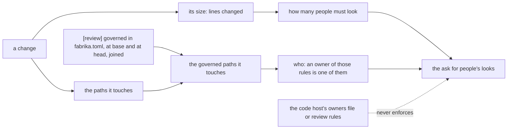

# 0079: A change's size sets how many people must look at it and its governed paths set who, both read from fabrika's own settings and never from the code host, as a trial



```ts
// A sketch, next/. The result of working out a change's risk tier, as data. Every name and every
// number here is made up: the size cuts, the counts and how owners are named are not decided.
{
  _tag: "tiered",
  change: "sha256:…",
  looks: 1,                          // how many people must look: set by size alone
  who: ["owner of .github/"],        // who must be among them: set by governed paths alone
  set: {
    size: { lines: 312, cut: "51 to 400" },
    governed: [".github/"],          // from [review] governed, base and head joined
  },
}
// A change that touches no governed path: the same looks, and who is [], so any person may look.
// A small change to a governed path: still one look, and that person is a rules owner.
```

**What this decides:** in the product, a change's size decides how many people must look at it,
and the governed paths it touches decide that an owner of those rules is one of them; fabrika reads
both from its own settings, never from the code host, and nothing blocks on it until a replay on
this repo measures its false alarms.

## Context

[0071](0071-risk-tier-decides-who-looks.md) decided that each change gets a risk tier, set from
what the change touches and never from who wrote it, that decides how many people must look. It
left open what sets the risk tier: paths, a classifier, or both. This record answers that point
and amends 0071 in part. Tracker ticket 678 holds it.

[Experiment 252](../experiments/252-risk-tiers-on-phoenix.md) tested a risk tier set from paths on
457 merged pull requests of one other public repo, whose pull requests go through today's fabrika:

- By path tier, later fixes (a fix pull request merged within 7 days that shares a file and links the change or its issue) were: low 0 of 22,
  medium 12 of 123 (9.8%), high 23 of 312 (7.4%). High was not above medium.
- 312 of 457 changes (68%) landed in the high tier, because that repo's governed folders hold most
  of its work.
- By size, later fixes were 1 of 78 (1.3%) for up to 50 changed lines, 17 of 232 (7.3%) for 51 to
  400, and 17 of 147 (11.6%) above 400. The small and large intervals do not overlap.
- People's reviews asked for: 747 by the path tiers against 526 by the fixed size cuts.
- Its reading: governed folders mark who may change the rules, not where bugs come from. Those are
  two reasons to put a person in front of a change, so keep them apart.
- It is one repo, an odd one (it builds the pipeline that reviews it), and about 70% sure. Some of
  size's win may come from a big change sharing more files with a later fix.

Which version each piece is about:

- Today's version already reads `[review] governed` and `ui` from `.fabrika/fabrika.toml` at a
  change's base and at its head, and joins the two, so a change cannot take itself out of a review
  (`rulesOfBoth`, in [one fabrika.toml per repo](../docs/direction/one-fabrika-toml-per-repo.md)).
  Its `[ship] approval` is `codeowners` or `none`.
- The risk tier is the product, built in `next/`. Nothing in `next/` reads a governed list yet.

Related, and not changed by this record:

- [0069](0069-choices-are-settings.md): a choice that fits as a `fabrika.toml` value is one. The
  governed list is one already.
- [The services fabrika needs](../docs/direction/services-and-our-own-ci.md) and
  [the backend is a library](../docs/direction/backend-as-a-library.md): a stage asks a typed
  service, and the code host is reached only through `CodeHost`.
- [Four new combos](../docs/direction/new-combos.md) left open where the guarded list lives,
  `.github/CODEOWNERS` or `fabrika.toml`. This record answers it for who must look:
  `fabrika.toml`.

## Decision

**A change's size sets how many people must look at it, and the governed paths it touches set who
must be among them, both read by fabrika from its own settings and never from the code host, as a
trial (owner, 2026-11-10).**

- **Size sets the count.** A bigger change gets more people's looks.
- **Governed paths set who.** When a change touches a governed path, an owner of those rules is one
  of the people who look. Touching a governed path does not raise the count by itself.
- **Both come from fabrika's own settings.** fabrika reads the governed list and its owners from the
  repo's settings file at the change's base and at its head, and joins the two, so a change cannot
  take itself out. This is how today's version already reads `[review] governed`.
- **The code host never enforces it.** fabrika does not rely on a code host's owners file or its
  review rules for this. A repo may have fabrika read such a file as input, through the `CodeHost`
  service; it is never the thing that enforces.
- **A trial.** Nothing blocks on it until it is replayed on this repo's own merged pull requests and
  its false alarms are measured. 0071 already says a blocking check needs that, and AGENTS.md asks
  about 0% to block and up to 10% to only advise.

**Binding constraints** (0071's, kept as they are):

- Nothing about the writer feeds the risk tier: not the person, the agent, its model or its past
  record. Size and paths are both read from the change.
- An agent's look never counts toward the count of people.

## Consequences

- 0071's open point "what sets the risk tier" is answered: size and governed paths, each with its
  own job. A classifier is not part of it.
- The governed list now has two readers: today's review, and the product's risk tier. One list, one
  read at base and head.
- The replay on this repo comes before any block. It is the first measurement of our own; until
  then the risk tier can only advise.
- What must be recorded from day one stays as 0071 says. The sketch adds what set the risk tier:
  the size and its cut, and the governed paths it touched.
- Not decided here:
  - The size cuts, and the count of people for each cut.
    *2026-11-10: [0082](0082-approvals-is-a-floor-for-every-run.md) names the base count, the repo
    setting `approvals`, a floor no run goes under; size moves the count from there.*
    *2026-11-10, later: 0082's amendment renames that setting `review.human-approvals`.*
  - How the settings name a governed path's owners. That is a design for the settings study and
    Tier 1's row P38 ([the Tier 1 plan](../docs/plan/tier-1.md#the-pull-requests-one-at-a-time)).
  - Whether today's `[ship] approval = codeowners` stays as one option.
  - Which plan tier ([the tiers](../docs/plan/tiers.md)) builds it in `next/`.
  - Whether a look comes before the merge or after it. That is still 0071's open point.

## Records

- Glossary: `governed path` added to the Pipeline section of [TERMS](../.glossary/TERMS.md).
