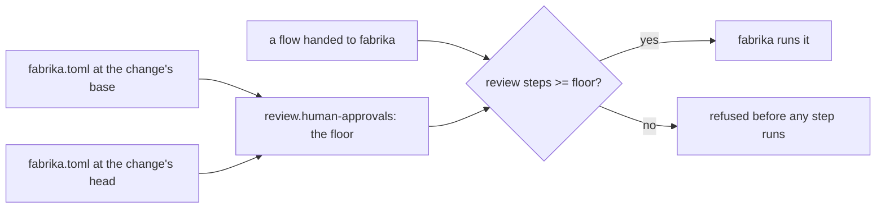

# 0082: How many people must approve a change is one repo setting named human-approvals, a floor no run or handed-over flow may go under, where 0 means no floor and only the repo's settings file changes it



```ts
// A sketch, next/. `Setting.make` is from the proposed settings note in open PR 831, and `Flow`
// from the flow runner in open PR 814; neither is on main. `isReview` is not decided (Consequences).
export const humanApprovals = Setting.make("review.human-approvals", {
  schema: Schema.Int.check(Schema.isGreaterThanOrEqualTo(0)),
  default: 1,
  scope: ["repo"],
});
// a Schema filter on a handed-over flow, so a flow under the floor never decodes
const meetsFloor = (floor: number) =>
  Schema.makeFilter<Flow>((f) => f.steps.filter(isReview).length >= floor, {
    expected: `at least ${floor} review steps`,
  });
```

```toml
# .fabrika/fabrika.toml, a sketch
[review]
human-approvals = 2   # every run asks at least two people; 0 means this repo has no floor
```

**What this decides:** the number of people who must approve a change is one setting the repo
owns, `human-approvals`; it is a floor for every run, so a flow handed to fabrika may ask for more
approvals but never fewer, and the only way to lower it is to change that number in the repo's
settings file.

## Context

[0079](0079-size-counts-governed-paths-name-who.md) decided, as a trial, that a change's size sets
how many people must look at it and its governed paths set who, read from fabrika's own settings at
the change's base and head. It named no setting for the count, and its sketch calls the count
`looks`. [0074](0074-agent-hands-over-a-flow.md) decided that an agent hands fabrika a flow as data,
which fabrika checks and runs, and left open what fabrika checks before it runs one. A flow holds
its own steps, so without a floor a flow could leave out the review steps the repo wants. Tracker
ticket 678 holds this.

The industry's word is "approvals":

- GitHub branch protection's "require a specific number of approving reviews"
  ([about protected branches](https://docs.github.com/en/repositories/configuring-branches-and-merges-in-your-repository/managing-protected-branches/about-protected-branches)),
  API field `required_approving_review_count`, "a number between 1 and 6 or 0 to not require
  reviewers"
  ([branch protection API](https://docs.github.com/en/rest/branches/branch-protection?apiVersion=2022-11-28)).
- GitLab's "Approvals required", where "a value of 0 makes the rule optional"
  ([approval rules](https://docs.gitlab.com/user/project/merge_requests/approvals/rules/)), API
  field `approvals_required`
  ([merge request approvals API](https://docs.gitlab.com/api/merge_request_approvals/)).

Both use 0 to mean "none required", with no second switch. This record does the same.

How it relates:

- **[0079](0079-size-counts-governed-paths-name-who.md), amended in part.** 0079's sketch says the
  count is "set by size alone". Here the count starts from the repo's `human-approvals`, and size moves it
  from there; how size moves it is still 0079's trial. The record's prose keeps "look" for a
  person's look; the setting is `human-approvals`, never `looks`. 0079's other rules and its binding
  constraints stay.
- **[0074](0074-agent-hands-over-a-flow.md), amended in part.** It answers part of 0074's open
  point "what fabrika checks before it runs a handed-over flow": at least the floor's review steps.
  The rest of that point stays open.
- **[0071](0071-risk-tier-decides-who-looks.md)** left open which part of a risk tier a repo's
  settings may change. This record makes the base count a setting. Its status is not changed here:
  0079 already carries its amendment, and this record builds on 0079.
- **[0069](0069-choices-are-settings.md):** a choice that fits as a `fabrika.toml` value is one,
  declared once with its schema and default. The floor is a number, so it is one.
- **[0064](0064-the-lead-drives-with-flows.md):** a flow is a list of typed steps one program runs.
  The floor is a check on that list.
- **[One fabrika.toml per repo](../docs/direction/one-fabrika-toml-per-repo.md):** "the order of the
  steps stays in code. No `steps = [...]`." That still holds: the order of a run lives in its flow,
  which is code and data fabrika checks, never in the settings file. The file holds only the floor,
  a number, which is a knob that note allows.
- **Today's version is not changed.** Its `[review]` has only `governed` and `ui`, and its
  `[ship] approval` is `codeowners` or `none`. This record is about the product, built in `next/`.

## Decision

**How many people must approve a change is one repo setting, `human-approvals`, and it is a floor for
every run: a run may ask for more approvals, never fewer, and only the repo's settings file changes
it (owner, 2026-11-10).**

- **One setting, the industry's name.** The repo owns `human-approvals`, an integer of at least 0.
  Its name is the industry's word, as GitHub and GitLab say it, with `human-` in front so it says it
  counts people ([Amendments](#amendments)). Never `looks`.
- **A floor for every run.** A flow handed to fabrika ([0074](0074-agent-hands-over-a-flow.md)) may
  hold more review steps than the floor, never fewer. Our own pipeline's lane, one named flow, is
  held to it too.
- **Refused at the check, before any step runs.** fabrika checks a handed-over flow against the
  floor when it checks the flow. A flow under the floor is refused, with the floor and its count in
  the reason, and no step of it runs. So a run can be stricter than the repo, never looser.
- **The number is the switch.** `human-approvals = 0` means the repo has no floor. There is no second
  on/off setting.
- **No way around it from inside.** There is no per-run exception. Only the repo's settings file
  changes the floor, read at the change's base and at its head as 0079 already reads its settings,
  so neither a change nor a flow can take itself out.

**Binding constraints:**

- No flow, flag, run or agent lowers the floor. Only the repo's settings file does.
- A flow under the floor never starts: the check refuses it before its first step.
- The floor reads the settings at base and head, as 0079 does, never the head alone.
- 0079's constraints stay: nothing about the writer feeds the count, and an agent's look never
  counts toward the count of people. So an agent's review step never counts toward the floor.

## Consequences

- The count 0079 leaves to size now has a named base, `human-approvals`, and a default to set in the
  sketch. The default of 1 is the sketch's, not decided here; it is for the build's plan.
- fabrika's flow check gains one rule with a clear reason to refuse. It is a Schema filter, so a
  flow under the floor never decodes, and the refusal names the key, as the settings note's load
  rules ask.
- To record from day one: on each refused flow, the floor it was checked against and the count it
  had, beside 0074's facts for a handed-over flow.
- Not decided here:
  - **How size changes the number.** 0079's trial still decides it; `human-approvals` is the base number.
  - **Which table the key lives in** once the pipeline is a pack: `[review]` today, or the pipeline
    pack's own table.
  - **What counts as a review step in a flow:** a typed step kind, picked in the build's plan. It
    must be a step a person answers, since an agent's review never counts as a person's approval.
  - Whether a person's approval comes before the merge or after it. That is still 0071's open
    point.

## Records

- Glossary: `human-approvals` (first added as `approvals`) in the Pipeline section of [TERMS](../.glossary/TERMS.md).
- [0079](0079-size-counts-governed-paths-name-who.md) and
  [0074](0074-agent-hands-over-a-flow.md): status lines now say amended in part by this record,
  with a one-line pointer in each.

## Amendments

- 2026-11-10 (owner): the setting is renamed from `review.approvals` to `review.human-approvals`, so
  its name says it counts people. A bare `approvals` read as how many times an agent reviews. An
  agent's review never counts toward it. The sketch's `scope` is now the list `["repo"]`, not the
  string `"repo"`, as the settings walk decided the same day. Nothing else in this record changes.
