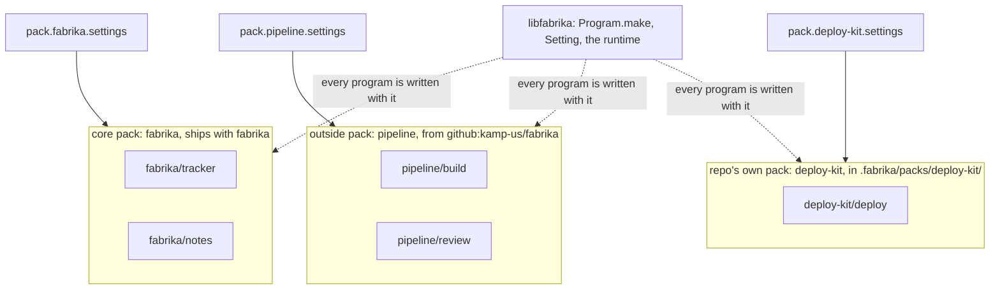

# 0083: Every program in next/ belongs to a pack, a repo's own included, and a pack declares one settings schema that all its programs read, never a settings table per program



Each box of programs is a pack, and each pack's settings reach only its own programs. Nothing
sits outside a box.

```toml
# A sketch. .fabrika/fabrika.toml
[pack.pipeline]
from = "github:kamp-us/fabrika"
ref = "v1"

[pack.pipeline.settings]      # the pack's own settings, checked by the pack's schema
region = "eu"
review.model = "claude-sonnet-5-5"
```

```ts
// A sketch, next/. `Setting` is from the proposed settings note (PR 831), not on main.
// In the pack: one group for all its programs.
export const settings = Setting.group({ region, review: Setting.group({ model }) });
// In any program of that pack: fabrika hands it a ConfigProvider scoped to its own pack.
const { region } = yield* settings;
```

**What this decides:** in `next/`, there is no loose program: every program is in a pack, what
ships with fabrika is the core pack, and settings belong to a pack, which all its programs read.

## Context

Tracker ticket 683. The owner decided this on 2026-11-10.

Three places held programs, and settings had more than one home:

- [The cloud is one more host](../docs/direction/the-cloud-is-one-more-host.md), section A4, gave
  three spellings in a sketch: `fabrika/tracker` (built-in), `pipeline/build` (from a pack) and
  `./programs/deploy` (the repo's own, a path from its `.fabrika` folder).
- [One fabrika.toml per repo](../docs/direction/one-fabrika-toml-per-repo.md), "Where the files
  live", lists `programs/deploy/` as the repo's own programs (proposed) beside
  `packs/deploy-kit/`, a pack the repo offers. Its "Where packs come from" (decided 2026-10-31)
  puts each pack's own settings in its `[pack.<name>]` table, and its older line says "one pack's
  own settings; the pack checks them".
- [The tiers](../docs/plan/tiers.md) put repo programs in `.fabrika/programs` in Tier 5 and packs
  in Tier 7. [0068](0068-tiers-carry-every-part.md) gives programs written outside fabrika's
  source a thin slice before both, and [0075](0075-cold-author-checks-outside-programs.md) checks
  that slice with a cold agent as the author.
- [0069](0069-choices-are-settings.md) makes every choice that fits a value a setting, declared
  once as an Effect `Config`. It does not say who owns a program's settings.

The known ways, each page read on 2026-11-10:

- **The model followed: a Cloudflare Worker's `env`.** A Worker's bindings "are located on the
  `env` object", which its handlers take as an argument, its `DurableObject` and
  `WorkerEntrypoint` classes hold as a property, and any module can import from
  `cloudflare:workers` ([bindings](https://developers.cloudflare.com/workers/runtime-apis/bindings/)).
  One `env` per Worker, read by all its code. A pack is the Worker here, and its programs are its
  code.
- **The contrast: a VS Code extension pack.** "An Extension Pack is a set of extensions that will
  be installed together", and "should not have any functional dependencies with its bundled
  extensions" ([extension manifest](https://code.visualstudio.com/api/references/extension-manifest)).
  Each extension contributes its own settings, each with "its own unique ID"
  ([contribution points](https://code.visualstudio.com/api/references/contribution-points#contributes.configuration)).
  So VS Code's pack is only a bundle, and settings live per extension. Ours is the other way: the
  pack is the unit that owns settings, and a program has none of its own.
- **The core pack's model: a language's standard library.** "The Rust Standard Library is the
  foundation of portable Rust software", and "`std` is available to all Rust crates by default"
  ([std](https://doc.rust-lang.org/std/)). A language is its syntax plus its standard library.
  Here libfabrika is the syntax and the core pack is the standard library.

This walks back two spellings in direction notes, A4's `./programs/deploy` and the `programs/deploy/`
folder, and gives each a dated pointer. It amends and supersedes no decision file: 0068, 0069,
0075 and [0020](0020-programs-get-hard-walls.md) all still hold, and this record cites them.

## Decision

**Every program belongs to a pack, and a pack declares one schema for its settings that every
program in it reads; a program has no settings of its own.**

- **No loose program.** A program is always in a pack. A repo's own program lives in a pack in the
  repo's own `.fabrika/packs/<name>/`, the folder decided on 2026-10-31 for packs a repo offers.
  So a repo's own pack and a pack it offers to others are one thing in one folder.
- **One spelling.** A program is named `<pack>/<program>`, a repo's own included. A4's third
  spelling, a path such as `./programs/deploy`, goes.
- **libfabrika is the syntax, and the core pack is the standard library.** What ships with
  fabrika is the core pack, which holds the core programs, such as the tracker and notes. Every
  other pack sits beside it. "Core" names only the core pack; libfabrika is never called the
  core.
- **The core pack is named `fabrika` in every key.** Its programs are `fabrika/tracker` and
  `fabrika/notes`, the 2026-10-31 spelling kept, and its settings sit in
  `[pack.fabrika.settings]`. "The core pack" is what prose calls the pack named `fabrika`.
- **Settings are per pack, never per program.** A pack declares one settings schema, and every
  program in the pack reads it, as a Worker's code reads its `env`. The line "one pack's own
  settings; the pack checks them" is kept, and is now the only place a program's settings live.
- **A program sees only its own pack's settings.** fabrika hands each program a `ConfigProvider`
  scoped to its pack at load, so another pack's values are not there to read. This follows
  0020's constraint that no program's isolation rests on code alone where a wall can hold it.

**Binding constraints**

- No `next/` code, note or plan adds a program outside a pack, a program-level settings table, or
  a path spelling for a program.
- A pack's settings are declared once, as 0069 asks, in the pack. Its schema checks them, and
  0069's and the 2026-10-05 note's load rules hold: an empty table changes nothing, an unknown key
  fails.

## Consequences

- **What this changes in the plan.** Tier 5's "repo programs (`.fabrika/programs`)" now means a
  repo's own pack in `.fabrika/packs/<name>/`. The tier each lands in does not move: repo programs
  stay in Tier 5, packs from elsewhere in Tier 7, and 0068's thin slice comes before both.
  [The tiers](../docs/plan/tiers.md) and [Tier 1's detail](../docs/plan/tier-1-detail.md) get a dated
  line ([0013](0013-plan-docs-change-with-the-work.md)).
- **What it costs.** A one-file program now needs a `pack.toml` beside it. 0075's cold-author
  check should count that step as part of what an outside author must learn.
- Pointers: [one fabrika.toml per repo](../docs/direction/one-fabrika-toml-per-repo.md),
  [the cloud is one more host](../docs/direction/the-cloud-is-one-more-host.md#a4-packs-part-decided-2026-10-31),
  [packs are programs](../docs/direction/packs-are-programs.md), the tiers and Tier 1's detail
  each get one dated line. Nothing else in them changes.
- **Not decided here:**
  - How a repo lists a pack from its own folder: a `[pack.<name>]` table with no `from`, or loaded
    by being in the folder.
  - The name of the settings sub-table. `settings` is the sketch's word. A sub-table exists so a
    pack's key cannot clash with `from` or `ref`. The 2026-10-31 sketch put `region` beside `from`
    and `ref` in the pack's own table.
  - Which programs the core pack holds beyond the tracker and notes, and whether the pipeline's
    steps are in it or in a pack of their own.
  - How a pack's settings schema is found at load. A lean: `pack.toml` names the file.
  - Whether `ref` may name a branch, open since 2026-10-31, stays open.
  - Whether a keybinding's command name, such as `desk.split`, takes the pack's name too.
- **Follows from 0020, not new:** a pack never reads a value another pack declares, unless that
  value is handed over through a pipe or a flow.

## Records

- `.glossary/TERMS.md`: `core pack` is added; `pack` and `program` are amended.
