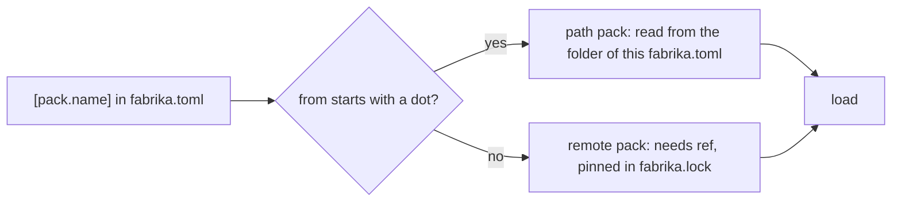

# 0084: A repo's own pack is listed in fabrika.toml like any pack, with a from that starts with a dot as a path from that file's folder, never found by its folder alone



```toml
# A sketch. .fabrika/fabrika.toml
[pack.my-tools]
from = "./packs/my-tools"      # a dot: a path from this file's folder; no ref, no lock line

[pack.pipeline]
from = "github:kamp-us/fabrika" # no dot: a remote; needs ref, pinned in fabrika.lock
ref = "v1"
```

**What this decides:** a repo turns on its own pack the same way it turns on any other, with one
`[pack.<name>]` table, and a `from` that starts with a dot is a path from that `fabrika.toml`'s
folder, with no `ref` and no lock line.

## Context

Tracker ticket 683. The owner decided this on 2026-11-10.

- [0083](0083-every-program-in-a-pack.md) put every program in a pack and said a repo's own
  program "lives in a pack in the repo's own `.fabrika/packs/<name>/`". Its "not decided" list left
  open how a repo lists a pack from its own folder: a `[pack.<name>]` table with no `from`, or
  loaded by being in the folder. This record answers that.
- It applies the 2026-10-31 call in
  [the cloud is one more host](../docs/direction/the-cloud-is-one-more-host.md#a4-packs-part-decided-2026-10-31),
  section A4: a dot means a path, and no dot means a remote. It also keeps
  [one fabrika.toml per repo](../docs/direction/one-fabrika-toml-per-repo.md#where-packs-come-from-2026-10-31):
  a project lists its packs in `fabrika.toml`, one `[pack.<name>]` table each, and no folder name
  is forced on a project.
- This amends 0083 in part. `.fabrika/packs/<name>/` stays the place a repo offers packs to
  others (decided 2026-10-31), and the usual place for its own, but the path in `from` is what
  counts. The rest of 0083 holds: a program's name is still `<pack>/<program>`, and the path here
  is where a pack's code sits, never a spelling for a program.

The known ways, each page read on 2026-11-10:

- **Cargo's path dependencies.** A dependency written as `path = "hello_utils"` "is found in the
  `hello_utils` folder, relative to the `Cargo.toml` file it's written in"
  ([specifying path dependencies](https://doc.rust-lang.org/cargo/reference/specifying-dependencies.html#specifying-path-dependencies)).
  The base folder here is Cargo's: the file that names the path.
- **GitHub Actions' local actions.** A step's `uses: ./path` is "the path to the directory that
  contains the action in your workflow's repository", and takes no ref, while an action from
  another repository should name "a Git ref, SHA, or Docker tag"
  ([`jobs.<job_id>.steps[*].uses`](https://docs.github.com/en/actions/reference/workflows-and-actions/workflow-syntax#jobsjob_idstepsuses)).
  The dot-means-local spelling and the missing ref are Actions'. Actions reads the path from the
  workspace root, not from the workflow file's folder; we take Cargo's base instead, so a nested
  `fabrika.toml` reads the same way wherever it sits.

## Decision

**A repo's own pack is a `[pack.<name>]` table like any other, and a `from` that starts with a dot
is a path from the folder of the `fabrika.toml` that names it.**

- **A dot means a path, no dot means a remote.** `from = "./packs/my-tools"` is a path pack;
  `from = "github:kamp-us/fabrika"` is a remote pack.
- **The path is read from the folder of the `fabrika.toml` that names it,** as Cargo reads `path`
  from its `Cargo.toml`. For the repo's file that folder is `.fabrika/`, so `./packs/my-tools` is
  `.fabrika/packs/my-tools/`.
- **A path pack has no `ref` and no line in `fabrika.lock`.** The repo's own commit pins its code,
  as it pins every other file in the repo.
- **A remote pack needs a `ref`,** and `fabrika.lock` pins its commit and hash, as decided
  2026-10-31.
- **The two shapes are one Effect Schema union, and a table that fits neither fails to load.** A
  path with a `ref` fails, and a remote with no `ref` fails. This is the load rule that an unknown
  key fails, applied to the two shapes.

  ```ts
  // A sketch, next/. Decoded with onExcessProperty: "error", so a path pack's `ref` is an unknown
  // key. The pack's settings sub-table (0083) is left out of the sketch.
  const PathPack = Schema.Struct({ from: Schema.String.check(Schema.isPattern(/^\./)) });
  const RemotePack = Schema.Struct({
    from: Schema.String.check(Schema.isPattern(/^[^.]/)),
    ref: Schema.String,
  });
  const PackSource = Schema.Union([PathPack, RemotePack]);
  ```

- **A pack must be listed to load.** A folder under `.fabrika/packs/` that no `[pack.<name>]`
  table names is not loaded. There is one registry: the `[pack.<name>]` tables.
- **No folder is forced.** `.fabrika/packs/<name>/` is the usual place for a repo's own pack and the
  place a repo offers packs to others, but `from` may name any folder the rules allow.

**Binding constraints**

- No `next/` code loads a pack that no `[pack.<name>]` table lists, and none scans a folder to find
  packs.
- A path pack never gets a `ref` key or a lock line; a remote pack never loads without both.

## Consequences

- **What it costs.** A repo's own pack needs a two-line table even when it sits in the usual
  folder. In return, one look at `fabrika.toml` tells a reader every pack that runs, and a stray
  folder runs nothing.
- **What changes.** 0083's status line and its "No loose program" bullet point here. The
  glossary's `pack` row says how a repo's own pack is listed.
- **Not decided here:**
  - Whether a path may point outside the repo, such as `../shared-packs`. Outside the repo, the
    repo's commit no longer pins the code, so the "no lock line" rule would need a second look.
  - Whether a person's home file, `~/.fabrika/fabrika.toml`, may list a path pack. **A lean, not a
    decision:** yes, by the same rule, with the path read from that file's folder, `~/.fabrika/`.

## Records

- `.glossary/TERMS.md`: `pack` is amended to say how a repo's own pack is listed.
