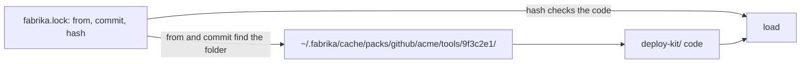

# 0085: The home's cache of downloaded pack code is ~/.fabrika/cache/packs/, never ~/.fabrika/packs/, so packs/ names only real pack source



**Before:**

```text
~/.fabrika/packs/                      a shared cache of pack code, by commit
acme/.fabrika/packs/deploy-kit/        a pack this repo offers to others
```

**After:**

```text
~/.fabrika/cache/packs/github/acme/tools/9f3c2e1/deploy-kit/
acme/.fabrika/packs/deploy-kit/        a pack this repo offers to others
```

Only the home's folder moves. `packs/` now names real pack source and nothing else.

**What this decides:** downloaded pack code is cached in `~/.fabrika/cache/packs/`, so the word
`packs/` in a `.fabrika` folder always means pack source a person wrote.

## Context

Tracker ticket 683. The owner decided this on 2026-11-10.

- [One fabrika.toml per repo](../docs/direction/one-fabrika-toml-per-repo.md#where-packs-come-from-2026-10-31)
  decided on 2026-10-31 that `~/.fabrika/packs/` only caches code, keyed by commit, and that any
  repo offers packs in its own `.fabrika/packs/<name>/`. Since
  [0083](0083-every-program-in-a-pack.md), a repo's own pack also sits there.
- So one name had two opposite jobs: `packs/` in a repo's `.fabrika/` holds real source that a
  person edits and commits, and the same name in the home held only downloads that can be deleted
  and fetched again. Since the home and the repo share one shape, as `~/.claude` and `.claude/` do,
  a reader of either folder could not tell which job a `packs/` had.

The known ways, each read on 2026-11-10:

- **Cargo.** Cargo clones a git dependency into `git/db` and checks "the required commit of the
  repo" out into `git/checkouts`, where "multiple checkouts of different commits of the same repo
  are possible" ([Cargo Home](https://doc.rust-lang.org/cargo/guide/cargo-home.html)). On disk that
  is `~/.cargo/git/checkouts/<repo>-<id>/<short commit>/`. The cache sits apart from any crate a
  person writes, and is keyed by commit.
- **Claude Code.** Plugin files sit in `~/.claude/plugins/cache/<marketplace>/<plugin>/<version>/`,
  where the version is the manifest's `version` or, without one, the source commit shortened to 12
  characters ([plugin loading](https://code.claude.com/docs/en/plugins/loading#find-plugins-on-disk)).
  The folder is named `cache`, and a person can read who and what each folder is.
- **pnpm, looked at and not picked.** pnpm keeps one content-addressable store, by default
  `~/Library/pnpm/store` on macOS, and hard-links files from it into each project
  ([store settings](https://pnpm.io/settings/store#storedir)). That pays when thousands of packages
  share files. A pack is a few KB, so there is little to share, and a store keyed by content costs
  the readable folder names that Cargo and Claude Code keep.

## Decision

**The home caches downloaded pack code in `~/.fabrika/cache/packs/`, and `packs/` in any `.fabrika`
folder names only real pack source.**

```text
~/.fabrika/cache/packs/github/acme/tools/9f3c2e1/deploy-kit/
```

- **The folder is found from the lock's `from` and `commit`:** the host, the repo, the commit, then
  the pack's name, as above.
- **The hash in `fabrika.lock` checks the code when it loads, and never finds the folder.** The
  folder name stays readable, as in Cargo and Claude Code.
- **Everything else from 2026-10-31 stays.** One cache per computer, shared by every project, keyed
  by commit. Projects pinned to the same commit share one copy.
- **A repo's `.fabrika/packs/<name>/` is unchanged:** the place a repo offers packs to others, and
  the usual place for its own.

**Binding constraints**

- No `next/` code writes downloaded pack code to `~/.fabrika/packs/`.
- Nothing finds a cached pack by its hash.

## Consequences

- **What it costs.** Nothing to move: no code under `next/` reads or writes either folder yet
  (checked on 2026-11-10). A path is two words longer.
- **What it opens.** `~/.fabrika/cache/` is a home for other downloads later, so each one need not
  pick its own top-level name. Nothing else is put there by this record.
- **Pointers.** [One fabrika.toml per repo](../docs/direction/one-fabrika-toml-per-repo.md), in its
  folder tree and in "Where packs come from", and
  [the cloud is one more host](../docs/direction/the-cloud-is-one-more-host.md#a4-packs-part-decided-2026-10-31),
  A4, each get one dated line. Nothing else in them changes.
- **Not decided here:**
  - How the cache is cleaned: when a commit no project pins any more is removed.
  - Whether a host other than GitHub gets its own first folder name the same way.
