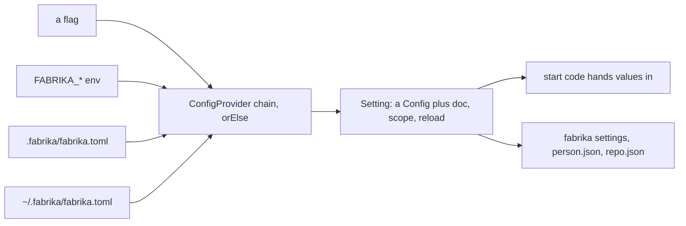

# 0086: Settings are declared once with Setting.make, read through Effect's ConfigProvider from two TOML files, scoped per file, and stop the start on a wrong value



```ts
// A sketch, next/. Setting is P38's room; its path is a sketch name.
export const port = Setting.make("instance.port", {
  schema: Schema.Int.check(Schema.isBetween({ minimum: 1, maximum: 65535 })),
  default: 18787,
  doc: "The port the local instance listens on.",
  scope: ["person"],
  reload: "restart",
});
```

**What this decides:** how every setting in fabrika is declared, where it is read from, which file
may set it, and what happens when a value is wrong.

## Context

[0069](0069-choices-are-settings.md) decided that a choice that fits as a `fabrika.toml` value is
one, declared once with its schema and default, and left open the order of sources and whether a
check enforces it. The [settings](../docs/direction/settings.md) note, from
[experiment 251](../experiments/251-settings.md), gives the whole shape. The owner walked each part
and approved it on 2026-11-10. It builds on 0069 and does not change it, so 0069 is cited, not
amended. It also builds on [0080](0080-a-running-copy-is-an-instance.md),
[0081](0081-no-question-word-names.md), [0082](0082-approvals-is-a-floor-for-every-run.md),
[0083](0083-every-program-in-a-pack.md), [0084](0084-own-pack-listed-by-path.md) on a repo's own pack
and [0085](0085-pack-cache-under-cache-folder.md) on the pack cache.

## Decision

**In `next/`, every setting is declared once with `Setting.make`, which is an Effect `Config` plus
its words, a required scope and how it reloads; it is read through a chain of `ConfigProvider`s
from flags, the environment, the repo's file and the person's file; and a wrong value stops the
start in words at its file, line and key.**

The seven principles:

- **S1.** A choice is a setting, and a short list never is: the step order, a wall, a secret, an
  identity, state, plumbing, the home, a security limit, a constant nobody varies.
- **S2.** Declared once; the file reader, env name, flag, print, editor schemas and error come from
  the declaration.
- **S3.** An empty file works: every setting has a default.
- **S4.** One order per key: flag, env, the repo's file, the person's file, the default; and every
  value says where it came from.
- **S5.** A wrong value, an unknown key or a key outside its scope stops the start, in words, at the
  file, line and key; a running app keeps the last good values.
- **S6.** Read at the edge, handed in, and recorded with its hash beside `build`.
- **S7.** What you can set comes from fabrika itself: `fabrika settings`, two JSON Schemas, the
  reference page.

The calls from the walk:

- **`scope`, required, a list:** `["person"]`, `["repo"]` or `["person", "repo"]`. No "both", no
  default. A Setting keeps its scope in its type, so one `Schema.Struct` per file decodes that file
  and makes its JSON Schema, named by a `#:schema` line.
- **Inside, a `Config`.** Sources are `ConfigProvider`s chained with `orElse`, handed in with
  `ConfigProvider.layer`; a test swaps the layer with `ConfigProvider.fromUnknown`.
- **TOML behind a `Toml` service** (parse with positions, set, remove). Its first Layer is on
  `toml-eslint-parser` 1.0.3, which replaces smol-toml in `next/`; a write is a text splice.
- **Settings per pack,** in `[pack.<name>.settings]`, declared by the pack as one group, read through
  a provider scoped to that pack. Both files may list packs; on the same name the repo's wins.
- **`review.human-approvals`** is the example of a repo setting; a flow holds the step order, and the file
  holds the floor.
- **`fabrika-version`** in the repo's file names the oldest fabrika it works with, is read first, and
  exists from the first version. No format number.
- **The design:** TOML tables per area and per pack, with a schema line, and each change the hands
  see a ledger fact. The file stays the source.

**Binding constraints:**

- No setting has a second reader, a second schema or a default outside its declaration.
- No key, field or option named `where`, `why` or `what` (0081).
- No machine reads a settings file or holds a provider in its Model.
- A key set in a file outside its scope stops the start; it is never skipped quietly.

## Consequences

- P38's plan builds the room, the providers, the `Toml` service and Tier 1's settings, from the
  note's table of Tier 1's choices.
- `next/apps/fabrika/src/stage-records.test.ts` writes a `pack.toml` beside its fixture programs and
  names them under the pack.
- The glossary gets `scope (setting)` and an amended `setting` row.
- Not decided here:
  - Whether `orElse` can say which file gave a value, or each file needs its own tagged provider.
  - What two instances on one laptop do when both take the default port.
  - Whether the brain's Worker gets each value as its own binding.
  - Whether a person reaches for `fabrika settings` at all.
