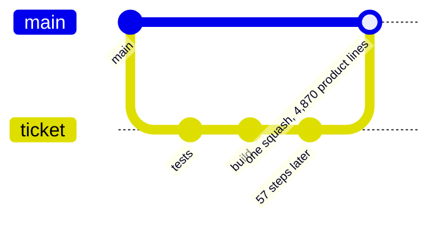
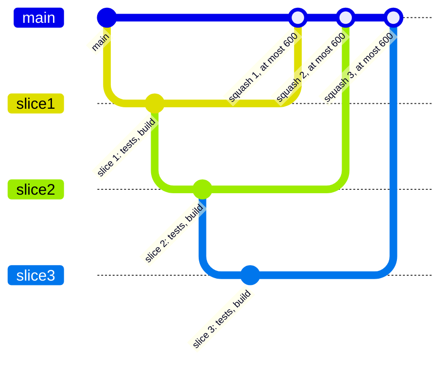

# 0087: A pull request changes at most 600 lines of product code, a repo setting, and bigger work is a stack of slices cut at plan time, as a trial that advises until it is replayed

**What this decides:** no pull request changes more than 600 lines of product code; a plan cuts
bigger work into a stack of slices, each one a pull request that lands whole, and a plan with a
slice over the cap is refused by code before any agent runs.

**Before:**



**After:**



One branch that grows until it lands becomes a stack of slices, each its own pull request through
every step, landing bottom up with [0004](0004-squash-merges-and-native-stacks.md)'s `gh stack`.

```ts
// A sketch, next/. `Setting.make` is from the settings note, docs/direction/settings.md (PR 852, 0086).
// The key name, its table and how lines are counted are for the build's plan.
export const lines = Setting.make("review.lines", {
  schema: Schema.Int.check(Schema.isGreaterThanOrEqualTo(1)),
  default: 600,
  doc: "The most product lines one pull request may change.",
  scope: ["repo"],
  reload: "restart",
});

// The plan lists its slices, each with its own estimate. A Schema filter on the plan,
// so a plan with a slice over the cap never decodes.
const slicesFit = (cap: number) =>
  Schema.makeFilter<Plan>((p) => p.slices.every((s) => s.estimate.lines <= cap), {
    expected: `every slice at most ${cap} product lines`,
  });
```

```toml
# .fabrika/fabrika.toml, a sketch
[review]
lines = 600   # the trial's starting number
```

## Context

**The first case, as a fact.** [PR 810](https://github.com/usirin/tea-fabrika/pull/810) (tracker
ticket 286, Tier 1's row P14) holds 4,870 product lines and 10,655 test lines in 94 files after 57
steps. It is to be restacked. [0072](0072-a-churning-lane-is-redone.md) already counted it as the
lane with the second most steps. [Tier 1's risks](../docs/plan/tier-1.md) say it plainly: a big
landing is a weak review.

**Why a cap.** A person cannot review much more than a few hundred lines well. By
[0079](0079-size-counts-governed-paths-name-who.md), a change's size sets how many people must look
at it, so a huge change costs people's time, agent time and compute at once. Tracker ticket 686
holds this decision.

What the sources say, and how well we read them:

- **Google's engineering practices,**
  ["Small CLs"](https://google.github.io/eng-practices/review/developer/small-cls.html) (read
  2026-11-10): "100 lines is usually a reasonable size for a CL", and 1000 lines "is usually too
  large".
- **SmartBear's study of code review at Cisco:** developers "should review no more than 200 to 400
  lines of code (LOC) at a time"
  ([SmartBear's best practices page](https://smartbear.com/learn/code-review/best-practices-for-peer-code-review/),
  read 2026-11-10). Its
  [case study page](https://smartbear.com/resources/case-studies/cisco-systems-collaborator/) gives
  the scale: 2,500 reviews of 3.2 million lines over 10 months. **Secondary:** both are the vendor's
  own summaries, and SmartBear sells a review tool. The primary write-up, the book *Best Kept
  Secrets of Peer Code Review* (SmartBear, 2006), was not read.
- **Our own data, [experiment 252](../experiments/252-risk-tiers-on-phoenix.md),** on 457 merged
  pull requests of one other public repo (phoenix, run through today's fabrika): small changes (50
  lines or fewer) had 1 of 78 (1.3%) later fixed, 51 to 400 lines 17 of 232 (7.3%), and large ones
  (over 400 lines) 17 of 147 (11.6%). Lines there are additions plus deletions, tests included. About
  70% sure, one repo, and some of size's edge may be that a big change shares more files with a
  later fix.

**600 sits above all three.** Google leans to about 100, SmartBear to 200 to 400, and our phoenix
data already shows more later fixes past 400. 600 is the owner's starting number, not one these
sources favor. It is replayed on this repo's own merged pull requests before it blocks anything.
AGENTS.md asks a blocking check to show about 0% false alarms, and up to 10% to only advise.

How it relates:

- **[0079](0079-size-counts-governed-paths-name-who.md), cited, not amended.** 0079 says size sets
  how many people must look, and leaves its cuts open. This record adds a cap on size itself and
  changes none of 0079's rules, so its status line stays. The size 0079 reads and the size this cap
  reads should be one count; the build's plan makes them one.
- **[0071](0071-risk-tier-decides-who-looks.md):** the cap reads the change, never the writer,
  as 0071's binding constraint asks.
- **[0082](0082-approvals-is-a-floor-for-every-run.md):** same shape, a repo setting checked as a
  Schema filter before any step runs. The cap is a ceiling on one slice, beside 0082's floor on
  people.
- **[0076](0076-a-lane-stops-at-its-budget.md):** the plan already gives an estimate in steps and
  dollars. Each slice now gives one in lines too. A slice that grows past the cap is the same kind
  of stop (Consequences).
- **[0072](0072-a-churning-lane-is-redone.md):** restacking PR 810 keeps its old branch and pull
  request as they are, as a redo does; nothing is rewritten.
- **[0004](0004-squash-merges-and-native-stacks.md):** the tooling. A stack is a GitHub stack, run
  with `gh stack`, each slice squash-merged bottom up.
- **[0014](0014-the-lead-merges-when-every-step-passed.md), as amended by
  [0066](0066-mutation-runs-on-a-schedule.md):** each slice is its own pull request, so it goes
  through every step (plan, tests, build, one review) and merges by 0014's rule.
- **[Every pull request goes through the steps](../docs/direction/next-is-a-pipeline-pre-run.md)
  and [how a change lands](../docs/plan/README.md#how-a-change-lands):** no builder starts before
  an approved plan, so the plan is the place to refuse. Docs-only decision pull requests and lead
  tooling keep their own paths there; whether the cap covers them is open below.
- **[0069](0069-choices-are-settings.md):** the cap is a number, so it is a setting.

## Decision

**A pull request changes at most 600 lines of product code, a number the repo owns as a setting,
and bigger work is a stack of slices the plan cuts, each of which lands whole, with a plan that
holds a slice over the cap refused by code before any agent runs (owner, 2026-11-10, a trial).**

- **The cap.** 600 product lines per pull request. It is a trial: a setting the repo owns, sketched
  as `review.lines`, default 600, scope `repo`.
- **Cut at plan time.** A plan for bigger work lists its slices. Each slice is one pull request
  that lands whole, with its tests, and works on its own (the plan skill's "pull requests that each
  land whole"). The stack runs on 0004's native stacks.
- **A check on the plan, as code.** The plan carries each slice's estimate in product lines. A plan
  with a slice estimated over the cap is refused before any agent runs. It is code, never a line of
  prose a planner may skip.
- **Advise first.** Until the replay on this repo's merged pull requests measures its false alarms,
  the check prints and names each slice over the cap, and does not refuse. It refuses once the
  replay shows about 0% false alarms.

**Binding constraints:**

- No slice is cut so it cannot land alone: each lands with its tests and leaves main working.
- The cap reads the change, never who wrote it (0071).
- Only the repo's settings file changes the number.
- The check runs on the plan, before the first agent of a slice starts.

## Consequences

- The plan's shape gains a list of slices, each with an estimate in product lines. Today that is
  lead tooling (`plancheck.sh` in the plan skill), fast-tracked
  ([0033](0033-agents-code-follows-next-rules.md)); in `next/` it is a field of the plan and a
  Schema filter, as sketched.
- When the check lands, the plan skill's prose line about splitting a big plan leaves the prose,
  since code checks it.
- The replay comes first: run the check over this repo's merged pull requests, count the ones it
  would have refused, and read each by hand. Until then it advises.
- PR 810 is restacked into slices. Its old branch and pull request stay as they are.
- The cost: more pull requests, each through every step, and a stack waits bottom up. A planner
  must estimate lines per slice, which no plan does today.
- To record from day one, on each plan check: each slice's estimated lines, the cap it was checked
  against, and whether it passed; on each merged slice, its real product lines, so estimate and
  real can be compared.
- Not decided here:
  - **Whether test lines count toward the cap.** The lean: they do not, since a person reads a law
    change only when it loosens one ([0014](0014-the-lead-merges-when-every-step-passed.md)). An
    experiment on test size is running and may change this.
  - **How product lines are counted exactly:** generated files, lockfiles, shots and docs. The
    build's plan picks. The known way to look at first is `.gitattributes`' `linguist-generated`,
    which GitHub's own diff uses to hide generated files.
  - **What happens to a slice that grows past the cap during the build.** The lean: the lane stops
    and asks, as 0076's budget does.
  - **Whether docs-only and lead tooling pull requests are covered.**
  - Whether a stack is one lane or one lane per slice.
  - The number itself, after the replay.

## Records

- Glossary: `slice` and `stack (pull requests)` added to the Pipeline section of
  [TERMS](../.glossary/TERMS.md).
- [AGENTS.md](../AGENTS.md): one line beside the pipeline steps rule.
