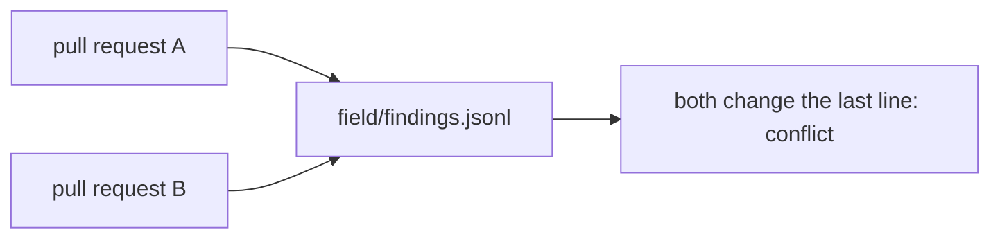
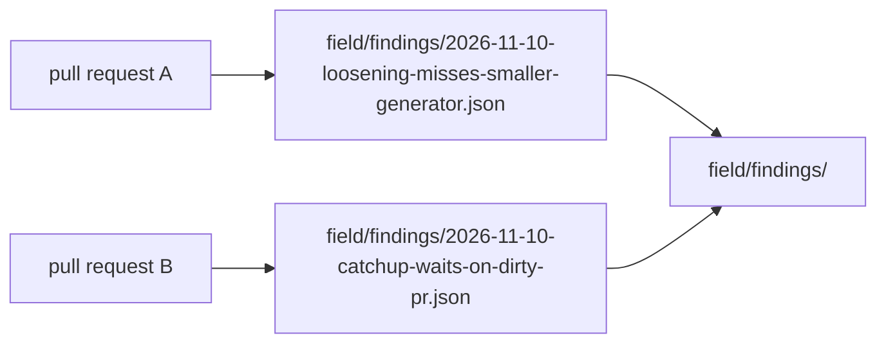

# 0090: Each field row is its own file named by its date and a short slug, never a line appended to a shared file

**What this decides:** a new finding, note or run row is written as one small file in
`field/findings/`, `field/notes/` or `field/runs/`, and its id is its file name; the old `.jsonl`
files stay as history.

## Context

Every pull request that logs work adds rows at the end of the same three files:
`field/findings.jsonl`, `field/notes.jsonl` and `field/runs.jsonl`. Two open pull requests that
each add a row both change the file's last line, so git sees a conflict. On 2026-11-10 this
stopped two merges, and one hand merge briefly pushed conflict markers.

`.gitattributes` already gives `runs.jsonl` and `notes.jsonl` git's `merge=union` driver, and an
open pull request adds `findings.jsonl` to it. That helps only a merge done by git on a laptop.
GitHub ignores custom merge drivers, so a pull request that adds a row still shows as
conflicting there, and its checks never start (finding `2026-11-10-f36`, rated `fix`). Union also
keeps both sides of a bad merge without a word, so a broken or doubled row lands silently.

The ids broke too. Each writer guessed the next counter (`<date>-f<nn>`, `<date>-<nn>`,
`<date>-r<nn>`) without seeing the other open pull requests, so two writers took the same one.
`findings.jsonl` on main holds `2026-11-10-f36` twice, for two different findings, and each
rating had to add a `head` to say which one it meant. `notes.jsonl` and `runs.jsonl` hold
repeated ids as well.

The known way is one file per entry. [changesets](https://github.com/changesets/changesets) writes
each change note as its own file in `.changeset/`, and
[towncrier](https://towncrier.readthedocs.io/) keeps one news fragment per change, both so that
pull requests never edit the same file. Tracker ticket 562 is the work.

This amends part of [0035](0035-outside-work-becomes-finding-rows.md): its "Where" rule (rows go in
`field/findings.jsonl`, one per line) and its "the one that lands second renumbers" line. The rest
of 0035 stands.

## Decision

**Each field row is its own small file in its log's folder, and its id is its file name: the date
plus a short kebab-case slug. Nothing appends to a shared file, and no counter is guessed.**

**Before:**



**After:**



```text
# before: one line each, appended to the end, ids from a guessed counter
field/findings.jsonl    {"id":"2026-11-10-f36", ...}  <- twice, from two writers
field/notes.jsonl
field/runs.jsonl

# after: one file each, the file name is the id; the old files stay as history
field/findings.jsonl                      unchanged, read alongside the folder
field/findings/2026-11-10-loosening-misses-smaller-generator.json
field/notes.jsonl
field/notes/2026-11-10-hand-merge-pushed-conflict-markers.json
field/runs.jsonl
field/runs/2026-11-10-review-ticket-562.json
```

The two pictures use the same pull requests: what moves is the file each one writes. The `.json`
extension shows the lean on format, below; it is not decided.

- **All three logs.** Findings, notes and runs each get a folder: `field/findings/`,
  `field/notes/`, `field/runs/`. A rating is a findings row too, so it is a file there.
- **The id is the file name.** `YYYY-MM-DD-<slug>`, the slug short and kebab-case, as in
  `2026-11-10-loosening-misses-smaller-generator`. The row's own id field (`id` on a finding or a
  note, `run` on a run) is the file name without its extension. There is no counter.
- **A clash is visible.** Two writers who pick the same slug on the same day add the same path,
  and git shows a plain conflict. Neither row lands on top of the other without a word.
- **Old rows stay as they are.** Field rows are never edited or deleted, so the three `.jsonl`
  files stay, with their old ids (`2026-11-10-f36`, `2026-11-08-102`, `2026-11-02-r01` and the
  like). A reader reads each folder and its old file together.
- **The row's fields do not change.** [field/README.md](../field/README.md) keeps each log's
  fields and what CI checks on them. Only where a row lives, and how its id is made, changes.

**Weighed and not taken:**

- Git's `merge=union` attribute. It keeps one file and works for a merge on a laptop, but GitHub
  does not run it, and it can hide a bad merge by keeping both sides.
- A [ULID](https://github.com/ulid/spec) as the id. It never collides, but nobody can read it or
  tell two rows apart by name.

**Binding constraints:**

- No new row is appended to `field/findings.jsonl`, `field/notes.jsonl` or `field/runs.jsonl` once
  ticket 562's build lands.
- No existing row is moved, renamed, edited or given a new id.
- A new row's id is never a counter.

## Consequences

- Everything that reads rows reads a folder plus the old file: the `field` CI job
  (`field-check.ts`), the rating page, and every report and count. That is ticket 562's build, not
  this file.
- [field/README.md](../field/README.md) says "three files, one record per line". It gets a one-line
  pointer here now; its full rewrite comes with the build. AGENTS.md's table and the skills that
  name `field/*.jsonl` change with the build too.
- Two id styles live side by side: the old counters in the `.jsonl` files and the new slugs in the
  folders. A reader that sorts or matches ids must accept both.
- The `merge=union` lines in `.gitattributes` keep doing no harm on files nobody appends to.
  Whether to drop them is the build's call.
- A writer now picks a slug, which takes a moment of thought a counter did not.
- **Not decided here:**
  - The format of one row file. One JSON object per file is the plain reading and the lean, not
    decided. The fields stay those field/README.md gives.
  - How a `step` run row, whose `run` id comes from its lane, names its file.
  - Grouping. If `field/runs/` grows unwieldy, it may be grouped by month; that waits until it does.
  - The code change itself, which is ticket 562's build.
