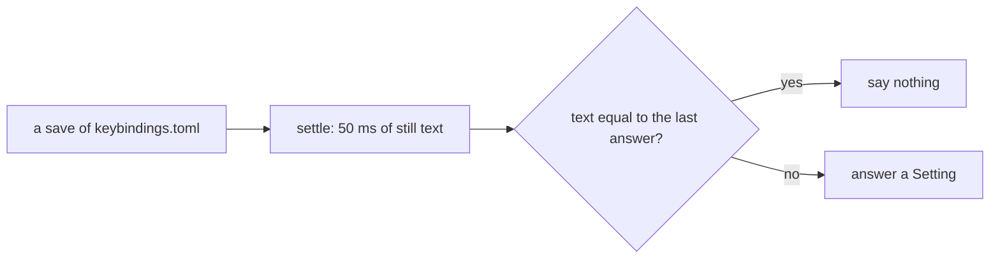
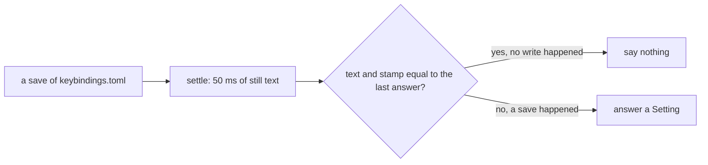

# 0092: The keys reader answers every save of the keys file, the same text included, and never skips a save because its text equals what it last said

**What this decides:** in today's version, `settingsSaves` in `apps/fabrika/src/host/settings.ts`
answers once for each burst of saves to `~/.fabrika/keybindings.toml`, even when the text is the
same as its last answer.

## Context

Today's version. The owner decided this on 2026-11-11, while checking
[pull request 646](https://github.com/usirin/tea-fabrika/pull/646) (the project window, ticket 276).

Each project gets its own fabrika window, with its own host
([a window is one project](../docs/direction/brain-hands-window-agent.md), and its look in
[the project window](../docs/direction/project-window.md)). So several running hosts share one
person's keys file. That is the normal case, not a rare one.

Each host's keys manager (`apps/fabrika/src/host/keybindings.ts`) also writes the file itself. Its
own save moves what it holds before its reader has answered that save. If another host then saves
the old text back, the reader sees text equal to its last answer. Under the old rule it said
nothing, and that host stayed on old shortcuts until the next real change.

The old rule came from ticket 553. Its plan's L5 said repeated saves never repeat an answer, and
`settings.test.ts` said "answers once, not again for each save" (the reader was then named
`settingsFile`, and deduped with `Stream.changesWith` on the text). The rule lived only in that plan
and those tests. No decision or decided note stated it, so no older record changes status here.
Pull request 646's plan amendment changed the rule (its L5b) without a record. This is that record.

## Decision

**The keys reader answers every save of the keys file, the same text included; it never skips a
save because the text equals what it last said.**

**Before:**



**After:**



The question moves from "is the text new?" to "was the file saved?".

```ts
// Today's version, apps/fabrika/src/host/settings.ts.
// before (ticket 553): one answer each time a save changes the text
settingsFile(folder, "keybindings.toml", decode); // Stream.changesWith on the text
// after (pull request 646): one answer for each save burst, the same text included
settingsSaves(folder, "keybindings.toml", decode); // a save is told by its stamp: mtime, size, inode
```

- One answer per burst of saves. The 50 ms settle still folds a burst into one answer.
- A save is told apart by the file's stamp (its mtime, size and inode), read with its text.
- A watch hint or a poll tick that finds the text and the stamp unchanged says nothing, readable or
  refused. Only a real write answers.
- The answer is the same `Setting` as before: `{_tag: "none"}`, `{_tag: "read", value}` or
  `{_tag: "refused", line, why}`.

## Consequences

- A host that missed another host's change catches up on the next save, whatever text it holds.
  Answering every save cannot leave a host on old shortcuts this way.
- Cost: a save that changes nothing makes each host reread the file and run its keys manager once
  for nothing. That is cheap, and the manager already skips a text it holds.
- Ticket 553's L5 no longer holds as written. Pull request 646 narrows L5 to ticks and hints with no
  write, and adds L5b: each save burst answers once, the same text and a refused read included.
- Not a setting ([0069](0069-choices-are-settings.md)): nobody would want a host that skips saves,
  so there is nothing to vary.
- Not decided here: how `next/` reloads settings. The `reload: "live" | "restart"` field in
  [settings](../docs/direction/settings.md) covers that.
