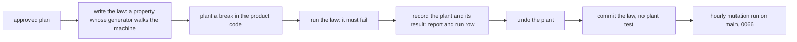

# 0093: Each law the tests step writes is a property that walks the machine, and each plant is run once and recorded, never kept, as a trial



```ts
// A sketch, after experiment 256's new file. One generator, folded through the real machine.
// Each event is read against the state the fold has reached, and picks a move that is possible there:
// a link Msg goes to the dial the link is on (or one off), an answer picks a Cmd that is really waiting.
const Run = fc.record({ layout, events: fc.array(fc.tuple(event, fc.nat()), { minLength: 10, maxLength: 150, size: "max" }) });
const near = (s: S, by: number): number => Math.max(1, (dialIn(s) ?? s.dials) + by);

// Kept: a property, or a fixed test whose title starts with one of the four labels.
it.prop("the window's client is the client machine's own fold", [Run], ([run]) => { /* ... */ });
it("format: every Msg the runner sends decodes through the machine's msg schema", () => { /* ... */ });

// Not kept: a plant test, or a hand-written list of cases.
it("plants: dropping the press row breaks the record law", () => { /* ... */ });
```

**What this decides:** the tests step writes each law as a property whose generator reads the state
it folds, it proves each law can fail by planting a break once and recording the result instead of
committing a plant test, and a lint rule checks that every test is a property or carries a label.

## Context

[Experiment 256](../experiments/256-law-file-size.md) measured P14's window machine law file (PR
810, `next/packages/tuval/src/window/machine.ts`). The old file had 4,243 lines and 148 tests: 71
property laws, 60 plants, 6 reach checks and 11 examples. It killed 95 of 150 sampled mutants (seed
119120) in 49 s. A rewrite of 1,365 lines with 7 tests (6 properties and 1 `format:` vector) killed
118 in 2.5 s. Its first version, written before any mutation result, killed 99. The rewrite's
generator reads the state it folds and picks the next move from what is possible there. The old
file needed seven hand-built list generators, each added after blind lists missed a case.

The doubts: one product file, one sample, and the rewriter had read the old file. So this is a
trial, with a second check before it is trusted.

The known way to walk a machine is model-based or stateful testing: fast-check's
[model-based testing](https://fast-check.dev/docs/advanced/model-based-testing/) (`fc.commands`,
fast-check 4.10.2 here), Hypothesis's
[stateful tests](https://hypothesis.readthedocs.io/en/latest/stateful.html), and tea's own
`arbGuidedSequence` in `@demlik/tea/pbt` 0.25.0, which drops an answer when no Cmd waits for it.

Relations:

- No accepted decision requires kept plants. The rule lives in prose and notes:
  [five steps for every check](../docs/direction/five-steps-for-every-check.md) step 3 says a
  planted break is "run every time", and
  [nobody writes their own exam](../docs/direction/nobody-writes-their-own-exam.md) lists "the
  planted mistakes" in the exam. Both get a one-line pointer to this file. Where they speak of a
  law seen to fail once, as [every machine has laws](../docs/direction/every-machine-has-laws.md)
  does, they still hold.
- The tests skill (`.agents/skills/tests/SKILL.md`) asks for a plant per law near its top, and the
  review skill (`.agents/skills/review/SKILL.md`) checks that each law catches its plant. Both
  change in the follow-up build below.
- [0066](0066-mutation-runs-on-a-schedule.md) holds as it is: its hourly run on main is what
  catches a law that checks nothing, after the merge.
  [0077](0077-mutation-gaps-carry-a-category.md) holds: a repeated gap category still files one
  ticket against the tests step.
- [0040](0040-existing-tools-before-hand-written.md) applies to the lint rule, below.
- [0087](0087-a-pull-request-caps-product-lines.md) holds: P14 is restacked under it, and its law
  file is the first one written this way.

## Decision

**The tests step writes each law as a property that walks the machine, and runs each plant once
without keeping it, as a trial (owner, 2026-11-11).**

- **A law walks the machine.** Its generator reads the state it is folding and picks the next move
  from what is possible there. No hand-written lists of cases. A single example stays allowed only
  when its title starts with `vector:`, `format:`, `pinned:` or `scenario:`, with its reason, as
  before.
- **A plant is run once, not kept.** The test writer still breaks the product code to prove each
  law can fail. It records each plant and its result in its report and in the lane's run row.
  The plant test is not committed.
- **A lint rule checks the shape.** Every `it` or `test` in a `next/` test file is a property, or
  its title starts with one of the four labels. A property is `it.prop` or `it.effect.prop`, a body
  that calls `fc.assert(fc.property(...))` or `fc.assert(fc.asyncProperty(...))`, or a body that
  calls one of `@demlik/tea/pbt`'s runners (`propertyTrace`, `propertyInvariant`,
  `propertyTerminates`). Oxlint's
  [`jest/valid-title`](https://oxc.rs/docs/guide/usage/linter/rules/jest/valid-title.html) can
  require a title pattern with `mustMatch`, but it cannot say "or the body is a property", so the
  rule is ours, in `oxlint-plugins/` (0040). It only advises until its false alarms are measured on
  main at about 0%; then it blocks.
- **A second check comes before the trial is trusted.** A fresh agent writes laws for a different
  product file from its plan alone, without having read that file's old tests. Both files run
  against the same mutant sample again (150 mutants of that file, seed 119120).
- **P14 goes first.** Its law file is rewritten this way as P14 is restacked under 0087.

**What ends the trial:** the second check's result. If the new file kills at least as many of the
sample as the old one, the trial ends and this stays the rule.

**What would reverse it:** the second check's new file killing fewer mutants than the old one, or
the hourly mutation run finding a law on main that kills no mutant although its recorded plant run
said it failed. Either brings kept plants, or hand-built lists, back to the owner in a change to
this file.

**Binding constraints:**

- A plant test is not a law, so removing one is not loosening and needs no owner read. Removing or
  narrowing a law still waits on the owner, as [0014](0014-the-lead-merges-when-every-step-passed.md)
  says.
- A plant that was not run, or whose result is not recorded, counts as not run: the law is not
  done.
- This covers laws on product code in `next/`. A lint rule's own planted lines
  (`oxlint-plugins/plants.test.ts`, `next/apps/fabrika/src/exam/plant.ts`) are that rule's test
  inputs and stay.

## Consequences

- Law files get smaller and faster. In experiment 256 the file went from 49 s to 2.5 s.
- The cost: a law that checks nothing can slip onto main and stay until the hourly mutation run
  (0066) catches it. The recorded plant run is the guard until then, and it is only as good as the
  record.
- The follow-up build, each through its own change, none of it in this file's pull request:
  - The tests skill: step 2 writes walking properties and runs plants once; step 4 and the
    "Never" list stop asking to keep plants; step 6 reports each plant and its result.
  - The review skill: check the report's plant record against each law, and plant a break in a
    scratch copy where a law looks weak, as now.
  - The lint rule in `oxlint-plugins/`, with its edge cases listed and a test each (0040), as an
    advice rule until its false alarms on main are counted.
  - The field run row: a place for each plant and its result.
  - P14's law file, rewritten in its restack.
  - The second check, as its own experiment.
- `loosening.sh` will list the removed plant tests in P14's rewrite as hits. The lead's hand check
  reads each as a plant, not a law, under the first binding constraint.
- Not decided here: what makes a generator "walk" well enough beyond the second check, and whether
  `arbGuidedSequence` becomes the one way to write one.

## Amendments

- 2026-11-11: the second check ran as [experiment 257](../experiments/257-second-check-blind-laws.md). A law file written from the plan alone, blind to the old tests, killed 98 of 144 mutants of `gateway/internal/waiting.ts`; the old file killed the same 98. By the rule above ("at least as many"), the trial ends and this stays the rule. One small file, so the write-up says what it cannot tell us.
