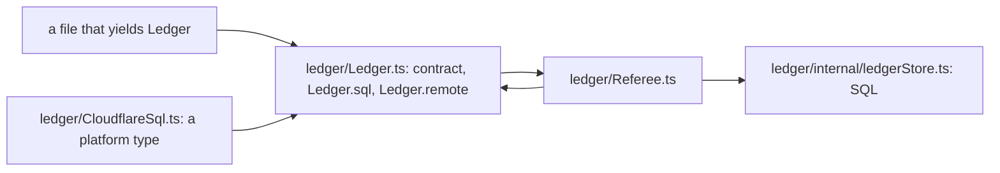
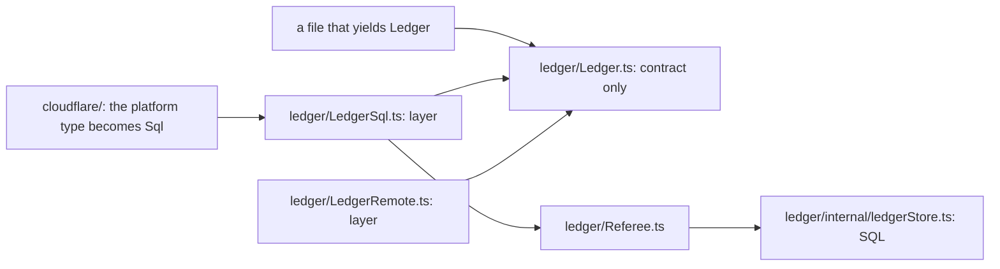

# 0095: In next/, a service file holds only its contract, each layer is its own sibling file, and a platform's adapter lives in that platform's folder

**What this decides:** code in `next/` is written to be a delight to read: every module is laid out
by domain-driven design, a bundle for one platform never pulls another platform's code or types,
and a service's definition is kept apart from the layers that implement it.

**Before:**



**After:**



```ts
// before: ledger/Ledger.ts
export class Ledger extends Context.Service<Ledger, LedgerShape>()("Ledger") {
  static readonly sql = (sql: Sql, who: Who) => /* imports Referee and the SQL store */;
  static readonly remote = (stub: LedgerCalls, who: Who) => /* decode and spans */;
}

// after: ledger/Ledger.ts holds the contract and nothing that runs
export class Ledger extends Context.Service<Ledger, LedgerShape>()("Ledger") {}

// after: ledger/LedgerSql.ts, read through its module like NodeFileSystem.layer
export const layer = (sql: Sql, who: Who): Layer.Layer<Ledger, never, Doorbell> => /* ... */;

// a caller
LedgerSql.layer(sql, { reader });
```

A sketch. What moves: the arrows out of `Ledger.ts` are gone, so reading or importing the contract
brings nothing else with it, and the cycle between `Ledger.ts` and `Referee.ts` ends.

## Context

After the folder move ([0043](0043-rooms-on-floors.md), [0091](0091-modules-and-layers.md)) the
owner asked for code that reads like poetry, and named four things: a delight for any reader,
domain-driven design inside every module, platform-clean bundles, and service definitions apart
from their layers.

A read of `next/` on 2026-11-11 (nothing was bundled or run) found:

- 35 `Context.Service` classes in libfabrika; 19 of them carry 24 static layer members.
- No static layer imports a platform package today. Platform code arrives through small interfaces
  passed as arguments.
- The cost is elsewhere. Importing the `Ledger` tag also loads `Referee` and a 451-line SQL store.
  `Ledger.ts` and `Referee.ts` import each other only because the layer sits in the tag's file.
  `gateway/Gateway.ts` is 1,641 lines, with contract, rules and SQL in one function, and its
  service type is inferred from that function.
- Two adapters sit inside `ledger/`, one of them using a raw platform type, against
  [0042](0042-platform-pieces-go-through-alchemy.md). One tsconfig gives every libfabrika file both
  Node and Cloudflare global types.

Effect's own packages split the same way: `FileSystem` and `SqlClient` are contracts in `effect`,
and their Node and Cloudflare layers live in platform packages. `effect`'s AGENTS.md teaches a
static layer as the default for a service with one implementation, so this decision departs from
[0023](0023-next-follows-effects-code-style.md) in that one place, and 0023 is amended in part.
[Where each piece lives](../docs/direction/where-each-piece-lives.md) already says each platform's
implementation is a Layer on a subpath.

## Decision

**In `next/`, a service file holds only the service's contract; every layer that implements it is
its own sibling file read through its module; and anything that names a platform lives in that
platform's folder.**

- **Readable first.** A module is small and says one thing. A reader should be able to follow a
  file top to bottom without opening another to understand it.
- **Domain-driven design inside every module.** A module keeps three kinds of file apart: the
  domain (schemas and pure rules, no SQL and no Effect service), the application (service
  contracts and the code that composes them), and the infrastructure (SQL, stores, adapters, under
  `internal/` or in a layer file). One file is one of the three.
- **A service file is the contract.** It holds the service class, its own error, the types and
  small interfaces it speaks in, and no layer, no SQL and no code that runs. The service's type is
  written out, never inferred from an implementation.
- **A layer is a sibling file,** named for the service and the variant, exporting `layer`:
  `LedgerSql.layer(...)`, `LedgerRemote.layer(...)`, as Effect writes `NodeFileSystem.layer`
  ([0029](0029-format-and-names-follow-effect.md), [0032](0032-libraries-take-effects-file-layout.md)).
  A memory or test layer is a sibling too.
- **No static layer members** on a service class, platform-free ones included. One rule reads more
  evenly than a rule with an exception.
- **Platform code lives in its platform's folder.** A file under a domain module names no platform
  package and no platform global type. The adapter that turns a platform handle into our own small
  interface lives in `cloudflare/` or `node/`.
- **A bundle for one platform holds no other platform's code,** and the checks say so, not review.

**Binding constraints**

- New code in `next/` follows this from now. Existing services move in slices, each a pull request
  with its plan, tests, build and review, inside the 600-line cap
  ([0087](0087-a-pull-request-caps-product-lines.md)).
- `Gateway` and the Cloudflare services get an explicit service interface before their layers move.
- Each rule that code can check becomes a check: a lint rule that a `Context.Service` class has no
  static that returns a `Layer`; an import ban on platform packages inside the domain modules; a
  tsconfig per folder, so a domain module cannot name a platform global; and the browser bundle
  exam also fails when a contract file reaches a store.

## Consequences

- One more file per layer. A reader looking for "how is `Ledger` built" opens a sibling, not the
  same file.
- A departure from `effect`'s AGENTS.md example. 0023's status names this record.
- The bundle saving is reasoned, not measured. Bundling a contract file alone, both ways, would
  settle it, and the first slice does that.
- Not decided here: separate platform packages with their own export maps. 0043 leaves that open,
  and it stays open.
- Not decided here: which module moves first. The plan picks; `ledger` shows every part of the
  rule, and `gateway` is the largest.
