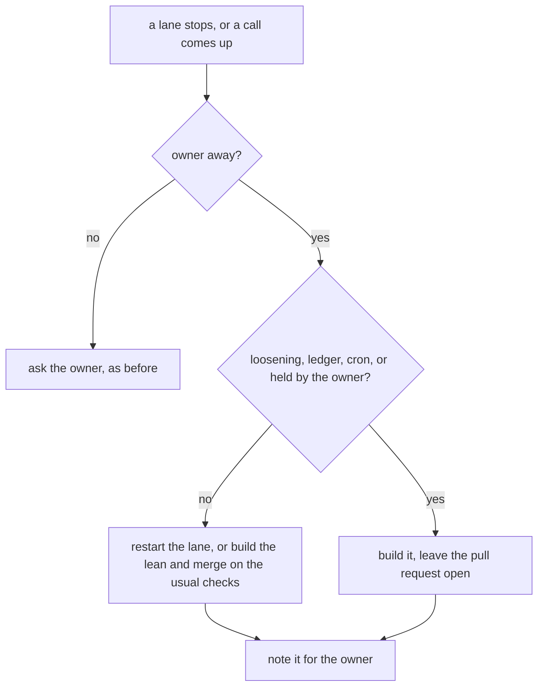

# 0096: While the owner is away, the lead restarts a lane its budget stopped and builds its lean as an open pull request, never a list of questions

**What this decides:** when the owner is asleep or away, the lead keeps every lane moving and
leaves pull requests to read, not questions to answer.

## Context

[0076](0076-a-lane-stops-at-its-budget.md) stops a lane at its window or its backstop and asks a
person to redo, cut scope or drop. Overnight on 2026-11-11 three lanes stopped that way and
several calls were parked for the morning. The owner ruled that lanes keep going through the night
and that the morning shows pull requests, not only questions (tracker ticket 675 holds the
budget trial).

This amends 0076 in part: who answers its stop while the owner is away. Its window, its backstop
and its three answers stand. It builds on
[0014](0014-the-lead-merges-when-every-step-passed.md) and
[0056](0056-lead-runs-a-refused-step-itself.md).

## Decision

**While the owner is away, the lead answers a lane's budget stop itself and builds its lean on
any open call as a pull request; only the calls that are the owner's alone stay unmerged.**

- A lane stopped by 0076's window or backstop, where the lead's read is "go on": the lead
  restarts it at once and notes it for the owner. A restart resets the window and the dollars, so
  the note says what was spent before.
- Where the lead's read is redo, cut scope or drop, it does that as a plan amendment or a fresh
  lane, also noted.
- A design call with a lean is built as a pull request. If nothing in it is the owner's alone, it
  merges by 0014. If something is, it stays open, with the lean, its cost and how sure in the
  body.
- A free slot is filled from the queue, up to the agent cap
  ([0012](0012-twelve-agents-at-once.md)).
- The owner's alone, built but never merged by the lead: a real loosening of a law, a new ledger
  entry or cron ([0033](0033-agents-code-follows-next-rules.md),
  [0067](0067-hourly-mutation-runs-in-ci.md)), a new design call no decided note
  answers, and anything the owner held or rejected.
- The owner hears one line only when something cannot wait. Everything else is on the status
  the lead keeps.

## Consequences

- A lane can spend past its budget overnight with no person in the loop. The backstop still stops
  each run; the cost is that the lead, not the owner, judges "go on". The trial's numbers must
  count a lead restart as its own outcome, or the trial reads as fewer stops than happened.
- The owner wakes to more open pull requests and fewer questions.
- Not decided here: a dollar ceiling for one night, and how the status shows a lead restart.
