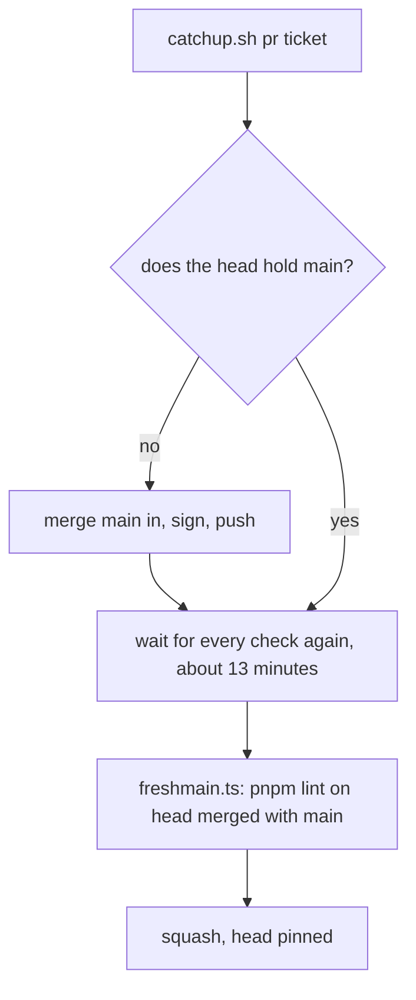
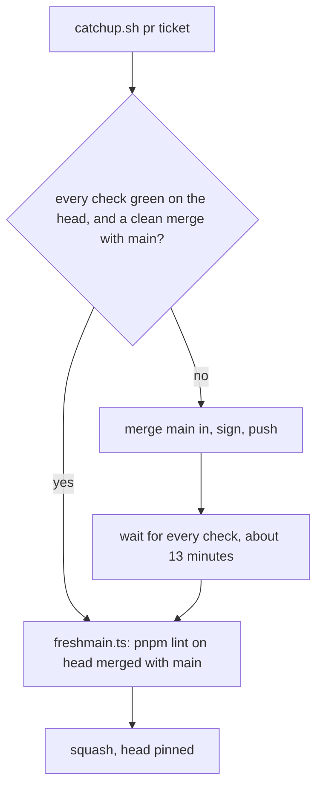

# 0097: A green pull request that merges cleanly lands as it is, with only lint run on the true merge, never a catch-up and a second full CI run

**Before:**



**After:**



```text
before  green head, behind main  ->  merge main in, full CI again, lint on the true merge, squash
after   green head, behind main  ->  lint on the true merge, squash
```

The catch-up and its second CI run leave the path of a pull request that is already green.

**What this decides:** the lead's merge script does not merge main into a pull request whose checks
are green on its head and whose merge with main is clean; it runs the lint on the true merge and
squashes.

## Context

On 2026-11-11 about 20 finished pull requests stood in one line after a CI outage. `catchup.sh`
merged main into each one and waited for every check again, about 13 minutes each, so the line was
hours long.

[0049](0049-merge-behind-main-once-lint-passes-on-the-true-merge.md) already lets a green pull
request land behind main once `pnpm lint` passes on its true merge. The script used that only when
main moved during its own wait: it still caught every pull request up first. This decision removes
that first catch-up for a pull request that is already green. It amends 0049 in part: 0049's rule
and its binding constraints stay, and "when main moved after the checks" now covers a head whose
checks ran before the script started.

The [ship stage rules](../docs/direction/ship-stage-rules.md) say the same for the product's own
ship stage: a branch behind main ships as it is. The review is on the diff, so the diff a reviewer
read is the diff that lands.

## Decision

**A pull request whose every check is green on its head, and whose head merges cleanly with
current main, lands without a catch-up: `freshmain.ts` runs `pnpm lint` on the true merge, then the
squash goes in pinned to that head (owner, 2026-11-11).**

- "Green" is every check the script waits for today, on the exact head: check, e2e, next, commits
  and the tests, where the changed paths run them.
- A head with a red, missing or running check takes the old path: merge main in, sign, push, wait.
- A head that conflicts with main is refused, as today. The lane merges main and pushes.
- The tests and the type check do not run on the true merge before it lands. Main's own CI run
  after the merge is where a clash between two pull requests shows.

**Binding constraints**

- The head stays pinned. A head that moved since its checks is refused.
- The lint on the true merge runs and fails closed. No flag skips it.
- No auto-merge, no `--admin`, no force push.

## Consequences

- A green pull request lands in about the time of one lint run, not one CI run. A line of finished
  pull requests no longer waits on itself.
- The cost, as in 0049: a break that only tests or types would catch between two pull requests can
  be red on main for about one CI run. The lead fixes it the same turn. One was seen the day this
  was decided: a law that would have passed without testing its field after a rename on main. A
  reader caught it; lint alone would not have.
- What we watch: red runs on main that follow a merge landed this way. If they are common, that is
  the evidence to bring back to the owner.
- Not decided here: branch protection and the ruleset, which stay the owner's switch.
