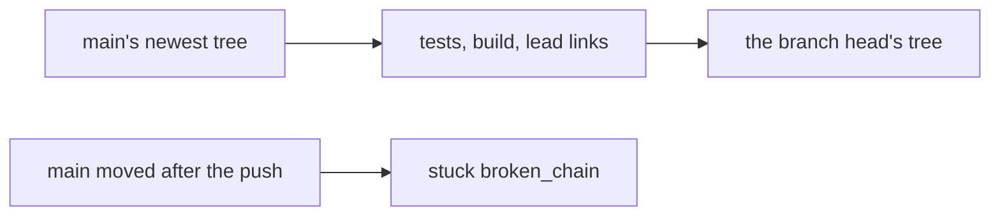
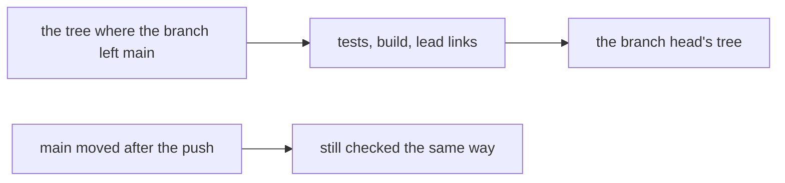

# 0098: The signed chain covers a branch's own change, from where it left main to its head, and a branch behind main is never refused for that

**Before:**



**After:**



```text
before  commits check: main's newest commit must be an ancestor of the head, else stuck broken_chain
after   commits check: every commit from the merge base to the head has a valid link, in order
```

The start of the chain moves from main's newest tree to the tree where the branch left main. What
is checked between the two ends does not change.

**What this decides:** the `commits` check judges the commits a branch added, and it no longer
answers `stuck broken_chain` because main gained a commit the branch does not hold.

## Context

On 2026-11-11, five finished pull requests were red on `commits` and nothing else. Each had been
pushed a few minutes after another merge, so main's newest commit was not in the branch, and the
check answered `stuck broken_chain`. The only cure was to merge main in and wait for every check
again, and the same thing could happen on the next push.

The rule came from [a unit of work is a commit](../docs/direction/a-unit-of-work-is-a-commit.md):
the first link starts at main's tree and the last ends at the squash commit's tree. That reads well
when one pull request lands at a time. With many in flight it ties each one to every other merge.

[0049](0049-merge-behind-main-once-lint-passes-on-the-true-merge.md) and
[0097](0097-a-green-pull-request-lands-without-catching-up.md) already let a green pull request
land behind main. A check that fails every branch behind main undoes both. This decision amends,
in part, that note and
[code commits and signs each step](../docs/direction/code-commits-and-signs-each-step.md), whose
rule that a branch behind main gets a `lead` merge link before it can merge no longer holds.

## Decision

**The signed chain starts at the tree where the branch left main (its merge base) and ends at the
branch head's tree. A branch that is behind main is checked the same way as one that is not (owner,
2026-11-11).**

- At pull request time, `commits` no longer reads whether main's newest commit is an ancestor of
  the head. Every other answer stays: `unsigned_commit`, `build_touched_exam`, `no_exam_list`,
  `stale_link` and `ask exam_read`.
- `broken_chain` stays for a real gap: a link that does not start where the last one ended, or a
  chain that does not reach the head's tree.
- After a squash, the chain is read against the pull request's own change, not against whatever
  main held when it landed.
- A merge of main into a branch is still a `lead` link when one is made. It is no longer required.

**The merge cycle is not the release cycle.** A pull request lands when its own checks pass. Main
turning red after two pull requests clash is a new ticket, fixed the same turn, not a reason to
make every pull request wait on every other.

**Binding constraints**

- Every commit a branch adds still needs a valid link from its own step's key. This decision
  removes no signature.
- A builder still may not change an exam path.
- No history rewrite, no force push.

## Consequences

- A finished pull request stays green on `commits` while main moves. With 0097 it lands in about
  the time of one lint run.
- The cost: the chain no longer proves the squash's tree by itself. The squash is the head's
  change applied to main by a clean merge, and the lint on the true merge is the check on it
  ([0049](0049-merge-behind-main-once-lint-passes-on-the-true-merge.md)).
- Main can be red for a short time after a clash that only tests or types would catch. What we
  watch is how often.
- Not decided here: moving tests off the pull request and onto a schedule, as mutation already is
  ([0066](0066-mutation-runs-on-a-schedule.md)). The owner named it as the direction; it needs its
  own decision. Also not decided: what a release is and what gates it.
