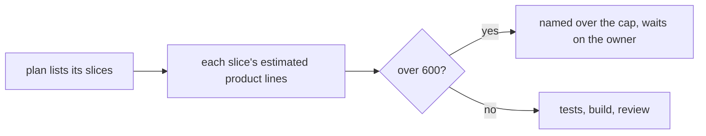
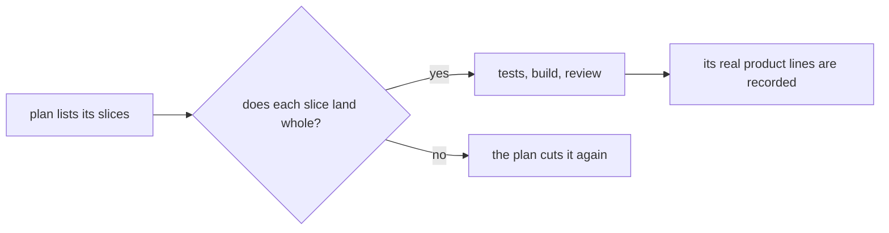

# 0099: No number caps the size of a pull request, and a plan still cuts big work into slices by what lands whole

**Before:**



**After:**



```text
before  a pull request changes at most 600 product lines; one over the cap waits on the owner
after   no line count stops, refuses or holds a pull request; its size is recorded, never judged
```

The number leaves. The question a plan asks of a slice stays: does it land whole, with its tests,
and leave main working?

**What this decides:** [0087](0087-a-pull-request-caps-product-lines.md)'s 600-line cap is gone,
and with it the plan check that names a slice over the cap.

## Context

0087 set the cap on 2026-11-10 as a trial that only advised. One day of use showed its cost. A
slice that was one whole thing, such as
[PR 926](https://github.com/usirin/tea-fabrika/pull/926) at 1,069 product lines, was held as "over
the cap" although nothing in it could land alone. The choices were to cut it where no clean cut
exists, or to wait for the owner. Both slow the work and neither makes the change safer.

The number was never measured here: 0087 itself says 600 is a starting number that no source
favors, and its replay on this repo's merged pull requests had not run.

What 0087 was after still matters: a huge landing is a weak review
([Tier 1's risks](../docs/plan/tier-1.md)). The plan's slices answer that, by meaning and not by
count. This record amends 0087 in part: its cap, its `review.lines` setting and its plan check go;
its slices, its stacks and its "each slice lands whole" stay.

## Decision

**No number caps a pull request's size: nothing stops, refuses or holds a pull request for its
line count, and a plan still cuts big work into slices, each of which lands whole with its tests
(owner, 2026-11-11).**

- A pull request is not "over the cap". Its size is no reason to wait on the owner.
- There is no `review.lines` setting and no check of a slice's estimated lines against a number.
- A plan still lists its slices when the work has more than one part that can land alone. The cut
  is by what works on its own, never to fit a count.
- Size is still recorded: each slice's estimated product lines in the plan, and its real product
  lines on the merged pull request ([record wide, read later](../AGENTS.md)).

**Binding constraints**

- No slice is cut so it cannot land alone (kept from 0087).
- [0079](0079-size-counts-governed-paths-name-who.md) is not changed: size may still say how many
  people look. This record only removes the ceiling.

## Consequences

- Pull requests held only for size, PR 926 among them, land by
  [0014](0014-the-lead-merges-when-every-step-passed.md)'s rule like any other.
- AGENTS.md's cap line is replaced by the slicing rule.
- The cost: nothing mechanical stops a 5,000-line landing like
  [PR 810](https://github.com/usirin/tea-fabrika/pull/810) any more. The guards left are the plan's
  slices, the lead's read of the plan, and [0076](0076-a-lane-stops-at-its-budget.md)'s budget in
  steps and dollars. PR 810 is still restacked.
- Not decided here: whether a measured size ever advises again. The recorded estimates and real
  sizes are there if someone asks.
