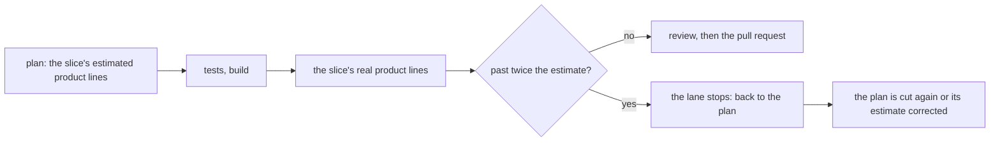

# 0100: A slice that grows past its own plan's size goes back to the plan, never into another patch, and the number is the plan's own estimate



```text
plan      slice 2: about 300 product lines
build     the branch now changes 900 product lines
answer    stop, not one more build round: the plan was wrong about this slice, fix it there
```

**What this decides:** the size check on a slice compares it with what its own plan said, and a
slice that has outgrown that goes back to the plan.

## Context

[0099](0099-no-number-caps-a-pull-request.md) removed the 600-line cap because nobody could say
where the number came from. It kept a printed warning drawn from this repo's merged pull requests.
That warning says "large next to the others". It does not say "this went wrong".

A team that runs the same kind of loop keeps a stop-loss beside it: a second failed review on one
pull request, or a diff over its stated size, sends the work upstream and not into another patch on
the symptom. The size half answers the question 0099 left open. The number is nobody's pick: it is
the plan's own estimate for that slice, which plans already carry
([0087](0087-a-pull-request-caps-product-lines.md), kept by 0099).

We already do this for steps and dollars.
[0076](0076-a-lane-stops-at-its-budget.md) stops a lane at twice the plan's estimate in steps and
dollars, and [0072](0072-a-churning-lane-is-redone.md) redoes a churning lane from its plan. Lines
were the one estimate with nothing reading it. This record amends 0099 in part: its warning from
merged pull requests stays, as a backstop only.

## Decision

**A slice whose real product lines pass twice its plan's estimate stops and goes back to the plan:
the plan is cut again or its estimate is corrected, and no further build round patches it (owner,
2026-11-11).**

- The number compared against is the slice's own estimate in the approved plan. No repo-wide number
  is involved.
- The margin is twice the estimate, the same backstop 0076 uses for steps and dollars, so a lane
  has one rule for all three.
- "Back to the plan" means what 0072 means: the lead or the planner reads why the slice grew. The
  answer is a new cut, a corrected estimate with its reason, or a drop. The work done is kept on
  its branch.
- A plan with no line estimate for a slice cannot be checked. That is a plan gap, named at plan
  check time.
- The warning from our own merged pull requests (0099) still prints. It is the backstop for a plan
  whose estimate was itself far too large.

**Binding constraints**

- The check never blocks a merge of a slice that stayed within twice its estimate, whatever its
  absolute size.
- It reads the change and the plan, never who wrote either
  ([0071](0071-risk-tier-decides-who-looks.md)).

## Consequences

- An honest estimate matters more: a planner who pads every estimate is never stopped. The record
  of estimate against real lines, kept since 0087, shows padding over time.
- Until the check is code it is the lead's read at each step's end. It becomes code in the lane's
  budget check, beside steps and dollars, as a ticket; it is lead tooling
  ([0033](0033-agents-code-follows-next-rules.md)).
- The cost: a slice that grew for a good reason stops once and needs a person or the planner to say
  so.
- Not decided here: whether a second failed review on one pull request also sends the work back to
  the plan. 0076's "3 of the last 5 steps" covers most of it today.
- Not decided here: whether twice is the right margin for lines. It is 0076's number, taken for
  consistency, and the recorded estimates and real sizes can test it.
