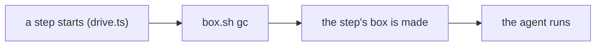
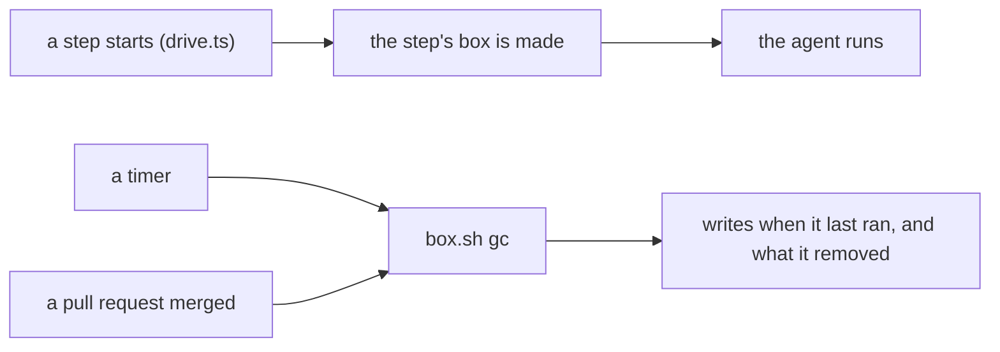

# 0101: Box cleanup runs on a timer and after a merge, never on a step's start path, as the first trial of moving a job from the lane to a loop

**Before:**



**After:**



```text
before  every step start waits for the cleanup to finish
after   no step waits for it; it runs on its own clock and says when it last ran
```

The cleanup moves off the path every step takes. What it removes does not change here.

**What this decides:** a step's start no longer runs or waits for `box.sh gc`; a timer and each
merge do.

## Context

On the night of 2026-11-10 the cleanup hung on Docker from 21:13 to 02:00. It runs at the start of
every step, so 12 step starts waited more than 6 minutes each: about 8.4 lane-hours, for a job no
step needs the answer of. Mutation testing already left the lane for an hourly run on main
([0066](0066-mutation-runs-on-a-schedule.md), [0067](0067-hourly-mutation-runs-in-ci.md)).

The known way: Kubernetes removes dead containers and unused images from a background loop in the
kubelet, never inside "start a pod". Starting work and tidying up are separate jobs.

AGENTS.md says repo tooling adds no Claude Code hooks and that a tool runs when called, with
`drive.ts` running `box.sh gc` itself on start. This record changes the second half: the caller is
now a timer and the merge script. It adds no hook. A new scheduled job is the owner's call
([0033](0033-agents-code-follows-next-rules.md), 0067); this is that call.

## Decision

**`box.sh gc` runs on a timer and once after each merge, and no step's start path runs it or waits
for it (owner, 2026-11-11, a trial).**

- The timer's period is a setting, with a default the build's plan picks and measures.
- Every run writes one fact: when it ran, how long it took, what it removed, and whether it failed.
  A reader can always answer "when did it last run".
- A run that is late is named: the status a person reads says so when the last run is older than
  two periods.
- Two runs never overlap. A run that finds one going ends at once.
- A step that finds no room for its box (disk, a name still standing) fails with that reason. It
  does not start a cleanup of its own.

**Binding constraints**

- The cleanup removes nothing it would not remove today. What it may remove is
  [PR 889](https://github.com/usirin/tea-fabrika/pull/889)'s question, decided apart.
- No Claude Code hook. The timer is an OS or repo scheduler a person can list and stop.
- The laptop caps in AGENTS.md hold: one Docker box at a time, `nice`.

## Consequences

- A step start gets faster by the cleanup's time, and a hung cleanup stalls nothing.
- The cost: the disk can grow between runs, and a dead timer is silent unless the "last ran" fact
  is read. That is why the fact and the late warning are part of the decision, not extras.
- AGENTS.md's line about `drive.ts` running `box.sh gc` on start is replaced when the build lands.
- This is the first trial of a wider question: which jobs belong in every lane, which in a queue
  and which on a timer. Its guidelines are being studied and are not decided here. What this trial
  should teach: what a loop needs to be trusted, and how late is fine for a job like this.
