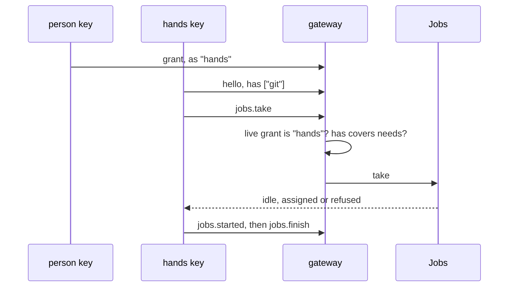

# 0102: A machine that runs jobs dials in with a key granted as `hands` and asks for work with `jobs.take`, and the first job is `git --version` on one selected host



**Before**, a grant lets a key in as one of two kinds:

```ts
{ key: "…", for: "<person>", to: "<ledger>", as: "window" } // or as: "agent"
```

**After**, a third kind, and one call only that kind may make:

```ts
{ key: "…", for: "<person>", to: "<ledger>", as: "hands" }

{ jsonrpc: "2.0", method: "jobs.take", params: { process: "…" } }
// answers "idle", "assigned" or "refused"
```

`as` gains `"hands"`, and work is pulled, never pushed.

**What this decides:** the two scope calls the hands plan (Tier 1 row P39) left to the owner: what
its first job is, and how a machine is allowed to take work.

## Context

P39's plan raised two new design calls. Its first slice was built on the plan's leans while the
owner was away ([0096](0096-the-lead-fixes-forward-while-the-owner-is-away.md)) and stayed open as
[pull request 917](https://github.com/usirin/tea-fabrika/pull/917). The owner answered both on
2026-11-11.

What was already settled, and stays: a client says what it can do in its hello, under `has`, and
that is what keeps a build away from a browser tab. A capability says "can", never "may"; whether
a client may do something is a grant on the ledger
([capabilities](../docs/direction/brain-hands-window-agent.md#capabilities)). The notes asked for
that split and left its wire shape open.
[0068](0068-tiers-carry-every-part.md) calls the one-host shape of the thin slice a sketch, not a
ruling.

## Decision

**A machine that runs jobs is its own kind of key, `hands`, and it asks for each job.**

- A grant's `as` gains `"hands"`, beside `"window"` and `"agent"`. A person key signs it, as with
  the other two.
- A `hands` key may call the jobs methods (`jobs.take`, `jobs.started`, `jobs.finish`,
  `jobs.read`). It gets none of a window's rights: it signs no grant and reads no person-only
  view.
- `jobs.take` is the only way work reaches a machine. Calling it is the machine saying it is
  willing to work now. Nothing is offered to a client that did not ask.
- The gateway checks three things on every take, each from its own source: the live grant is
  `hands` (may), the hello's `has` covers the job's `needs` (can), and the call itself (willing).
  None implies another.
- The caller's identity comes from the authenticated connection. Parameters never carry `by`, a
  rank or a replacement target.
- **P39's first job is `git --version`, on one host a person selects.** A job whose host is lost
  is not moved to another host by code; a person reopens it.

**Binding constraints**

- No window or agent key takes a job, and no hands key acts as its person.
- A browser tab can be a `hands` client: the methods need JSON, signing and a WebSocket only.
- Competing claims, leases and automatic reassignment stay Tier 4 work
  ([0068](0068-tiers-carry-every-part.md)).

## Consequences

- The signed grant schema, the rank list in `Access` and the gateway's pending and granted shapes
  each gain one case, with their laws. That lands in a later P39 slice; slice 1 adds only the jobs
  module and does not touch access.
- The first command only proves the path: a real command crosses from the brain to a laptop and
  its result comes back. It does no useful work yet.
- Recovery from an uncertain job is by hand until Tier 4.
- Not decided here: the names of capabilities under `has`, how a person selects the host in the
  app, and what a second job is.

## Records

- `.glossary/TERMS.md` gains the row "hands key".
