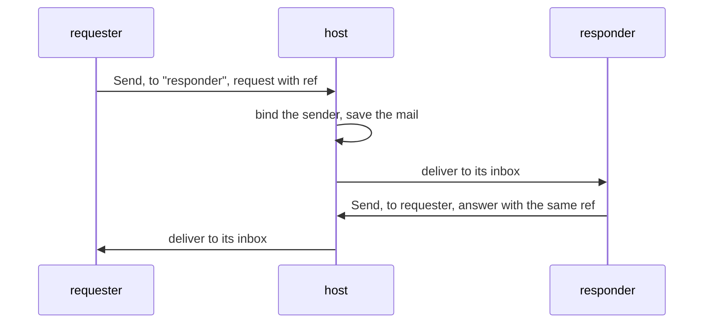

# 0103: A program may send mail to another program's named mailbox and get a reply, beside pipes, and the host carries it



**Before**, programs meet one way: a program prints an output and a line wires it to the next.

```text
asks | ticket
```

**After**, a program may also return a `Send` command. The host delivers it and the reply comes
back as mail:

```ts
// requester asks for the successor of 7
{ type: "request", ref, value: 7 } // Send, to the mailbox named "responder"
// later, in requester's own inbox
{ type: "answer", ref, value: 8 }
```

A pipe goes one way. Mail can ask and be answered.

**What this decides:** the one design question the plan for programs working together (Tier 1 row
P41) left to the owner.

## Context

[G6](../docs/direction/program-guidelines.md) says programs meet on typed pipes and never call
each other. A pipe joins one chain in one direction, so a program cannot ask another a question
and wait for the answer. P41's plan proposed a named-mailbox `Send` as an explicit addition to
G6, and its first slice was built on that lean while the owner was away
([0096](0096-the-lead-fixes-forward-while-the-owner-is-away.md)), as
[pull request 929](https://github.com/usirin/tea-fabrika/pull/929). The owner said yes on
2026-11-11.

## Decision

**Programs have two ways to meet: a pipe, for a person composing them in a line, and mail, for a
program asking another in code.**

- A program returns a `Send` command naming the target's mailbox. It never imports, starts or
  calls the other program. G6's first rule holds unchanged.
- The host carries the mail. It binds the sender from the running process, never from a
  parameter, and saves the mail before it schedules the target.
- A reply is mail too, matched by the `ref` the request carried.
- This follows OTP: processes share nothing and meet through messages in a mailbox.

**Binding constraints**

- No program reads another program's state or mailbox. It sends, and it reads its own inbox.
- Delivery and authority stay with the host: a program cannot deliver mail itself.

## Consequences

- There are two composition mechanisms where G6 had one. A plan that composes programs says which
  it uses and why.
- Not decided here: whether a pipe becomes shell syntax on top of this same mail path, so there is
  one transport. The owner wants that tried. Mail is saved before it is delivered, so a stream of
  many small outputs may cost too much on it; an experiment measures that before pipes are built
  in `next/`.
- Real delivery between instances and the pack example a person can run are P41's later slices.
