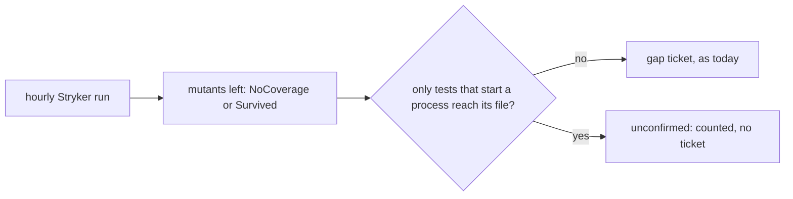

# 0104: A mutant that only a test starting a child process could kill is marked unconfirmed and files no ticket, never re-tested by a second pass of our own

**What this decides:** what the hourly mutation run does with a mutant it cannot judge, and that
the hand-built second pass is not merged.

## Context

A test that runs the code under test in a child process can never kill a mutant: Stryker's vitest
runner switches the mutant on only inside its own test worker, and the child runs the code
unchanged. Those mutants read as NoCoverage or Survived, and the hourly run
([0066](0066-mutation-runs-on-a-schedule.md), [0067](0067-hourly-mutation-runs-in-ci.md)) filed
false gap tickets for them (tracker ticket 265).

[Pull request 925](https://github.com/usirin/tea-fabrika/pull/925) built a second pass of our own
that writes each such mutant to disk and runs the process-starting tests again. No other Stryker
user was found doing that. It is about 830 lines for a gap in a tool we do not own, and two of its
numbers were guesses. [0040](0040-existing-tools-before-hand-written.md) says to use what the tool
has before writing our own. The owner picked the plain way on 2026-11-11.

## Decision

**The run says "cannot tell" for these mutants and files nothing for them.**

- A mutant left NoCoverage or Survived, in a file whose only related tests start a process, is
  counted as `unconfirmed` in the run's result. It files no gap ticket and does not count against
  the daily ticket cap.
- The run reports the count and the files each hour, so the size of the blind spot stays visible.
- The gap in Stryker is reported upstream. If a release closes it, this rule goes with the bump.
- Pull request 925 is closed, not merged.

## Consequences

- Real test gaps in code that only child-process tests reach stay unseen for now. The hourly
  count says how large that is.
- Looking at those files (should the test call the code in process, or is the child process the
  point?) is its own later piece of work, sized from the count.
- Not decided here: how "starts a process" is detected. The ticket that builds this picks the
  simplest check that Stryker's own report and config allow, before any of our own.
