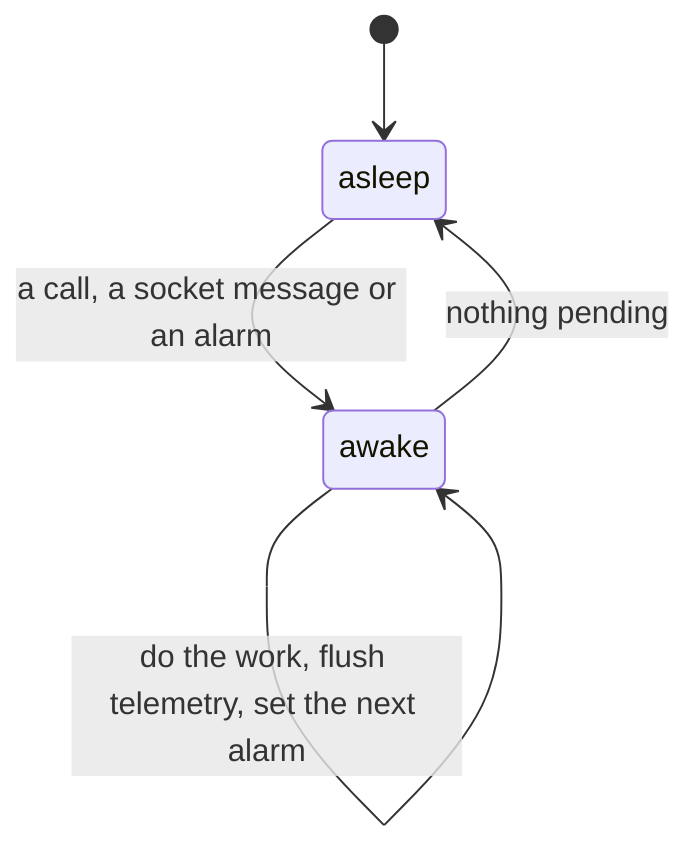

# 0105: A Durable Object never stays awake on its own: it works inside a wake, sets an alarm for later work and sleeps, and holds no timer or loop between wakes



```ts
// sketch: a loop is an alarm that sets the next alarm, never a fiber that sleeps
const tick = Effect.fn("cleanup.tick")(function* () {
  yield* runner.msg({ type: "tick" });
  const now = yield* Clock.currentTimeMillis;
  yield* alarm.set(now + Duration.toMillis("1 hour"));
});
```

**What this decides:** how any Durable Object in `next/` spends time, so none is billed for waiting.

## Context

Cloudflare bills an object for the time it is awake and does not let it hibernate while a timer
is pending ([lifecycle](https://developers.cloudflare.com/durable-objects/concepts/durable-object-lifecycle/),
[pricing](https://developers.cloudflare.com/durable-objects/platform/pricing/)). An object that
keeps an interval, a sleeping fiber or a polling loop is awake forever. That is the well-known
costly mistake with this platform.

We already hit one case: telemetry exporters built into an instance's scope keep a timer pending,
logs every second and traces every five, so the object never sleeps
([alchemy issue 2878](https://github.com/alchemy-run/alchemy/issues/2878)). The owner ruled on
2026-11-11 that no object of ours runs forever, and asked for patterns read from the platform's
and Alchemy's own code so the mistake cannot come back.

## Decision

**An object does its work inside a wake and then has nothing pending.**

- A wake is a call, a socket message or an alarm. Work that must happen later is an alarm, set
  before the wake ends. A loop is an alarm whose handler sets the next alarm.
- No `setInterval`, no `setTimeout` left pending, no forked fiber that sleeps or repeats on a
  schedule, and no polling inside an object. `Effect.sleep`, `Schedule` repeats and
  `Effect.forkDetach` of a long-lived fiber are the Effect forms of the same thing.
- Telemetry is flushed at the end of each wake, never on a timer.
- A socket an object keeps open uses the platform's hibernatable form, so an open connection does
  not keep the object awake.
- An alarm handler catches its own failures and always sets the next alarm: the platform stops
  retrying after a few failures, and a loop that stopped is silent. Each loop records when it
  last ran.
- An alarm handler is safe to run twice.

**Binding constraints**

- A gap in Alchemy or Effect that forces a pending timer is patched locally with its upstream
  issue, as [0042](0042-platform-pieces-go-through-alchemy.md) says. It is not worked around by
  leaving the object awake.
- A `.patterns/` doc gives the allowed shapes with real code, written from the installed
  Cloudflare runtime's and Alchemy's source, and a lint rule holds what a rule can hold. Only what
  needs judgment stays in prose.

## Consequences

- Instance telemetry in `next/` changes to flush per wake. An experiment is finding whether that
  needs a patch to Alchemy, a patch to Effect's exporter, or only our own code.
- Code already in `next/` that keeps an object awake is found by a sweep and filed as findings
  or tickets.
- Local development follows the same rule, so a mistake shows on the laptop: a test can assert
  that an idle object hibernated.
- Not decided here: the reusable loop piece itself (one object per loop, or Alchemy's scheduler
  for many due times on one object). That is part of the loops and queues study.
