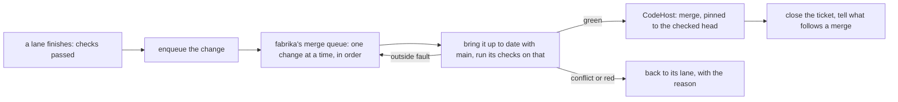

# 0107: fabrika provides the merge queue as its own primitive, in its official pipeline pack, and the code host only holds the code and performs the merge it is told to

**What this decides:** who owns the job of landing finished changes in order, and that this repo
does not move to an organization to get the code host's queue.

## Context

Landing a finished pull request is a queue job: one job per event, done once, in order. This repo
has no queue of the code host's, because GitHub does not offer its merge queue to a repo owned by
a personal account ([0049](0049-merge-behind-main-once-lint-passes-on-the-true-merge.md)). The
lead has landed changes with scripts and three rules written around that gap
([0049](0049-merge-behind-main-once-lint-passes-on-the-true-merge.md),
[0097](0097-a-green-pull-request-lands-without-catching-up.md),
[0098](0098-the-signed-chain-covers-the-branch-not-main.md)).

Moving the repo to an organization would give GitHub's queue. The owner ruled on 2026-11-11 not
to: GitHub is the code host and nothing more, reached through `CodeHost`
([0349](0349-we-build-and-use-our-tools.md),
[0079](0079-size-counts-governed-paths-name-who.md)). A team on another code host, or on none
with a queue, needs the same job done. So fabrika has to provide it.

## Decision

**The merge queue is a fabrika primitive. The code host is told what to merge and when.**

- A finished change is enqueued. The queue takes changes in order, brings each up to date with
  main, has its checks run on that state, and merges it pinned to the head that was checked.
- A change that conflicts or goes red returns to its lane with the reason. A fault outside the
  change (a mirror down, a runner lost) is retried and never sent back as the lane's failure.
- The queue reaches the code host only through the `CodeHost` service: read a change, run or read
  its checks, merge. No rule of the queue lives in the code host's settings.
- What follows a merge hangs on the queue's merge event, not on a timer: closing the ticket, and
  bringing a local checkout that tools run from up to date, once for a burst of merges.
- The queue ships in fabrika's official pipeline pack
  ([0083](0083-every-program-in-a-pack.md), [0084](0084-own-pack-listed-by-path.md)), so a team
  that takes the pack gets it with the other pipeline programs.
- It is proven on this repo first: our own pull requests land through it before anyone else's.
- This repo stays where it is.

**Binding constraints**

- The queue never loosens what a merge needs today: every step passed, the checks green on the
  merged state, the leak check clean, no real loosening of a law
  ([0014](0014-the-lead-merges-when-every-step-passed.md)).
- It is built in the order the owner set for all work: first it works, then it gets better, then
  it gets secure. The lead's scripts keep landing changes until the primitive takes the job over.

## Consequences

- The lead's landing scripts and the rules written for the missing queue are replaced when the
  primitive takes over; the pull request that switches deletes them.
- The ship step in `next/` gets its shape from this: it enqueues, and the queue lands.
- Not decided here: the queue's data shape, whether it tests changes one at a time or in batches,
  and where its worker runs. A plan answers those, stage by stage.
