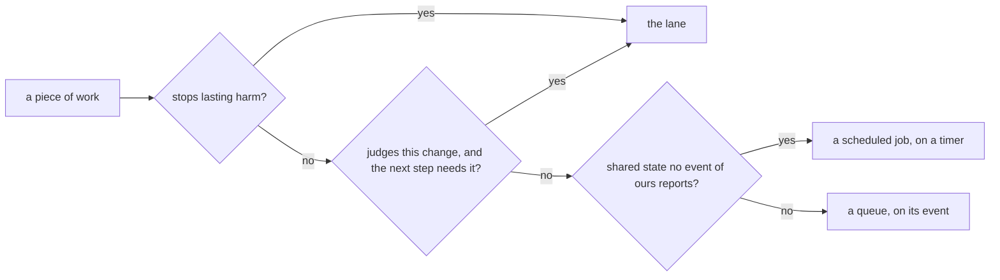

# 0108: Work lives in the lane, a queue or a scheduled job by two questions, a check against lasting harm never leaves the lane, and the tool checkout is brought up to date on the merge, never by a scheduled job



```ts
// A sketch, not built.
type Work = { judges: "this change" | "shared"; neededNext: boolean; stopsLastingHarm: boolean; ourEventMovesIt: boolean };
const home = (work: Work): "lane" | "queue" | "scheduled job" =>
  work.stopsLastingHarm || (work.judges === "this change" && work.neededNext)
    ? "lane"
    : work.judges === "shared" && !work.ourEventMovesIt
      ? "scheduled job"
      : "queue";
// The tool checkout: shared, not needed next, and main moves only on our merge, so "queue".
```

**What this decides:** where each piece of work in a change runs, by two questions and one tie-breaker, and
that the checkout the tools run from is brought up to date by the merge queue after it merges.

## Context

[0101](0101-box-cleanup-runs-on-a-timer.md) moved box cleanup off every step's start path, as a
first trial, and left the wider rule open. [Experiment 260](../experiments/260-lane-queue-or-scheduled-job.md)
sorted the 39 pieces of work in a change and measured what the wrong home cost on the night of
2026-11-10: 8.4 lane-hours to a cleanup inside step starts, about 28 PR-hours to a merge line run by
hand, and a tool checkout 36 commits stale. It proposed a scheduled job in the tooling for that
checkout. The owner corrected it: main moves only on a merge, so the update is an event, not a
scheduled job. The long reasoning is in
[lane, queue or scheduled job](../docs/direction/lane-queue-or-scheduled-job.md).

The picture that goes with this rule is decided in the same walk and recorded elsewhere: one merge
queue fabrika provides ([0107](0107-fabrika-provides-the-merge-queue.md)), tests on the pull request
with checks in five minutes ([0106](0106-a-pull-requests-checks-finish-in-five-minutes.md)), and a
scheduled job on Cloudflare as an alarm that sets the next ([0105](0105-a-durable-object-never-stays-awake-on-its-own.md)).

The sweep (`governance.sh` and a read by hand of 0014, 0015, 0019, 0049, 0066, 0067, 0096, 0097,
0101 and 0105) found no decision this contradicts, so it amends none. It agrees with 0101 (cleanup
on a timer and after a merge) and with the lead skill's pull of the main checkout after a merge. The
only text it walks back is AGENTS.md's line that `drive.ts` runs `box.sh gc` itself on start, which
0101 already replaced. The main watcher is a new timer, which
[0096](0096-the-lead-fixes-forward-while-the-owner-is-away.md) keeps for the owner; this is that
call.

## Decision

**A piece of work's home comes from two questions: does it judge this one change or something shared, and
must its answer exist before the next step starts (owner, 2026-11-11).**

- **The lane:** it judges this change, and the next step needs its answer.
- **A queue:** one piece of work per event, done once, that can wait its turn.
- **A scheduled job, on a timer:** it is about shared state (main, the laptop, the tracker), is
  safe to run twice, and compares "should be" with "is" and fixes the gap.
- **Tie-breaker:** a check that stops lasting harm (a leak, lost work, a builder changing its own
  exam) never leaves the lane, whatever it costs.
- **The tool checkout is not a scheduled job.** The merge queue brings the local checkout the tools
  run from up to date after it merges, once for a burst of merges, at a moment when no step is
  starting.
- **Every scheduled job writes a "last ran" fact** and is shown late when its last run is older
  than two periods, as 0101 set for the cleaner.
- **Two scheduled jobs for now:** the laptop cleaner (0101) and a main watcher that files one
  ticket when main goes red. A new scheduled job past these two is the owner's call.

**Binding constraints**

- A plan that adds or moves a piece of work names its home and answers the two questions for it.
- No check that stops lasting harm moves to a queue or a scheduled job.
- Nothing polls on a clock for a change that only our own event makes; it hangs on that event.

## Consequences

- The lane gets thinner, and a hung chore stalls no lane.
- A scheduled job can lag one period, and a dead one shows only through its late mark.
- A merge made outside the merge queue raises no event, so the checkout waits for the next one.
- Not decided here: what the merge queue runs before it merges (0107), how CI meets five minutes
  (0106), and the leans the note marks as not ruled on (typecheck twice, ticket closes on the merge
  with a scheduled job as backstop, the lead's hand work as a queue, a stopped lane waking the lead
  at once).
- A scheduled job piece for `next/` is planned in three stages, works, better, secure, under
  tracker ticket 762.

## Records

- [`.glossary/TERMS.md`](../.glossary/TERMS.md): the row `scheduled job`, in Pipeline.
