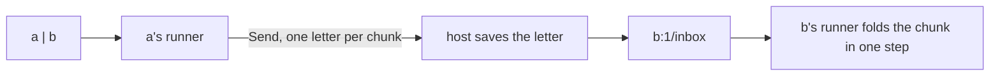

# 0109: A pipe between two programs is shell syntax over program mail, its letters saved like any letter and sent in chunks, never a second unsaved lane



```ts
// a | b   becomes, inside a's runner: one letter per chunk of lines, never one per line.
send({ to: "b:1", m: { type: "lines", lines: chunk } }); // chunk: up to k lines, or what came in a tick

// b folds a chunk in one step.
lines: (s, m) => [{ lines: s.lines + m.lines.length }, []],
```

**What this decides:** in `next/`, a pipe rides the same saved mail path that
[0103](0103-a-program-may-mail-another-by-name.md) built, in chunks, so there is one transport.

## Context

[0103](0103-a-program-may-mail-another-by-name.md) gave programs mail beside pipes and left one
question open: does a pipe become shell syntax on that same mail path, or does saving each output
cost too much? [Experiment 258](../experiments/258-pipes-on-mail.md) measured it on `next/`'s
program mail. The owner decided after a walk of it on 2026-11-11.

What the experiment found:

- Saving a letter costs 0.13 to 0.15 ms and stays flat up to 10,000 letters.
- With 100 lines per letter, 10,000 lines passed two real runners in 1.2 s.
- A RAM-only queue is 60 to 160 times faster. Nothing we pipe today needs that.
- One line per letter gets slower with each line, from two reads that scan everything: delivery
  reads the sender's whole outbox and the target's whole inbox on every send, and the recovery save
  rereads every receipt on every step
  ([finding](../field/findings/2026-11-11-recovery-save-rereads-every-receipt.json)).

This settles the question 0103 left open, so it amends 0103 in part. 0103's two ways to meet stay
as two syntaxes, a pipe in a line and a `Send` in code, over one transport.
[G6](../docs/direction/program-guidelines.md#g6-programs-meet-on-typed-pipes-never-by-calling-each-other)
still holds: programs meet on typed pipes and never call each other. This only says what carries
a pipe in `next/`.

## Decision

**A pipe is shell syntax over program mail: `a | b` becomes Sends from `a` to `b`'s named inbox,
saved like any letter, one letter per chunk of lines.**

- One transport, not two. A program can be piped with no shell present: the shell only writes the
  Sends a program could write itself.
- A pipe's letters are saved like any letter. There is no second, unsaved lane for speed. A program
  in `next/` rebuilds by replaying its inputs, so an input that was never saved cannot be replayed.
  And an object never stays awake ([0105](0105-a-durable-object-never-stays-awake-on-its-own.md)),
  so anything held only in RAM is gone between wakes.
- The writer sends chunks of lines, one letter per chunk, as a Unix pipe buffers. Never one letter
  per line.
- An inbox has a cap on unread letters. A Send to a full inbox answers `full`, and the sender
  waits until the reader catches up, as a full Unix pipe makes its writer wait. The cap is a
  `fabrika.toml` setting ([0069](0069-choices-are-settings.md)); its default comes from a
  measurement, not from another system's number.
- A pipe does not ride the ephemeral lane. That lane is "show it, never save it, never decide with
  it", and a pipe feeds a program's input, which decides.

**Binding constraints**

- Before a pipe carries a stream, two slow reads are fixed: delivery looks a letter up by its ID,
  and the recovery save stops rereading every receipt.
- No pipe is built on an unsaved queue, in the cloud or on the laptop.

## Consequences

- P41's later slices and the shell's pipe build on `Send`. The writer side owns the chunking.
- The chunk size is a choice, so it is a `fabrika.toml` setting with a default
  ([0069](0069-choices-are-settings.md)). It stays under the ledger's row cap.
- The cost: a line through two runners writes more entries than a RAM queue would. In the cloud
  that is rows billed; the experiment guessed under $0.50 a million lines at 100 lines per letter,
  not measured on a Durable Object.
- Pipe letters are ledger entries, so they are never deleted to save room: an old stretch of the
  ledger is sealed into its own read-only object, as
  [design for bounded objects](../docs/direction/design-for-bounded-objects.md) already decides.
  No separate cleanup of pipe letters exists.
- Not decided here:
  - The default value of the inbox cap.
  - A RAM road for a stream that truly needs one. None exists today. If one appears, it gets its own
    decision.

## Records

- `.glossary/TERMS.md`: the `pipe` row (Runtime) says what carries a pipe in `next/`.
