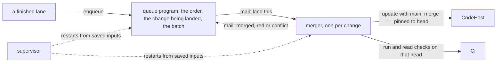

# 0110: The merge queue is built as fabrika programs, one queue program and one merger per change that talk by mail, never on Cloudflare Workflows



```ts
// sketch: the merger's states, the mail it takes and its three replies
import { Schema } from "effect";

export const Land = Schema.TaggedStruct("land", { pr: Schema.Number, ref: Schema.String });

export const State = Schema.Union([
  Schema.TaggedStruct("updating", { tries: Schema.Number }), // bring the change up to date with main
  Schema.TaggedStruct("checking", { head: Schema.String, tries: Schema.Number }), // its checks, on this head
  Schema.TaggedStruct("merging", { head: Schema.String }), // merge pinned to the head that was checked
]);

export const Reply = Schema.Union([
  Schema.TaggedStruct("merged", { ref: Schema.String, head: Schema.String, commit: Schema.String }),
  Schema.TaggedStruct("red", { ref: Schema.String, head: Schema.String, checks: Schema.Array(Schema.String) }),
  Schema.TaggedStruct("conflict", { ref: Schema.String, base: Schema.String }),
]);
// An outside fault (a mirror down, a runner lost) adds to `tries` and sets an alarm. It is never a reply.
```

**What this decides:** how the merge queue of
[0107](0107-fabrika-provides-the-merge-queue.md) is built in `next/`, what it runs on, and the order
its stages come in.

## Context

0107 (in [pull request 952](https://github.com/usirin/tea-fabrika/pull/952)) makes the merge queue a
fabrika primitive and leaves open where its worker runs and whether it
lands changes one at a time or in batches. The owner settled both on 2026-11-11, after a walk of
research on what a merge queue must do.

Cloudflare Workflows was the other candidate
([Workflows](https://developers.cloudflare.com/workflows/)). What the walk found:

- Alchemy (2.0.0-beta.84 read) offers Workflows two ways, and both run locally.
- `effect/workflow` in effect 4.1.2 is marked unstable.
- The cost is $0 above the Workers Paid plan either way, so cost picks neither.

What decided it is the shape. A Workflow keeps its control state as a position in code: which
`step` it reached. [0037](0037-implicit-state-machines-made-explicit.md) and
[0046](0046-one-tea-machine-per-file.md) rule that out. The queue's order, its batch and "one at a
time" are shared state that one place must hold. And `next/` already gives durable steps: a program
saves its inputs, rebuilds from them, and a supervisor restarts it
([0016](0016-tier-1-supervision-is-otps-top-level-supervisor.md)).

Two counts set the stages. GitHub Free runs 20 jobs at once and one full CI run of this repo is 16
jobs, so running two or more speculative merges side by side does not fit. On 2026-11-10, 147
changes merged and 23 of them touched code, so most of the line is docs and field rows.

This amends in part [0098](0098-the-signed-chain-covers-the-branch-not-main.md): its rule stands,
and the gap it admits (the chain no longer proves the squash's tree) is closed by the queue in the
secure stage.

## Decision

**One queue program holds the line, and one small merger per change lands it. They
talk by program mail, and Workflows is not used, in any stage.**

- The queue program holds the order, which change is being landed, and the batch. Nothing else
  decides what lands next.
- A merger lands one change: it brings the change up to date with main, waits for its
  checks on that exact head, and merges pinned to that head.
- They meet by mail ([0103](0103-a-program-may-mail-another-by-name.md)). The queue sends `land`;
  the merger replies `merged`, `red` or `conflict`. An outside fault is retried inside the merger
  and never sent back as the change's failure, as 0107 says.
- Each is a tea machine with named states, in its own file
  ([0037](0037-implicit-state-machines-made-explicit.md),
  [0046](0046-one-tea-machine-per-file.md)).
- Each runs in a Durable Object that never stays awake: every wait and every retry is an alarm
  ([0105](0105-a-durable-object-never-stays-awake-on-its-own.md)).
- Crash safety is what `next/` already has: a program rebuilds from its saved inputs, and a
  supervisor restarts it. This is the OTP shape: one supervisor, one worker per job.
- The merger reaches the code only through `CodeHost`, and the checks only through `Ci`.
- The queue starts a merger for each change while the app runs, as OTP's `start_child` does. That
  piece is built once, by P42's slice (a person starts a program,
  [0088](0088-six-slices-in-tier-1.md)), and the queue uses it. No stage runs one long-lived merger
  as a stand-in, and the set of programs is never a list fixed at startup.
- Which checks a change needs is the pipeline pack's setting `queue.checks`, one list per kind of
  change. Its default is empty, so fabrika starts with an empty file
  ([settings](../docs/direction/settings.md), S3), and the queue refuses a change whose kind names
  no check, with words that name the setting. A change is never merged over no checks.
- If a merged change's landed tree is not the tree it checked, the queue stops, says why, and
  waits for a person's `resume`
  ([jidoka and andon](../docs/direction/jidoka-and-andon.md)). This is not a setting.

**The stages, in the owner's standing order:**

| Stage | What the queue does |
|---|---|
| works | One change at a time, in order, each with its own merger. Main moves only through the queue. |
| better | Batches of 4 or 5, split on red. A cheap lane for docs and field rows. A record of how long each change waited in each state. |
| secure | The queue signs its own link from the checked head's tree to the landed tree, closing the gap 0098 admits. |

**Binding constraints**

- No Cloudflare Workflows and no `effect/workflow` in the queue or the merger, at any stage.
- No control state as a position in code: a wait is a named state plus an alarm.
- A merger never decides order, and the queue never talks to `CodeHost` or `Ci` to land a change.
- 0107's binding constraints hold: the queue never loosens what a merge needs today.

## Consequences

- The ship step in `next/` enqueues by sending the queue mail, and its stuck reasons come from the
  merger's replies.
- The cost: the queue leans on the restart-and-recover work (P34c), which is half merged, and on
  mail delivered between instances, which is P41's later slices (0103). Until both land, the queue
  cannot be trusted with main. Its second slice also waits on P42's start piece.
- Not decided here: where the checks run. That is the `Ci` service's Layer: GitHub Actions today,
  and a Cloudflare container Layer is being studied.
- Not decided here: the queue's data shape, and the batch size. The batch size is a setting
  ([0069](0069-choices-are-settings.md)), with its default taken from a measurement.

## Records

- `merger`, a new row in [`.glossary/TERMS.md`](../.glossary/TERMS.md), Pipeline.
- 0098's `status:` now names this decision.
