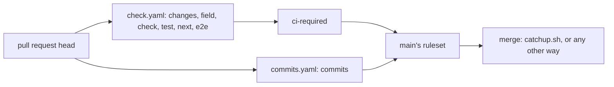

# 0116: GitHub requires the ci-required check on main beside commits, and a pull request need not be up to date to merge



```yaml
# .github/workflows/check.yaml, the job's shape
ci-required:
  needs: [changes, field, check, e2e, test, next]
  if: always()
  steps:
    - env:
        NEEDS: ${{ toJSON(needs) }}
      run: node .github/ci/required.mjs # skipped passes only when changes said so
```

**What this decides:** which checks GitHub itself demands before anything merges to main, and that
being behind main does not stop a merge.

## Context

Until now main's ruleset required one check, `commits`. Tests, lint, the type check and e2e ran in
CI, but only the lead's merge script, `catchup.sh`, waited for them. A merge made any other way went
through with them red. The guard lived in one script on one laptop.

On 2026-11-11 the owner decided that GitHub should refuse such a merge, and turned off the ruleset's
"require branches to be up to date" the same day.

The sister repo kamp-us/phoenix solved the same problem first, and this repo takes its shape. Its
ruleset requires a check named `ci-required`, with up to date not required. Its
[`ci.yml`](https://github.com/kamp-us/phoenix/blob/main/.github/workflows/ci.yml) has an always-on
job that reads every job's result and passes a skip only when the job was not required, from the
same output that gates that job. A pure judge
([`required.ts`](https://github.com/kamp-us/phoenix/blob/main/packages/fabrika-cli/src/ci/required.ts))
runs with no install. Its decisions:
[0061](https://github.com/kamp-us/phoenix/blob/main/.decisions/0061-ship-it-gating-check-set.md),
[0092](https://github.com/kamp-us/phoenix/blob/main/.decisions/0092-gates-fail-closed-on-zero-scope.md)
(a gate fails closed on zero scope),
[0404](https://github.com/kamp-us/phoenix/blob/main/.decisions/0404-required-set-is-the-blocking-set.md)
and
[0132](https://github.com/kamp-us/phoenix/blob/main/.decisions/0132-merge-queue-for-base-freshness.md).

Where this repo differs, and why:

- Phoenix keeps branches fresh with GitHub's merge queue (its 0132). That queue is not offered for a
  repo owned by a personal account
  ([0049](0049-merge-behind-main-once-lint-passes-on-the-true-merge.md)), so this repo builds its
  own: 0107, in [pull request 953](https://github.com/usirin/tea-fabrika/pull/953), and 0110, how it
  is built, neither on main yet.
- The job runs on `always()`, not `!cancelled()`. A required check whose job is skipped counts as
  passed on GitHub, so this one never skips: a canceled run reports it red.
- Its input is `toJSON(needs)`, one value, so the job list is the `needs:` list itself, and
  `pnpm lint` fails when a job in the workflow is missing from it.

This writes down the ruleset that [0049](0049-merge-behind-main-once-lint-passes-on-the-true-merge.md)
and [0097](0097-a-green-pull-request-lands-without-catching-up.md) left as the owner's switch. It
amends 0049 in part: 0049 found the up-to-date rule bypassed by timing, and that rule is now off,
so a merge behind main is allowed at GitHub too. 0049's lint on the true merge and its binding
constraints still hold. It sits beside [0014](0014-the-lead-merges-when-every-step-passed.md),
which still says when the lead merges.

## Decision

**Main's ruleset requires two checks, `ci-required` and `commits`, and does not require a branch to
be up to date with main (owner, 2026-11-11).**

- `ci-required` is the last job of `check.yaml`. It needs every other job there and passes when
  each one succeeded, or skipped where `changes.mjs` said it need not run. A failure, a
  cancellation, or a skip that should have run fails it.
- `commits` stays its own required check, from `commits.yaml` on `pull_request_target`. It is never
  folded into `ci-required`, which runs the pull request's own copy of the workflow.
- Only the owner changes the ruleset. No agent adds, drops or edits a required check or a bypass.
- `catchup.sh` keeps its own wait for the checks until the merge queue of 0107 and 0110 takes over
  landing. From then on, GitHub's required checks and the queue are the two guards.

**Binding constraints**

- A new job in `check.yaml` joins `ci-required`'s `needs:`. `pnpm lint` fails until it does.
- `ci-required` never skips and never continues on error.

## Consequences

- A merge made outside `catchup.sh` is refused while a check is red. The checks belong to CI, so
  the laptop is free to run agents.
- The cost: one more short CI job on every run. And a GitHub Actions outage now blocks merges at
  GitHub as well, as on 2026-11-11, when queued runs hung for about an hour.
- A role the ruleset lets bypass still merges past it: 0049 saw the rule suites record `bypass`.
  Whether that bypass stays is the owner's ruleset call.
- Not decided here: which jobs CI runs, or when (`changes.mjs` decides that). Paid CI stays out
  ([0112](0112-checks-run-on-free-ci.md)).
