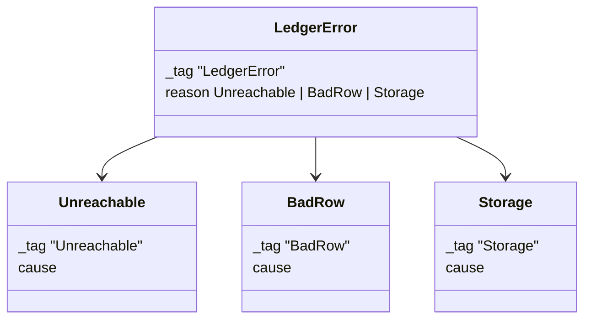

# 0119: In next/, a service error's reason is a tagged error of its own, as Effect's SqlError has it, never a string



**Before:**

```ts
export class LedgerError extends Schema.TaggedError<LedgerError>()("LedgerError", {
  reason: Schema.Literals(["unreachable", "bad_row", "storage"]),
}) {}

Effect.catchTag("LedgerError", (e) => (e.reason === "unreachable" ? retry : Effect.fail(e)));
```

**After (a sketch):**

```ts
export class Unreachable extends Schema.TaggedError<Unreachable>()("Unreachable", {
  cause: Schema.Defect(),
}) {}
export class BadRow extends Schema.TaggedError<BadRow>()("BadRow", { cause: Schema.Defect() }) {}
export class Storage extends Schema.TaggedError<Storage>()("Storage", { cause: Schema.Defect() }) {}

export class LedgerError extends Schema.TaggedError<LedgerError>()("LedgerError", {
  reason: Schema.Union([Unreachable, BadRow, Storage]),
}) {}

Effect.catchReason("LedgerError", "Unreachable", () => retry);
```

The service still has one error. What moves is its `reason`: from a word to a small error class
that can hold its own data and its cause.

**What this decides:** the shape of `reason` on a service's error in `next/`.

## Context

[0055](0055-errors-named-by-their-service.md) gives each service one error and leaves its `reason`
values to each build plan. Today every one is a string literal. The Effect code guidelines study
(experiment 262, [0114](0114-effects-team-as-the-builder.md)) put two shapes to the owner on
2026-11-11: keep the word, or follow Effect.

Effect's way is a named pattern in its own guide: "Define a tagged error with a tagged `reason`
field, then recover with `Effect.catchReason`, `Effect.catchReasons`, or by unwrapping the reason
into the error channel with `Effect.unwrapReason`" (`node_modules/effect/AGENTS.md`, "Creating and
handling errors with reasons"). `effect/src/sql/SqlError.ts` is built that way: each reason is a
`Schema.TaggedError` with `cause: Schema.Defect()`, and `SqlError` holds
`reason: SqlErrorReason`.

The owner picked Effect's way.

## Decision

**A service error's `reason` is a union of tagged errors, one class per reason.**

- Each reason is a `Schema.TaggedError` with `cause: Schema.Defect()` and whatever data that
  reason alone needs.
- The service's error holds `reason: Schema.Union([...])`. It stays one error per service (0055).
- A caller recovers with `Effect.catchReason` or `Effect.catchReasons`, never by comparing
  `e.reason` to a string.
- A reason's name is its `_tag`, a short noun in PascalCase, where the word was snake_case.
- This is about errors only. A step's outcome keeps `reason` as a short word, as
  [AGENTS.md](../AGENTS.md#before-you-design-anything) shows it.

## Consequences

- Every service error in `next/` changes shape. Existing ones move with the sweep that adds
  `cause` to them, so each is touched once.
- The cost: one small class per reason, and a saved or sent error changes its encoded form. Any
  stored error must be checked before its sweep.
- Not decided here: which reasons exist for each service. Each build plan still picks them (0055).
