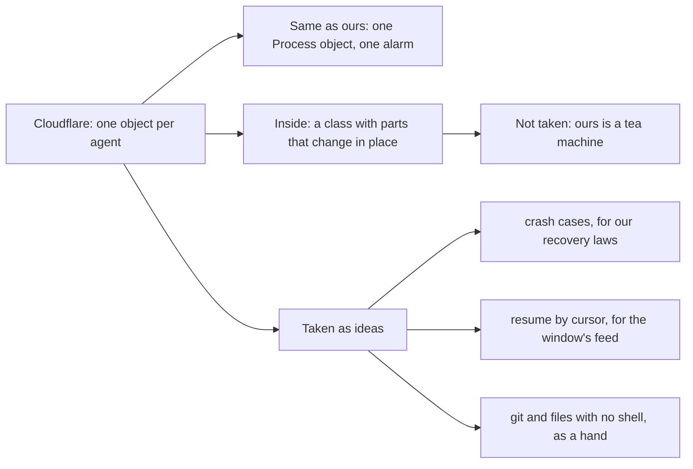

# 0121: next/ borrows three ideas from Cloudflare's agent pieces and never builds on them



```ts
// A sketch. The third idea, in our own shape: a hand dials the brain and says what it has.
{ has: ["git", "files"] } // no shell, so the brain never offers it a test or a build
```

**What this decides:** how `next/` uses the pieces Cloudflare ships for agents on Durable Objects
(`agents/lifecycle`, `tasks`, `streams`, `sessions`, and `@cloudflare/computer`'s Workspace).

## Context

Cloudflare's changelog entry of 2026-11-09 shows a Codex loop on one Durable Object, built from
those pieces. [Experiment 263](../experiments/263-cloudflares-agent-pieces.md) read each piece in
its package and held it against the settled notes. It is reading, and nothing ran. The owner walked
it on 2026-11-11.

Two things already match. `next/` runs each program in its own `Process` object
([the cloud is one more host](../docs/direction/the-cloud-is-one-more-host.md)), and that object
has one alarm set to its earliest timer, as Lifecycle's job queue does.

## Decision

**`next/` takes three ideas from these pieces and uses none of them as its base.**

- **Crash cases.** The runner's recovery laws are checked against Lifecycle's: an alarm armed
  before each run in case the object dies, and a fallback alarm when startup fails.
- **Resume by cursor.** The window's feed lets a browser continue from the last entry it saw, as
  Streams does with SSE's `Last-Event-ID`.
- **A hand with no shell.** A cloud host that has `git` and `files` and nothing else, for work
  that needs no test run, such as a docs change. It is tried on one real docs change beside
  GitHub's own API for writing a commit, and the simpler one wins.

**Not taken**

- The class-per-agent shape. Inside its object a program stays one tea machine
  ([0046](0046-one-tea-machine-per-file.md)).
- Files or git inside a program's object. Machine work stays a Cmd the hands do.
- Tasks' replay. Work cut off after it started stays `unknown` and is never run again on its own.
- Tasks, Streams and Sessions as stored records. The ledger stays the one record.
- Any direct import of these packages. They are Promise code on Cloudflare's own class, which
  [0042](0042-platform-pieces-go-through-alchemy.md) rules out.

## Consequences

- Three pieces of work, each with its own ticket: the recovery law check, the feed's resume, and
  the hand experiment. None starts a new tier row.
- The cost: nothing now. The hand experiment is one small run on a real docs change.
- Not decided here: whether a cloud hand with a container (real tests, no laptop) is built. It
  stays an option for a later tier, until a real ticket needs it.
- It cannot tell us speed or cost. Every figure in the experiment is Cloudflare's own.
