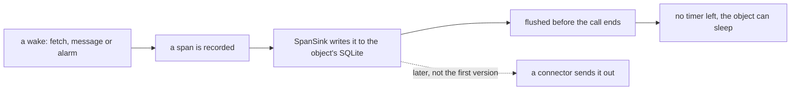

# 0122: The first version of next/ sends no telemetry to an outside backend, and when it does it goes through a connector, with no timer in an object



```ts
// A sketch, for the day a connector sends telemetry out of an object (experiment 259, mode `fixed`).
OtlpTracer.layer({ url, resource, exportInterval: Duration.infinity }); // no timer
webSocketMessage: (socket, message) => work(message).pipe(Effect.andThen(flush)); // send at the end of the wake
```

**What this decides:** whether `next/` sends telemetry to an outside backend now, and the rules for
the day it does.

## Context

[0038](0038-span-sink-measurements-and-metrics.md) left "sending in OTLP at flush" as an idea to
try later. An Alchemy issue reported that telemetry in a Durable Object keeps it from sleeping.
[Experiment 259](../experiments/259-telemetry-and-hibernation.md) measured it on our versions, on
the laptop's runtime: an object with no export timer that sends at the end of each wake slept in 3
of 3 runs and sent every record. With a metrics exporter it never slept. `next/` already has the
good shape: `SpanSink` writes to the object's own SQLite and keeps no timer. The owner walked the
result on 2026-11-11.

## Decision

**The first version sends no telemetry out. Later, a connector does it.**

- `next/` keeps what it has: spans and measurements go to the object's own storage through
  `SpanSink`, flushed before each call ends.
- Sending to an outside backend is not part of the first version. When it is added, it is a
  connector, an outside service reached by its name like any other, never an exporter wired into
  each object by hand.

**Binding constraints, for that day**

- No metrics exporter runs inside an object. Its timer re-arms forever.
- No exporter with a finite interval lives in an object's instance scope. It sends at the end of
  each wake.

## Consequences

- Nothing changes in code now. No patch to Alchemy or Effect is needed.
- The cost, later: about 10 lines in one shared helper. A record made between wakes waits in
  memory and is lost if the object sleeps first.
- Not decided here: the connector's shape for telemetry, and which backend.
- Not measured: the cloud. Every run was on the laptop's runtime.
