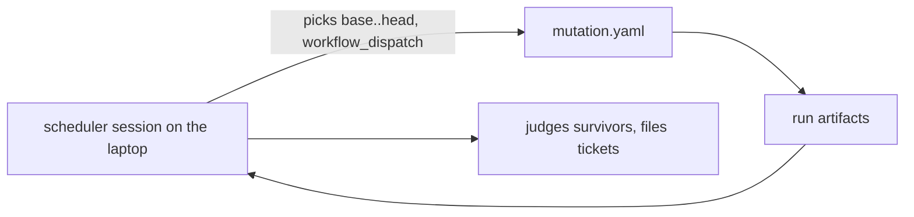
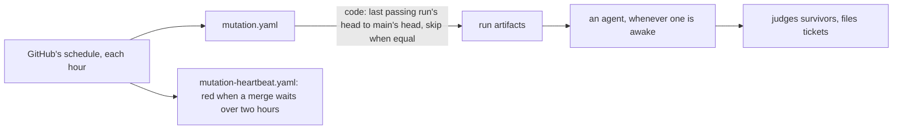

# 0123: GitHub's schedule starts the hourly mutation run and its heartbeat, code picks the range, and an agent only judges the survivors

**Before:**



**After:**



```yaml
# after, a sketch
on:
  schedule:
    - cron: "17 * * * *"
  workflow_dispatch:
```

The run no longer needs a session to be alive. The session's judgment moves to after the run.

**What this decides:** what starts the hourly mutation run, and what tells us when it stops.

## Context

[0067](0067-hourly-mutation-runs-in-ci.md) put the run in GitHub CI, started by hand each hour by
a scheduler session, and ruled out a cron trigger because "the range, the skip and the ticket
filing need judgment". Two of those three are code: the range is the last passing run's head to
main's head, and an equal pair is a skip. On 2026-11-11 no run started for three hours while about
twenty merges landed, and nothing said so. `.agents/skills/mutation/scripts/heartbeat.ts` was
written for that, and its workflow waited on this call. The session's own timer ends 2026-11-17.

The known way is a scheduled workflow with a dead man's switch beside it. GitHub's docs say a
schedule can fire late under load and is paused after 60 days with no activity in a public repo.
The owner walked both ways on 2026-11-11 and picked the schedule.

## Decision

**`mutation.yaml` gets a `schedule` trigger, and `mutation-heartbeat.yaml` runs each hour beside
it.**

- A scheduled run picks its own range in code: `base` is the head of the last passing run, `head`
  is main's head. When they are equal it ends as a skip.
- `workflow_dispatch` stays, with its two inputs, for a run by hand.
- Judging the survivors and filing tickets stays an agent's job, as
  [0066](0066-mutation-runs-on-a-schedule.md) says. It reads the artifacts of every run since the
  last one it judged, so a run made while no agent was awake is not lost.
- The heartbeat goes red when a merge on main has waited more than two hours for a passing run.
  The status page a person reads shows that as late.

**Binding constraints**

- Still no `push` or `pull_request` trigger. The run changes nothing in the repo.
- Free runners only. No outside account for the heartbeat.
- 0066's caps hold: three tickets a day, and the trial is read around 2026-11-17.

## Consequences

- This amends 0067 in part: its "never a cron trigger" and "started by hand each hour". Where the
  run happens, and the rest, hold.
- A run can start 10 to 60 minutes late when GitHub is busy. For an hourly check on main that is
  accepted.
- The scheduler session is no longer needed to start runs. An agent still has to judge.
- The cost: about 40 lines of lead tooling, in one small pull request.
- Not decided here: whether mutation returns to a pull request's steps after the trial.
