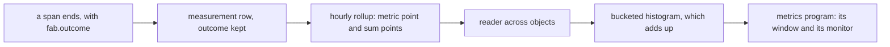

# 0124: In next/, metrics stay rows in the span sink with one named tag at a time, the next work is the read side, and a poll with no news is never a saved span



```ts
// A sketch, from experiment 255's spike.
{ _tag: "metric", piece: "lane.step", hour, count: 100, errors, ms: { p50, p95, max }, lag }
{ _tag: "sum", piece: "lane.step", hour, outcome: "stuck", count: 20 } // one closed tag, six values at most
yield* sink.sums("lane.step", from, to); // one piece, a range of hours, split by outcome
```

**What this decides:** how `next/` grows from saved spans to a metrics product, and in what order.

## Context

[0038](0038-span-sink-measurements-and-metrics.md) put measurements and hourly metric points in
the span sink. [Experiment 255](../experiments/255-metrics-on-the-span-sink.md) asked whether that
sink can carry a metrics product at one team's size. Saving can: one tag adds 4 bytes to a row and
a few rows an hour. Reading cannot yet: nothing reads the metrics, each object holds only its own,
and hourly percentiles do not add up. The owner walked it on 2026-11-11.

Two counts from today's version, read the same day from 85 local job records, went into the walk.
An agent run holds few spans: of 121, half hold 1 and nine in ten hold 10 or fewer. And 2,046,647
of 2,047,223 saved spans were one HTTP poll of the ledger, about two a second.

## Decision

**Metrics stay rows in the span sink, a tag is added one at a time by name, and the next work is
reading them.**

- A tag a metric splits by has a closed list of values, and any other value is counted as
  `other`. The first is a step's outcome, the five verbs. No general list of kept tags, and no
  split by several tags at once by default.
- The read side is built in this order: a reader that adds up one piece's points across objects,
  a bucketed histogram beside the exact percentiles, then a metrics program.
- The monitor and the dashboard are a program. Its window is the view. It has its own object and
  alarm, so it wakes itself to check, and it raises an ask like any other program.

**Binding constraints**

- A poll, a ping or a keepalive that brought no news is never a saved span.
- A span that arrives after its hour closed is kept raw and archived, and no count includes it. A
  monitor reads closed hours only.

## Consequences

- The spike's tag is about 100 lines in four files. A stored column needs a data move once real
  rows exist.
- Today's app gets its own fix for the poll spans, as a ticket. That is today's version, not this
  decision's code.
- Not decided here: the reader's shape across objects, the histogram's buckets, and the metrics
  program's window.
- Not measured: the real runtime's bytes. The spike counted on Node's SQLite.
