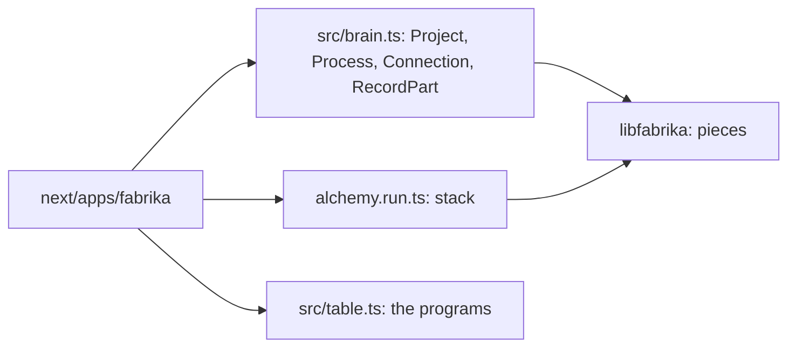
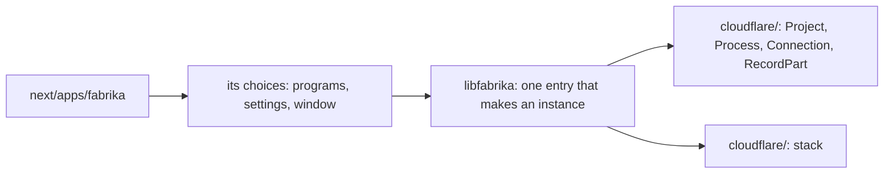

# 0126: libfabrika offers one entry that makes a running instance from an app's choices, so the brain's object classes and the deploy stack move out of the app

**Before:**

**After:**

The object classes and the stack change owner. The program table stays, as a choice handed in.

**What this decides:** which side of the line the brain's wiring is on, and what the app is left
holding.

## Context

[Why libfabrika exists](../docs/direction/where-each-piece-lives.md#why-libfabrika-exists-decided-2026-11-08)
gives the test: would a from-scratch client have to write it again? The same note then listed
"wiring, the deploy stack, what starts things" as what may stay in the app. Those two lines
disagree. `next/apps/fabrika/src/brain.ts` (326 lines, the four object classes) and
`alchemy.run.ts` (57 lines, `stack`) are what any second client would copy, so they fail the test
and were on the list. [0070](0070-flow-runner-stays-a-machine.md) met the same wall: only the app
wires the services a program needs. The owner looked at it on 2026-11-11, called the list wrong,
and gave the idea of one `make` for the whole thing.

## Decision

**The library offers one entry that turns an app's choices into a running instance. The brain's
object classes and the deploy stack move into libfabrika behind it, and the app keeps only
choices.**

- A choice is what a second client would pick differently: which programs, which settings, which
  window, which Layers it hands in.
- The object classes and `stack` name a platform, so they live in the library's `cloudflare/`
  folder ([0095](0095-a-service-file-holds-only-its-contract.md)) and are reached through Alchemy
  ([0042](0042-platform-pieces-go-through-alchemy.md)).
- It is built with the Alchemy port ([0041](0041-object-classes-are-effect-objects.md), ticket
  502), which rewrites those classes anyway, so each file is touched once.
- Everything an instance needs to exist is one Alchemy stack, owned by the library. Whether hands
  join it as a resource of our own is open, and experiment 264 tries it.
- The entry is `Fabrika.make`. Not `Instance.make`: every `make` returns an instance of
  something, so that name says nothing. What it makes is still called an instance in prose, as
  the glossary has it.

## Consequences

- About 390 lines change owner. The note's list is fixed in this pull request.
- A pack builder is not affected today: they run fabrika with their pack listed. This is for the
  second client, and for the test kit [0125](0125-the-example-program-is-a-checklist.md) asks for.
- The doubt: how cleanly Alchemy lets a library own part of a stack. The port's plan has to show
  it before it builds.
- Not decided here: `Fabrika.make`'s options. The port's plan brings them.
