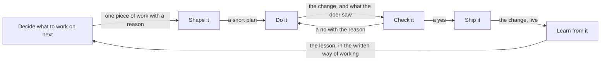

# 0127: How we get work done is seven principles, from a person's attention as the scarce budget to code holding the edges, and they answer 0059's steps 1 to 3, so next/'s pipeline builds on them

The six parts and their handoffs are the note's table,
[the loop, in plain words](../docs/direction/how-we-get-work-done.md#the-loop-in-plain-words). In
fabrika's words the parts are the tracker and `triage`, the `plan`, `test_writer` and `build`,
`mutation`, `review` and the `exam`, `ship`, and `field/` rows with findings
([in fabrika's words](../docs/direction/how-we-get-work-done.md#in-fabrikas-words)).

**What this decides:** the seven principles of
[how we get work done](../docs/direction/how-we-get-work-done.md) are the starting point that
`next/`'s pipeline design builds on.

## Context

[0059](0059-pipeline-starts-from-the-work.md) orders `next/`'s pipeline design: how work gets done
in plain words, then with fabrika, then guidelines, and only then the pipeline. Ticket 616 ran the
guidelines study for steps 1 to 3, in [experiment 250](../experiments/250-how-we-get-work-done.md)
and the note above, in PR 797.

0059's amendment of ticket 645 turned down the first draft's lens, how human teams work, and asked
for the teams where agents do most of the work. The study was redone on them: Anthropic, OpenAI,
Google, Cursor and Cognition, checked against Stripe, StrongDM, Ramp, single builders and METR. The
owner walked it on 2026-11-10 (the labs walk), and the first draft's six principles became seven.
Decisions [0076](0076-a-lane-stops-at-its-budget.md),
[0077](0077-mutation-gaps-carry-a-category.md), [0078](0078-agent-and-flow-slices-start-early.md)
and [0079](0079-size-counts-governed-paths-name-who.md) came out of the walks. On 2026-11-11 the owner
approved the seven as written.

This record does not change 0059. It answers the steps 0059 asked for first, so 0059 gains a dated
line under its amendments and keeps its status.

## Decision

**The seven principles are the starting point for how work gets done here, they are 0059's answer
to steps 1 to 3, and `next/`'s pipeline design may now build on them (owner, 2026-11-11).**

- **F1:** spend people's attention as the scarce budget; count every look by a person. Since the
  walk, [0096](0096-the-lead-fixes-forward-while-the-owner-is-away.md) leaves the owner pull
  requests to read, not questions, and [0082](0082-approvals-is-a-floor-for-every-run.md) makes
  `human-approvals` a floor no run goes under.
- **F2:** the unit is a ticket with intent and evidence, run to one pull request with proof. Since
  the walk, [0099](0099-no-number-caps-a-pull-request.md): no number caps a pull request, and
  slices land whole; [0100](0100-a-slice-over-its-own-estimate-goes-back-to-the-plan.md): a slice
  past its own estimate goes back to the plan.
- **F3:** check in layers, and place people by risk read from the change, never its author; an
  agent's yes never counts as a person's. The walk's guess, a risk tier set from paths, was wrong
  by [experiment 252](../experiments/252-risk-tiers-on-phoenix.md);
  [0079](0079-size-counts-governed-paths-name-who.md) holds that part instead: size sets how many
  look, governed paths set who.
- **F4:** every miss becomes a check, a rule or a skill the same day, and stale rules leave. Held in
  part by [0035](0035-outside-work-becomes-finding-rows.md) and, since the walk,
  [0077](0077-mutation-gaps-carry-a-category.md).
- **F5:** the repo is the memory, and the top file is a map. No record yet beyond the habit.
- **F6:** one writer per change; other agents read, review and advise. Since the walk,
  [0093](0093-laws-walk-plants-run-once.md)'s second check (a trial) is such a reader.
- **F7:** code holds the edges; the agent holds the path inside a step. Held by
  [0037](0037-implicit-state-machines-made-explicit.md) and
  [0046](0046-one-tea-machine-per-file.md) and, since the walk,
  [0064](0064-the-lead-drives-with-flows.md), [0070](0070-flow-runner-stays-a-machine.md) and
  [0074](0074-agent-hands-over-a-flow.md).
- **Also:** the tools are a first-class source of defects, a stop reason of their own inside F3.
  Held by [0076](0076-a-lane-stops-at-its-budget.md): every stuck step says its fault, `tool` or
  `work`.

**Binding constraints:**

- A plan or note that sets `next/`'s pipeline steps builds on these seven, and says where it leaves
  one and why.
- Each principle's lean and confidence number stays as the note writes it.

## Consequences

- `next/`'s pipeline design, 0059's step 4, may start.
- What it costs, from the note: an event per look (F1), proof tokens per pull request (F2), a count
  of false alarms before anything blocks (F3), one link per note and a weekly pass (F4), a rewrite
  of AGENTS.md (F5), less parallel speed inside a ticket (F6), and one experiment to test F7.
- Not decided here: the pipeline's shape itself, which is step 4, and where each fact the study
  found missing goes (each look by a person, who filed a ticket, who wrote the first plan, the
  lead's own checks, the owner's time).
- Each principle's doubt stays open as the note writes it, with the experiment that would settle
  it: F3's later fixes per tier, F5's long against short top file, F6's send-backs between two
  writers in turn, F7's fixed steps against one goal-plus-checks agent.
- F3 pulls against today's rule that the lead reads every diff, and F5 against the length of
  AGENTS.md. Neither rule changes here.
