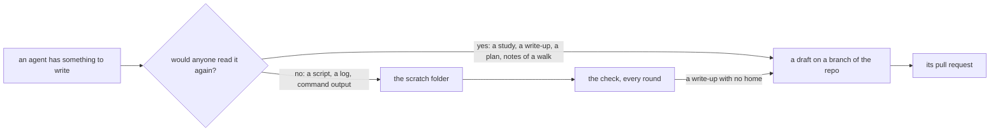

# 0128: A write-up is born on a branch of the repo, never in a scratch folder, and a check lists every write-up a scratch folder still holds



```text
before   scratch/frontier-study.md   written, walked with the owner, cited by two decisions, never landed
after    experiments/250-...md       written on its branch from its first line; scratch never held it
```

One line: the step "move it to the repo later" is gone, because the file starts in the repo.

**What this decides:** where an agent writes something worth reading again, and what catches the
one that still ends up in a scratch folder.

## Context

On 2026-11-11 a study the owner had walked the day before was found only in the lead session's
scratch folder. Two decisions on main already cited it as an experiment, and a pull request was
about to mark the older draft it replaced as decided. The scratch folder held 323 Markdown files
by then. AGENTS.md already says knowledge that lives only in a chat or an agent's private memory
is in the wrong place; a scratch folder is the same kind of place, and nothing checked it.

A rule in prose alone would repeat the miss: it fires only when the agent remembers it. So the
rule changes where the file starts, and code checks what is left
(AGENTS.md: a rule that code could check becomes a check).

## Decision

**A write-up is written on a branch of the repo from its first line, and a check lists every
write-up a scratch folder holds that the repo does not.**

- A write-up is anything someone would read again: a study, a reading, a measurement, an
  experiment's write-up, a plan, notes or changes from a walk, an inventory, an audit's result.
- It starts as a file in its home (`experiments/`, `docs/direction/`, `docs/plan/`, `.decisions/`,
  `field/`), on its own branch, as a draft. A lane's plan keeps its home beside the lane's state.
  Raw results still go to `runs/` or the private archive
  ([0027](0027-experiment-results-live-in-a-private-archive.md)).
- A scratch folder holds only what is thrown away: scripts for one use, logs, command output, an
  agent's brief.
- A brief for an agent that will write a write-up names the branch and the path. It never names a
  scratch path as the place for the result.
- The check is lead tooling, in TypeScript and Effect
  ([0113](0113-no-shell-or-python-scripts.md)). It reads a scratch folder, picks the files that
  look like write-ups, and lists each one the repo and its open pull requests do not hold. The
  lead runs it in the same round as the check that every decision is in the repo. Each file it
  lists is landed or deleted in that round.
- A short skill holds the question "where does this file go" and points at AGENTS.md's table. It
  adds no rule of its own.

**Binding constraints**

- The check only lists. It never moves, lands or deletes a file by itself.
- The check never prints a file's content, and it skips a file that may hold a key.
- A scratch path, a personal path or the name of a private store never goes into the repo; the
  check takes the folder as a flag.

## Consequences

- More draft branches exist at any time. The lead's round closes or lands them.
- The check needs a rule for "looks like a write-up". Its edge cases are listed with a test each
  before the code ([0040](0040-existing-tools-before-hand-written.md)): a copy of a repo file, an
  agent's brief, a file already in an open pull request, a file whose content landed under another
  name, a file with a secret.
- What the first run finds in the lead session's scratch folder is landed as its own work, biggest
  loss first.
- Not decided here: whether the check ever blocks anything. It advises until its false alarms are
  measured.

## Amendments

- 2026-11-11: the branch is pushed and a draft pull request is opened in the same turn the file is
  started, so the write-up also lives on the code host, and a lost laptop or a lost session loses
  nothing. More draft pull requests are open at any time; the lead's round lands or closes them,
  and a draft never enters the merge line.
