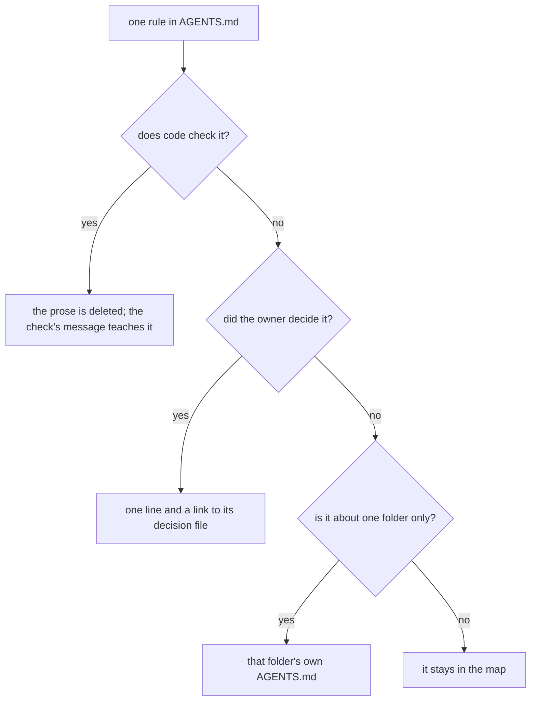

# 0129: AGENTS.md becomes a short map, each rule leaving it by one of three moves, after the decided rules have moved and one test of long against short has run



```text
before   AGENTS.md   685 lines, 12 sections, every rule for both versions in one file
after    AGENTS.md   a map of about 150 lines: where to read and write, the three checks,
                     the public repo rules, the laptop caps
         next/AGENTS.md and others   the rules for one folder, read when working there
```

The same rules exist after as before. What changes is where each one is read.

**What this decides:** how the top instructions file gets short, in which order, and what proves
no rule was lost.

## Context

The fifth principle of how we get work done says the repo is the memory and the top file is a
map. `AGENTS.md` is 685 lines on 2026-11-11, and every agent reads all of it for every job. The
teams that study read keep theirs short and point from it, or scope rules by folder. No
measurement here shows the long file hurts, so that is tested before the file is cut.
[0115](0115-decided-rules-live-in-decision-files.md) already moves every decided rule into a
decision file, which empties much of `AGENTS.md` by itself.

## Decision

**`AGENTS.md` becomes a short map. Each rule leaves it by one of three moves, and none is dropped.**

- **Code checks it:** the prose is deleted, and the check's own message says what to do
  (AGENTS.md's rule that a checked rule leaves the prose).
- **The owner decided it:** it becomes one line with a link to its decision file
  ([0115](0115-decided-rules-live-in-decision-files.md),
  [0008](0008-decision-discovery-is-the-agents-md-contract.md)).
- **It is about one folder:** it moves to that folder's own `AGENTS.md`, such as `next/AGENTS.md`,
  which an agent reads when it works there.
- What stays: what the repo is, the table of where to read and where to write, decision discovery,
  the three checks and the narrowest-check table, the public repo rules, and the laptop caps.

**The order**

1. 0115's move of decided rules lands first.
2. One test runs: the same step, on the same tickets, with the long file and with a short one, and
   the two are compared on send-backs, cost and what the agent got wrong. It is an experiment with
   its own write-up.
3. Then the cut, as one pull request.

**Binding constraints**

- The cut's pull request carries a table with one row for every line or bullet removed: where it
  went, or which check holds it. A rule with no row blocks the merge.
- A folder's file adds no rule that the map or a decision contradicts.
- The cut changes no rule. A rule that looks wrong becomes a question, not an edit.

## Consequences

- An agent's first read gets much shorter, and a rule is read where it applies.
- The cost: it is the most-read file in the repo, so a lost rule would be felt at once and found
  late. The table is the guard.
- If the test shows the short file does worse, the cut waits and the result goes to the owner.
- Not decided here: the exact line count, and which folders get a file of their own.
