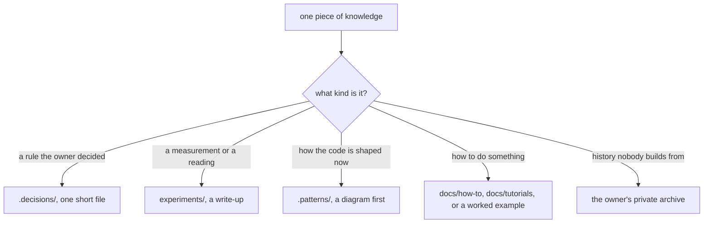

# 0130: Every piece of knowledge has one home by its kind, no new direction note is written, and docs/direction is emptied and removed



```text
before   docs/direction/   152 long notes: rules, reasoning, evidence and teaching mixed in one file
after    docs/direction/   gone
         a rule            .decisions/NNNN-slug.md, with its teaching example at the top
         its evidence      experiments/NN-title.md
         the code's shape  .patterns/name.md
         a living guide    docs/how-to/, docs/tutorials/, or an example such as the checklist
```

Each kind has one folder, and no folder takes a mix.

**What this decides:** where each kind of knowledge lives, and what happens to the long notes
under `docs/direction/`.

## Context

[0115](0115-decided-rules-live-in-decision-files.md) moves every decided rule out of the long
notes into decision files, and says the notes stay as the reasoning and the history. With the
rules gone, most notes hold little that is read again, and a long note beside a short decision is
a second place to look and a second place to go stale. The owner asked on 2026-11-11 whether many
big documents make sense at all, and decided that decisions cover the rules and whatever is left
becomes something else.

## Decision

**Every piece of knowledge has one home, picked by its kind, and a direction note is not one of
them.**

- A rule the owner decided is a decision file. Its teaching example, a small code block or a
  diagram, opens the file ([0005](0005-patterns-and-decisions-are-visual.md)).
- A measurement, a reading or a study is an experiment write-up.
- How the code is shaped now is a pattern doc, with a Mermaid diagram first wherever one fits
  (0005).
- How to do something is a how-to, a tutorial or a worked example, such as the checklist
  ([0125](0125-the-example-program-is-a-checklist.md)). The few notes still read as guides become
  these. None stays as a note.
- History that nothing builds from goes to the owner's private archive
  ([0027](0027-experiment-results-live-in-a-private-archive.md)). The public repo gets no
  `archive/` folder.
- No new note is written under `docs/direction/`. Long reasoning that a decision needs goes in the
  decision's own Context, or in the experiment that holds its evidence.
- `docs/direction/` is removed once it is empty.

**The order**

1. 0115's move of decided rules finishes first.
2. The lead sorts every remaining note by kind and brings the owner the count, with the list of
   notes whose long reasoning fits no short decision file.
3. After the owner's yes on that list, the notes move, in batches by kind.

**Binding constraints**

- Nothing is moved or deleted before the owner has seen the count and that list.
- A moving pull request carries a table with a row for every note it removes: where each part
  went. A note with no row blocks the merge.
- Every link to a moved note is rewritten in the same pull request, and no link is left dead.
- The move changes no rule. A rule that looks wrong becomes a question, not an edit.

## Consequences

- This changes 0115 in one place: a note no longer stays as the reasoning and the history. The
  rest of 0115 holds.
- AGENTS.md's table of where to read and write loses its direction rows when the folder goes, in
  the cut [0129](0129-agents-md-becomes-a-short-map.md) describes. Until then its rows hold for
  the notes still there, and the adr and guidelines skills change with them.
- The cost: about 150 notes to sort, and every decision, plan and skill that links one gets its
  link rewritten.
- The doubt: a few notes hold long reasoning that fits no short decision file. Step 2's list is
  what settles each one.
- Not decided here: which notes become guides, and the shape of a docs page beyond the how-to and
  tutorial folders that exist.
