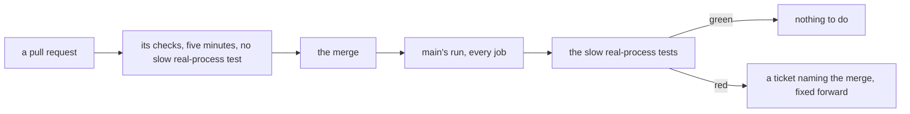

# 0131: A slow test that needs real processes runs on main after each merge, never on a pull request, and a red one is fixed forward



```text
before   the restart test ran on every pull request, started fabrika inside the test's own
         process, and passed or failed by timing
after    the same promise is tested through the dev script, on main, after each merge;
         a pull request never waits on it
```

The test moves from before the merge to right after it, and from a quick stand-in to the real start
path.

**What this decides:** when a slow test that starts, kills and waits on real processes runs, and
what happens when it goes red.

## Context

Ticket 646's flaky test kills the local runtime inside a step and checks that it comes back with no
letter lost or taken twice. Split into three sure cases, two pass every run and one fails every
run: it starts fabrika inside the test's own process, where nothing restarts the killed runtime.
Under the dev script, the path a person uses, the runtime does come back. The case has to start a
real process, so it is slow, and
[0106](0106-a-pull-requests-checks-finish-in-five-minutes.md) holds a pull request's checks to five
minutes. By [0108](0108-a-job-lives-in-a-lane-a-queue-or-a-scheduled-job.md)'s two questions it is
work for a queue on its event: it judges main as a whole, the next step does not need it, and our
own merge is the event. The owner decided on 2026-11-11.

## Decision

**A slow test that needs real processes runs in main's run after each merge, not on a pull request,
and a red run is fixed forward.**

- Such a test is one that starts a real program, kills or restarts it, and waits on it: the dev
  script with its local runtime is the first case.
- It tests the start path a person uses. A quick stand-in that behaves differently there is not
  used for it.
- It runs on every push to main, so a red run names the merge that broke it. No timer starts it.
- It never blocks a pull request, and a pull request's checks do not run it.
- A red run files a ticket in the tracker with the merge's commit. The fix is a new pull request.
  A merge is not reverted for it unless the fix cannot be found
  ([0096](0096-the-lead-fixes-forward-while-the-owner-is-away.md) has the same stance).
- A flaky result here is still fixed the day it is seen
  ([0036](0036-a-flaky-test-is-fixed.md)); running after the merge is no place to park one.

**Binding constraints**

- A test moves here only for being slow because of real processes. A test that is slow for
  another reason gets faster or gets split.
- A check against lasting harm never moves here (0108).
- The list of tests that run only on main is one named place in the repo, so a reader can see
  what a pull request does not run.

## Consequences

- A break in restart is on main for a few minutes before anyone knows. The ticket and the named
  merge are the guard.
- Main's run gets longer by these tests. The repo is public, so the minutes cost nothing.
- Pull request 820's third case is rewritten onto the dev script and is the first test on the
  list.
- Not decided here: whether fabrika started inside another process should restart its runtime too.
  Nothing ships that way today; a ticket holds the gap.
