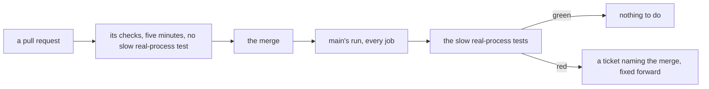

# 0131: A slow test that needs real processes runs on main after each merge, never on a pull request, and a red one is fixed forward



```text
a pull request   its checks, held to five minutes; no slow real-process test among them
main             after each merge, every job, and the slow real-process tests with them
```

A slow test of this kind runs right after the merge, never before it.

**What this decides:** when a slow test that starts, kills and waits on real processes runs, and
what happens when it goes red.

## Context

Ticket 646's flaky test kills the local runtime inside a step and checks that it comes back with no
letter lost or taken twice. One of its cases failed every run, and it looked like a test that could
only pass through a real, slow start of the program. That raised the question of where such a test
runs, since [0106](0106-a-pull-requests-checks-finish-in-five-minutes.md) holds a pull request's
checks to five minutes. By
[0108](0108-a-job-lives-in-a-lane-a-queue-or-a-scheduled-job.md)'s two questions it is work for a
queue on its event: it judges main as a whole, the next step does not need it, and our own merge is
the event. The owner decided on 2026-11-11.

The same day the case's real cause was found: the test ran on a test clock that never moves, so the
runtime's short wait before a restart never ended. On the real clock it passes in about four
seconds and stays on the pull request. So no test needs this rule yet. The owner kept it for the
first test that does.

## Decision

**A slow test that needs real processes runs in main's run after each merge, not on a pull request,
and a red run is fixed forward.**

- Such a test is one that starts a real program, kills or restarts it, and waits on it, and that
  cannot be made quick.
- It tests the start path a person uses. A quick stand-in that behaves differently there is not
  used for it.
- It runs on every push to main, so a red run names the merge that broke it. No timer starts it.
- It never blocks a pull request, and a pull request's checks do not run it.
- A red run files a ticket in the tracker with the merge's commit. The fix is a new pull request.
  A merge is not reverted for it unless the fix cannot be found
  ([0096](0096-the-lead-fixes-forward-while-the-owner-is-away.md) has the same stance).
- A flaky result here is still fixed the day it is seen
  ([0036](0036-a-flaky-test-is-fixed.md)); running after the merge is no place to park one.

**Binding constraints**

- A test moves here only for being slow because of real processes. A test that is slow for
  another reason gets faster or gets split.
- A check against lasting harm never moves here (0108).
- The list of tests that run only on main is one named place in the repo, so a reader can see
  what a pull request does not run.

## Consequences

- A break in restart is on main for a few minutes before anyone knows. The ticket and the named
  merge are the guard.
- Main's run gets longer by these tests. The repo is public, so the minutes cost nothing.
- The list starts empty. Ticket 646's case is not on it.
- A test that looks slow gets its cause found before it moves here: this one was a stopped clock.
