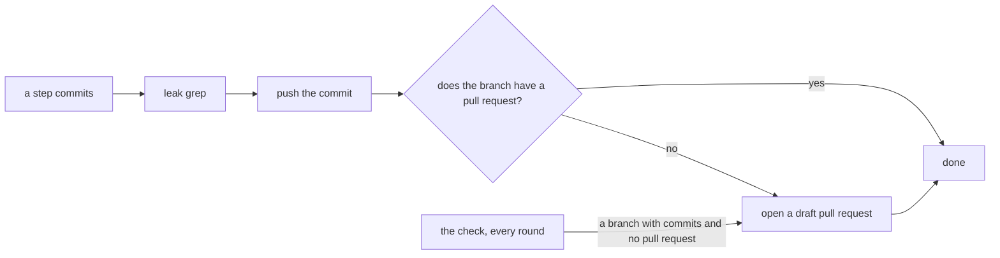

# 0134: Every commit is pushed when it is made and its branch has a draft pull request from the first commit, so no code stays only on a branch



```sh
# before: a lane's tests step
commit && sign                        # the commit sits on the laptop, or on a pushed branch nobody lists
# after
commit && sign && leak grep && push   # and a draft pull request is opened if the branch has none
```

One line: "its tests are written on a branch" stops being a possible state.

**What this decides:** when a commit leaves the laptop, and where a person finds work that is not
merged yet.

## Context

On 2026-11-11 the tests for hot reload (Tier 1 row P15) were found on a branch with no pull request.
A count the same day found about 60 pushed branches that hold commits not on main and never had a
pull request, most of them a lane's working branch. A lane opened its pull request only after its
review step, so tests and a build could sit for hours where the list of open pull requests did not
show them. The owner decided this the same day.

[0128](0128-a-write-up-is-born-in-the-repo.md) already says this for write-ups: a write-up is born
on a branch, as a draft. This decision says it for every commit, code included.

## Decision

**A commit is pushed the moment it is made, and a branch has a draft pull request from its first
commit.**

- The commit step does it, not the agent: the same command that commits and signs also runs the
  leak grep, pushes, and opens a draft pull request when the branch has none. A commit step that
  cannot push fails, and says so.
- A lane's pull request is opened as a draft at its first commit and marked ready when its steps
  have passed. It is no longer opened after review.
- A branch that holds an experiment's script
  ([0027](0027-experiment-results-live-in-a-private-archive.md)) has a draft pull request too. It
  stays a draft and is never merged; its write-up names it.
- A check lists every branch, on the laptop or pushed, that holds commits not on main and has no
  open pull request. The lead runs it every round and fixes each line the same turn: a draft pull
  request, or the branch is deleted when its work is already on main.
- The leak grep still runs before every push and still fails closed. The fix for a security hole
  still lands as a normal pull request, with no list of open holes in it.

**Binding constraints**

- No step, script or agent ends with a commit that is not on GitHub.
- No branch with commits not on main is without an open pull request for longer than one round of
  the check.

## Consequences

- The list of open pull requests becomes the full list of work in flight. Drafts will outnumber
  ready pull requests.
- CI runs on every push of a draft. Whether a draft runs fewer jobs than a ready pull request is
  not decided here.
- The lane's order changes: the pull request opens first, as a draft
  ([0133](0133-no-push-waits-on-a-local-typecheck.md) already moved it before the typecheck).
- The branches found on 2026-11-11 are sorted once: a draft pull request for each that holds work
  not on main, and deletion for each whose work has merged.
- Not decided: how long an unmerged draft may stay open before someone closes it.

## Amendments

- 2026-11-11 (owner): a draft pull request runs only the fast jobs, `changes`, `field`, `typecheck`
  and `check`'s lint, under the names `lint` and `ci-required (draft)`; marking it ready starts the
  full set (`check`, `test`, `next`, `e2e`, as changes.mjs picks them) on the same head, which is
  the run catchup.sh and the ruleset wait for. Nothing merges as a draft, so nothing gets weaker.
